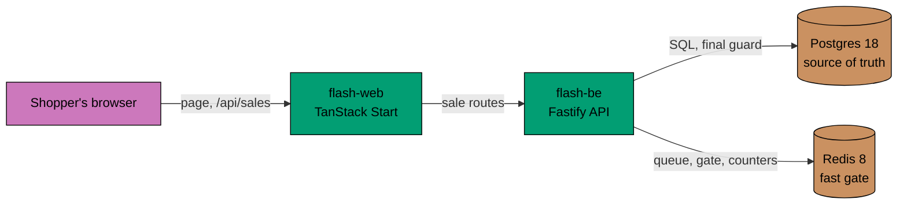

# Flash sale

A flash sale for one product with a limited stock. Shoppers see the sale, join a waiting queue, hold one item for a
short time, and pay to keep it. The system never sells more than the stock and never sells a shopper more than one item,
however many people press the button at once.

It is an npm workspace with five apps in `apps/` and two libraries in `libs/`:

| App             | What it is                                                                          |
| --------------- | ----------------------------------------------------------------------------------- |
| `flash-be`      | REST API (Fastify) with the sale logic, on Postgres (Kysely, no ORM) and Redis      |
| `flash-web`     | React client (TanStack Start). The browser only talks to its own web server         |
| `flash-be-e2e`  | Playwright tests against the running API                                            |
| `flash-web-e2e` | Playwright tests in a browser                                                       |
| `flash-load`    | k6 load test against three API instances behind nginx, with a verdict from the data |

`libs/typekit` (`@flash/typekit`) is a TypeScript port of [py-typekit](https://github.com/wahidyankf/py-typekit): `Result`,
`Option`, `attempt`, `pipe` and exhaustive matching. `flash-be` and `flash-web` use it, so a failure is a value and product
code has no `catch`; the linter enforces that. See [failures as values](docs/explanation/failures-as-values.md).

`libs/contract` (`@flash/contract`) is the HTTP contract of the API, written once with Zod: the route table, the schemas, the
error codes, a small client and the Server-Sent Events codec. `flash-be` registers its routes from it, and `flash-web`, the
e2e tests and the k6 script build their requests and read the replies through it, so no app writes a path or a reply type
by hand. [docs/reference/openapi.json](docs/reference/openapi.json) is generated from it. See
[the API contract](docs/explanation/api-contract.md).

Nx runs the commands only. It has no plugins, and every target is in the project's `project.json`. The apps' targets build
the library first.

`flash-be` is a hexagon: the rules sit in `src/domain`, the use cases in `src/application`, and Postgres, Redis, the
payment mock and HTTP are adapters behind ports. A unit test fails when a layer imports one it must not know. See
[hexagonal architecture](docs/explanation/hexagonal-architecture.md).

## How a purchase works



1. **Join the queue.** The shopper enters a name and presses Buy Now. The API puts them in a waiting queue and returns
   a signed ticket. A set number of shoppers is let in each second, so a rush becomes a steady flow.
2. **Hold an item.** An admitted shopper reserves. A Redis script counts the stock, the holds and the buyers in one
   step and takes one item for a limited time. The hold is also written to Postgres.
3. **Pay.** The shopper confirms. The payment is charged once, however often the request is repeated. A short Postgres
   transaction raises `sold` only while `sold < stock` and inserts the purchase, which is unique per shopper.
4. **Ask "did I get it".** One call returns the purchase, a live hold, or nothing.

An expired hold stops counting by itself, because its expiry time has passed. There is no sweep job and no counter that
can drift.

## Design choices and trade-offs

| Choice                                  | Why                                                                                                                                                        | What it costs                                                      |
| --------------------------------------- | ---------------------------------------------------------------------------------------------------------------------------------------------------------- | ------------------------------------------------------------------ |
| Redis Lua script as the hot path        | One script counts and takes an item atomically, so thousands of requests per second do not touch the database row                                          | A second store to run, and a rebuild when it is lost               |
| Postgres as the source of truth         | `UPDATE ... WHERE sold < stock`, `UNIQUE(sale_id, user_id)` and `CHECK (sold <= stock)` still refuse an oversell if Redis is wrong or empty                | Every purchase pays one short transaction                          |
| Reserve, then confirm                   | A shopper is not charged for an item that is gone, and an abandoned hold frees the item                                                                    | A hold takes stock from others until it ends                       |
| Waiting queue with a ticket             | Smooths a rush and cannot be skipped by posting to the reserve route                                                                                       | Shoppers wait; the queue needs an admitter that runs once per sale |
| Serving without Redis                   | Redis down means the queue fails open, reserve runs on Postgres under a row lock, and `/ready` reports 503. Redis is rebuilt from Postgres when it returns | The Postgres path is slower under load                             |
| Sale read cache of one second, with SSE | Many readers cost one database read a second. Writes never use the cache                                                                                   | The page can be a second old                                       |
| Rate limit per user and per address     | A flood gets `429` with `Retry-After`, not a slow server                                                                                                   | Shoppers behind one address share a limit                          |
| In-process mock payment                 | The flow, the refund and the retry rules are real; no provider is needed                                                                                   | It proves nothing about a real provider                            |
| Names, not accounts                     | A queue ticket binds a name to a request. No sign-up is needed                                                                                             | A name can be taken by anyone; this is not authentication          |

The longer explanations are in [docs/explanation](docs/explanation/README.md). The architecture diagrams are in
[specs/flash/architecture](specs/flash/architecture/README.md). One sale runs at a time; there is no admin page, a sale is
created with a seed command.

## Run it

You need [Volta](https://volta.sh/), Docker and Git. Volta pins Node and npm.

```bash
npm install                    # also installs the Git hooks
[ -f .env ] || cp .env.example .env
```

The values in `.env.example` are for local use only. Do not use the example passwords or the ticket secret anywhere else.

### Apps on the host, data in Docker

```bash
npm run docker:dev:up          # Postgres + Redis
npx nx db:migrate flash-be     # apply the migrations
npx nx db:seed-sale flash-be --stock=3 --starts-in-minutes=0 --duration-minutes=60 --hold-seconds=60
npx nx dev flash-be            # API on http://localhost:8080
npx nx dev flash-web           # web on http://localhost:3000
npm run docker:dev:down        # stop Postgres + Redis
```

Open <http://localhost:3000>, type a name and press **Buy Now**, then **Confirm purchase**. The step-by-step version is
[the tutorial](docs/tutorials/run-flash-sale-locally.md).

### Everything in containers

```bash
npm run docker:prod:up         # build the images, migrate, start the stack
docker compose -f compose.prod.yaml exec flash-be node dist/seed-sale.js --stock=5 --duration-minutes=60
curl localhost:8080/ready      # Postgres and Redis ok
open localhost:3000            # the sale page
npm run docker:prod:down       # stop the stack (volumes are kept)
```

Production compose reads `POSTGRES_*`, `TICKET_SECRET` and the ports from `.env`, and fails when one is missing.
Postgres and Redis are not published to the host.

## Tests

Every app has `typecheck`, `lint`, `test:quick` (those two plus unit tests) and `test:quick:watch`.

```bash
npx nx test:quick <app>        # typecheck + lint + unit tests
npx nx test:integration <app>  # needs the dev stack (flash-be, flash-web)
npx nx test:e2e <app>          # Playwright (flash-be-e2e, flash-web-e2e)
npx nx test:coverage <app>     # unit + integration, 99% floor; starts the dev stack
npx nx test:quick typekit      # a library: typecheck + lint + unit tests (no Docker)
npx nx test:quick contract     # the same for the contract
npm run openapi:check          # docs/reference/openapi.json matches the routes
npm run contract:guard:test    # no API path or ticket header written by hand in product code
npm run lint:rules:test        # the lint rules: no catch, exhaustive switches
npm run bdd:check              # every scenario is bound at the layers it needs
npm run docs:install           # once: fetch the docs checker
npm run docs:check             # links, structure and diagrams in the docs
```

The behaviour is written as Gherkin scenarios in [specs/](specs/README.md) first. Each scenario is bound at unit,
integration and end-to-end level, except where a real boundary makes that impossible; those few exceptions are written
next to the scenario with the test that proves it instead. A detail that only a developer would notice is a plain test next to the code, not a scenario (see
[scenario or plain test](docs/explanation/scenario-or-plain-test.md)). Playwright needs Chromium once:
`npx playwright install chromium`. See [test layers and coverage](docs/reference/test-layers-and-coverage.md).

`git push` runs the docs check, the behaviour coverage check, the lint rule tests, the OpenAPI check, the contract guard, and typecheck, lint, unit tests and the
coverage floor for the projects the change touches. Commits are checked with commitlint (Conventional Commits).

## Load test

`flash-load` starts three API instances behind nginx with Postgres and Redis, sends shoppers at them with k6 (run as a
container, so nothing else is installed), and then checks the data itself. Docker must run.

```bash
npx nx load:smoke flash-load   # 500 shoppers for 20 items, a few minutes
npx nx load:full flash-load    # 5,000 shoppers for 100 items
npx nx load:chaos flash-load   # 2,000 shoppers for 1,000 items, Redis is stopped mid-run
```

**The limits were fixed before the first run**: reserve p95 under 300 ms, purchase p95 under 500 ms (it includes the
150 ms of the mock payment), and no server errors. A failed run is a finding about the system; a limit is not changed
to make a run pass.

**Expected outcome.** Each run exits `0` and prints a table in which every check passes: no oversell (`sold` is at most
the stock), `sold` equals the purchase rows, no shopper bought twice, k6 and Postgres agree, the stock sells out, the
shopper who floods the queue gets `429`, and Redis and Postgres agree on the buyers. These are the numbers of the last
runs on a laptop where the client and the servers share the same CPUs, so treat the times as relative:

| Profile | Sold      | Reserve p95 | Purchase p95 | Server errors |
| ------- | --------- | ----------- | ------------ | ------------- |
| smoke   | 20/20     | 2.1 ms      | 156 ms       | 0             |
| full    | 100/100   | 1.6 ms      | 156 ms       | 0             |
| chaos   | 1000/1000 | 3.0 ms      | 155 ms       | 0             |

The chaos run found that paying while Redis was down took about two seconds, because of how the Redis client queues a
transaction. That is fixed, with a scenario that holds the outage and requires an answer in under 500 ms. The story is
in [what the load runs found](docs/explanation/load-test-findings.md). The profiles and checks are in
[docs/reference/load-test.md](docs/reference/load-test.md), and the steps in
[how to run the load test](docs/how-to/run-the-load-test.md).

## Documentation

- [docs/](docs/README.md): a tutorial, how-to guides, reference and explanations.
- [specs/](specs/README.md): the Gherkin behaviour scenarios and the C4 architecture. Specs win when they disagree with the docs.
- [api.http](api.http): manual requests for every endpoint.
- [AGENTS.md](AGENTS.md): rules for people and tools that change the code.
