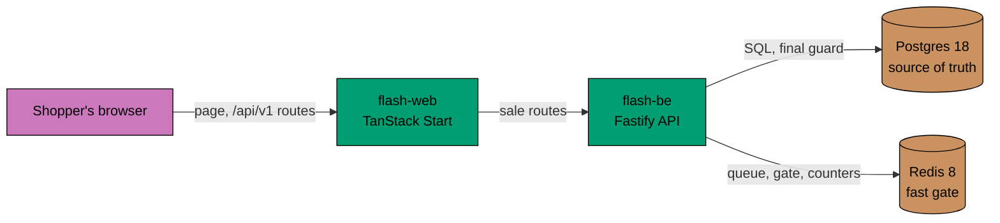
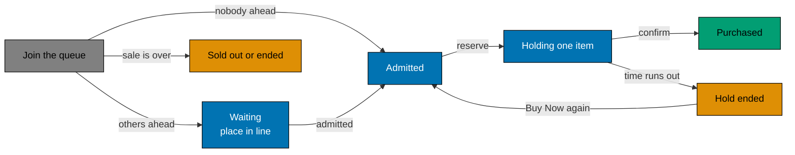

# Flash sale

A flash sale sells a small stock of one product to a large crowd in a short time window. The hard part is the rush:
thousands of shoppers press **Buy Now** in the same second. This project sells through that rush and keeps two promises
whatever happens: it never sells more than the stock, and it never sells one shopper more than one item.

It answers a coding interview task with a REST API, a React page, tests at three levels and a load test that checks the data after each run. Everything runs on one laptop with Node.js and Docker.

## Start here

| You want to                   | Go to                                                                                                                                                                 |
| ----------------------------- | --------------------------------------------------------------------------------------------------------------------------------------------------------------------- |
| see it work in ten minutes    | [run the demo](docs/how-to/run-the-demo.md); to present it in an interview, [prepare the defense](docs/how-to/prepare-the-defense.md)                                 |
| run it yourself, step by step | [the tutorial](docs/tutorials/run-flash-sale-locally.md) the first time, then [run in development](docs/how-to/run-in-development.md)                                 |
| run it in containers          | [run in production](docs/how-to/run-in-production.md)                                                                                                                 |
| understand the design         | [How a purchase works](#how-a-purchase-works), then [design choices](#design-choices-and-trade-offs) and the [decision records](docs/explanation/decisions/README.md) |
| learn a tool in the stack     | [docs/README.md](docs/README.md): run the tutorial, then read the [crash courses](docs/tutorials/crash-courses/README.md) for the tools you will touch                |
| change the code               | the [code map](docs/reference/code-map.md) and each app's `README.md` say where each kind of thing goes; [AGENTS.md](AGENTS.md) has the rules                         |

If you have five minutes, read these files in this order:

| File                                                                                                                                           | What you learn                                                                                                                                                                                               |
| ---------------------------------------------------------------------------------------------------------------------------------------------- | ------------------------------------------------------------------------------------------------------------------------------------------------------------------------------------------------------------ |
| [`apps/flash-be/src/domain/sale.ts`](apps/flash-be/src/domain/sale.ts)                                                                         | the sale rules: upcoming, active, sold out or ended, from window and stock                                                                                                                                   |
| [`apps/flash-be/src/adapters/outbound/redis/redis-hold-gate.ts`](apps/flash-be/src/adapters/outbound/redis/redis-hold-gate.ts)                 | the Redis script that takes one item for one shopper, atomically                                                                                                                                             |
| [`apps/flash-be/src/adapters/outbound/postgres/purchase-repository.ts`](apps/flash-be/src/adapters/outbound/postgres/purchase-repository.ts)   | the transaction that has the last word: `sold < stock`, one purchase per shopper                                                                                                                             |
| [`apps/flash-be/src/adapters/inbound/http/routes/`](apps/flash-be/src/adapters/inbound/http/routes/)                                           | every endpoint, one file per area, and what it does                                                                                                                                                          |
| [`apps/flash-web/src/sale-page.tsx`](apps/flash-web/src/sale-page.tsx)                                                                         | the page: it puts together the sale card (status, items left), the login and the Buy Now card, from [`src/sale/`](apps/flash-web/src/sale) and [`src/auth/`](apps/flash-web/src/auth), with Tailwind classes |
| [`apps/flash-load/k6/profiles.ts`](apps/flash-load/k6/profiles.ts), [`apps/flash-load/scripts/verdict.ts`](apps/flash-load/scripts/verdict.ts) | the stress profiles, and the verdict that is read from the data                                                                                                                                              |

## Words used here

These words have a fixed meaning in the code, the docs and the API.

| Word                | What it means here                                                                                                                                                                                                                   |
| ------------------- | ------------------------------------------------------------------------------------------------------------------------------------------------------------------------------------------------------------------------------------ |
| sale                | one product with a stock and a window (a start and an end time). One sale runs at a time: the current sale is the running one, else the next to open                                                                                 |
| queue and admission | before a shopper can hold an item, they join a waiting queue. Each second the server admits a set number of shoppers from the front, so a rush becomes a steady flow                                                                 |
| ticket              | what joining the queue returns: a value signed with a server secret that proves this shopper went through the queue for this sale. Holding an item needs it                                                                          |
| hold                | one item kept for one admitted shopper for a short time, set per sale (60 seconds in the demo). The API calls it a reservation. If the shopper does not pay in time, the hold ends and the item is free again                        |
| purchase            | a hold that was paid for. There is at most one per shopper per sale                                                                                                                                                                  |
| operator            | an account that may create, change and remove sales. Shoppers sign up themselves; an operator is made with a command on the server                                                                                                   |
| soft delete         | a removal sets `deleted_at` and `deleted_by` instead of erasing the row, so nothing is lost and the row says who removed it                                                                                                          |
| scenario and layer  | a behaviour is written once as a Gherkin scenario (Given, When, Then) and bound, that is run as a test, at three layers: unit (in memory), integration (with Postgres and Redis, or a fake API) and end-to-end (the running servers) |

## What the task asks for, and where it is

[REQUIREMENTS.md](REQUIREMENTS.md) lists each line of the interview task with the code, scenario or run that proves it.
It covers the functional and the non-functional requirements, what was added beyond the task, and what was left out on
purpose. In short:

- **The sale.** A start and an end time are set per sale. There is one product with a limited stock, and at most one
  item per shopper.
- **The API.** A status endpoint (`GET /api/v1/sales/current`). An attempt to buy in three calls: join the queue, hold
  one item, pay. An endpoint that tells a shopper whether they got an item (`GET /api/v1/sales/:saleId/purchases/me`).
- **The page.** A React page in `apps/flash-web` with the status, a login, **Buy Now** and a sentence for each outcome.
- **The rest.** The system diagram is [below](#how-a-purchase-works). The tests are under [Tests](#tests), and the
  stress tests under [Load test](#load-test).

## How a purchase works

This is the path where both promises are kept, so it is the part to understand first.



0. **Sign up or log in.** The shopper gets two cookies (a short access token and a longer refresh token); every call below is made as that account, so no call names a user.
1. **Join the queue.** The shopper presses Buy Now. The API puts them in the waiting queue and returns a ticket.
2. **Hold an item.** An admitted shopper reserves. A Redis script counts the stock, the holds and the buyers in one
   step and takes one item for a limited time. The hold is also written to Postgres.
3. **Pay.** The shopper confirms. The payment is charged once, however often the request is repeated. A short Postgres
   transaction raises `sold` only while `sold < stock` and inserts the purchase, which is unique per shopper.
4. **Ask "did I get it".** One call returns the purchase, a live hold, or nothing.

A shopper moves through these states. Buy Now makes the first two moves; Confirm purchase makes the last.



An expired hold stops counting by itself, because its expiry time has passed. There is no sweep job and no counter that
can drift.

### Under load

This is the production stack ([`compose.prod.yaml`](compose.prod.yaml)) and the shape the load test runs against.

```mermaid
flowchart LR
  accTitle: Flash sale under load
  accDescr: Shoppers reach the web app, which passes sale requests to nginx. An operator manages sales through nginx too. Nginx spreads requests over three identical API instances. The instances share one Postgres, which holds the truth, and one Redis, which holds the queue, the holds, the rate counters and the lease that lets one instance admit shoppers each second. If Redis is down the instances keep selling from Postgres under a row lock, and the readiness check reports it.
  browser["Shoppers' browsers"]
  operator["Operator"]
  web["flash-web<br/>page + /api pass-through"]
  lb["nginx<br/>least connections"]
  be["flash-be x3<br/>identical, stateless"]
  pg[("Postgres 18<br/>UPDATE sold < stock<br/>UNIQUE per user")]
  redis[("Redis 8<br/>Lua gate, queue,<br/>admit lease, counters")]
  browser -->|page, /api/v1 routes| web
  web -->|sale routes| lb
  operator -->|/api/v1/admin/sales| lb
  lb -->|one instance per request| be
  be -->|SQL, last word| pg
  be -->|one script per hold| redis
  redis -.->|if down: row lock| pg
  classDef person fill:#CC78BC,stroke:#000000,color:#000000
  classDef container fill:#029E73,stroke:#000000,color:#000000
  classDef store fill:#CA9161,stroke:#000000,color:#000000
  classDef default fill:#808080,stroke:#000000,color:#000000
  class browser,operator person
  class web,lb,be container
  class pg,redis store
```



An instance keeps nothing in memory that another needs: a queue ticket is signed with a shared secret, the state is in
Postgres and Redis, and each second one instance wins the lease that admits the next shoppers. Any instance can serve
any request, so adding capacity is adding instances.

## What is in the repository

It is an npm workspace with five apps in [`apps/`](apps) and two libraries in [`libs/`](libs). Each tool links to a crash course that
shows how this repository uses it.

| App                                             | What it is                                                                                                                                                                                                                                                                                                      |
| ----------------------------------------------- | --------------------------------------------------------------------------------------------------------------------------------------------------------------------------------------------------------------------------------------------------------------------------------------------------------------- |
| [`flash-be`](apps/flash-be/README.md)           | the REST API with the sale rules, on [Fastify](docs/tutorials/crash-courses/fastify.md) (a Node.js web framework). It stores data in Postgres through [Kysely](docs/tutorials/crash-courses/postgres-and-kysely.md) (a typed SQL query builder, no ORM) and uses [Redis](docs/tutorials/crash-courses/redis.md) |
| [`flash-web`](apps/flash-web/README.md)         | the React client, on [TanStack Start](docs/tutorials/crash-courses/react-and-tanstack-start.md) (a React framework that renders on the server and has server routes), styled with [Tailwind CSS](docs/tutorials/crash-courses/tailwind-css.md) (utility classes). The browser only talks to its own web server  |
| [`flash-be-e2e`](apps/flash-be-e2e/README.md)   | [Playwright](docs/tutorials/crash-courses/playwright.md) (a test runner for browsers and HTTP) tests against the running API                                                                                                                                                                                    |
| [`flash-web-e2e`](apps/flash-web-e2e/README.md) | Playwright tests in a browser                                                                                                                                                                                                                                                                                   |
| [`flash-load`](apps/flash-load/README.md)       | a [k6](docs/tutorials/crash-courses/k6.md) (a load-testing tool scripted in JavaScript) load test against three API instances behind nginx, with a verdict from the data                                                                                                                                        |

[`libs/typekit`](libs/typekit/README.md) (`@flash/typekit`, [crash course](docs/tutorials/crash-courses/typekit.md))
makes a failure a value. A function that can fail returns a `Result` (`Ok`, `Err`), so the failure is in its type and a
caller cannot forget it, and `attempt` turns a call that throws into a `Result`. It has nothing else and no dependency.
`flash-be`, `flash-web`, `flash-be-e2e`, `flash-load` and `flash-commons` use it, so product code has no `catch`. The
linter enforces that; see [failures as values](docs/explanation/failures-as-values.md).

[`libs/flash-commons`](libs/flash-commons/README.md) (`@flash/flash-commons`) holds the behaviour and values that 3 or
more places across the apps share: retry with exponential backoff, a max attempt count and jitter, the time units, the
HTTP status numbers, the payload decoders, the id rule, the table of API paths, the cookie jar of the tests, the time
phrases of the scenarios and a `sleep` (on its own entry, `/timers`, so the main entry stays pure). Every retry in the repository goes through it
([decision 017](docs/explanation/decisions/017-retry-backoff-jitter.md), [policies](docs/reference/retry-policies.md)).
A value repeated a third time gets one name ([decision 016](docs/explanation/decisions/016-dry-rule-of-three.md)).

The HTTP API is plain code: `flash-be` registers its routes in [`adapters/inbound/http/routes/`](apps/flash-be/src/adapters/inbound/http/routes), one file per area, and
every route, request and reply is listed in [docs/reference/http-endpoints.md](docs/reference/http-endpoints.md). Every
route is served under `/api/v1`, and every path is named once in
[`libs/flash-commons/src/api-paths.ts`](libs/flash-commons/src/api-paths.ts): `flash-be` serves it, and `flash-web`,
the e2e tests and the k6 script call it ([decision 019](docs/explanation/decisions/019-api-version-prefix.md)).

`flash-be` is a hexagon (hexagonal architecture, also called ports and adapters): the rules sit in `src/domain`, the use
cases in `src/application`, HTTP is an inbound adapter, and Postgres, Redis and the payment mock are outbound adapters behind ports. A unit test fails when a layer imports one it must not know. See
[hexagonal architecture](docs/explanation/hexagonal-architecture.md).

[Nx](docs/tutorials/crash-courses/nx.md) (a monorepo task runner) only runs commands here. It has no plugins, and every
target (a named command, run as `npx nx <target> <project>`) is in the project's `project.json`. The apps' targets build
the libraries first.

## Design choices and trade-offs

Each row is a choice a reviewer may question, with what it buys and what it costs.

| Choice                                                                                                               | Why                                                                                                                                                                           | What it costs                                                                             |
| -------------------------------------------------------------------------------------------------------------------- | ----------------------------------------------------------------------------------------------------------------------------------------------------------------------------- | ----------------------------------------------------------------------------------------- |
| Redis Lua script as the hot path ([002](docs/explanation/decisions/002-redis-gate-postgres-last-word.md))            | One script counts and takes an item atomically, so thousands of requests per second do not touch the database row                                                             | A second store to run, and a rebuild when it is lost                                      |
| Postgres as the source of truth ([002](docs/explanation/decisions/002-redis-gate-postgres-last-word.md))             | `UPDATE ... WHERE sold < stock`, `UNIQUE(sale_id, user_id)` and `CHECK (sold <= stock)` still refuse an oversell if Redis is wrong or empty                                   | Every purchase pays one short transaction                                                 |
| Reserve, then confirm ([001](docs/explanation/decisions/001-queue-hold-pay.md))                                      | A shopper is not charged for an item that is gone, and an abandoned hold frees the item                                                                                       | A hold takes stock from others until it ends                                              |
| Waiting queue with a ticket ([001](docs/explanation/decisions/001-queue-hold-pay.md))                                | Smooths a rush and cannot be skipped by posting to the reserve route                                                                                                          | Shoppers wait; each second one instance must win a Redis lease to admit the next shoppers |
| Serving without Redis ([003](docs/explanation/decisions/003-keep-selling-without-redis.md))                          | Redis down means the queue lets every shopper in at once, reserve runs on Postgres under a row lock, and `/ready` reports 503. Redis is rebuilt from Postgres when it returns | The Postgres path is slower under load                                                    |
| Sale read cache of one second, with Server-Sent Events ([008](docs/explanation/decisions/008-server-sent-events.md)) | Many readers cost one database read a second, and the page gets each change over one open HTTP stream. Writes never use the cache                                             | The page can be a second old                                                              |
| Rate limit per user and per address ([how](docs/explanation/rate-limiting.md))                                       | A flood gets `429` with `Retry-After`, not a slow server                                                                                                                      | Shoppers behind one address share a limit                                                 |
| In-process mock payment ([009](docs/explanation/decisions/009-in-process-mock-payment.md))                           | The flow, the refund and the retry rules are real; no provider is needed                                                                                                      | It proves nothing about a real provider                                                   |
| Accounts and cookie sessions ([007](docs/explanation/decisions/007-accounts-and-cookie-sessions.md))                 | Sign-up with a password (scrypt), an access and a refresh cookie, only token hashes stored, roles `shopper` and `operator` ([how](docs/explanation/authentication.md))        | No password reset, e-mail check or two-factor step                                        |
| The browser talks to the web server only ([006](docs/explanation/decisions/006-browser-talks-to-web-server-only.md)) | The API needs no CORS and no public address, and an allow-list keeps the operator routes away from the browser                                                                | One more hop for every sale call                                                          |
| A hexagon in the API only ([004](docs/explanation/decisions/004-hexagon-in-the-api-only.md))                         | The sale rules are tested without Postgres or Redis, and a unit test fails on a wrong import                                                                                  | More files than a flat API; the page stays plain React                                    |
| Failures as values ([005](docs/explanation/decisions/005-failures-as-values.md))                                     | A failure is in the type, so a caller cannot forget it; no `catch` in product code                                                                                            | Every call that may throw is wrapped in `attempt`                                         |
| Soft delete ([011](docs/explanation/decisions/011-soft-delete-everywhere.md))                                        | Nothing is lost, and a removal says who did it                                                                                                                                | Every read and every unique index filters `deleted_at`                                    |
| Retry with backoff and jitter ([017](docs/explanation/decisions/017-retry-backoff-jitter.md))                        | A retry storm cannot hit a server that is coming back, and every retry but the Redis reconnect ends                                                                           | A shopper may wait a little longer before a retry                                         |

The numbered choices have a decision record in [docs/explanation/decisions](docs/explanation/decisions/README.md), with
the other options that were weighed and when to look at it again. Longer explanations are in
[docs/explanation](docs/explanation/README.md), and the architecture diagrams in
[specs/apps/flash/c4](specs/apps/flash/c4/README.md).

### What was left out, and why

| Left out                                 | Why                                                                                                                                                       | What would make it worth adding                                     |
| ---------------------------------------- | --------------------------------------------------------------------------------------------------------------------------------------------------------- | ------------------------------------------------------------------- |
| A message broker                         | The Redis queue and one admitter per second smooth the rush already, and a purchase needs an answer now, not later                                        | Work that may finish after the reply, such as e-mail or fulfilment  |
| Microservices                            | One API holds every rule of one sale; a split would add network calls and a distributed transaction on the hot path                                       | Teams that ship separately, or parts that scale very differently    |
| An ORM                                   | The guards are a few exact SQL statements (`WHERE sold < stock`, the unique indexes); Kysely keeps them visible and typed                                 | Many more tables with plain CRUD                                    |
| An admin page                            | An operator needs only a few calls, and they are in the API with tests and in [`api-flash-be.http`](api-flash-be.http)                                    | Operators who are not developers                                    |
| A real payment                           | The task does not ask for one; the mock keeps the hard parts real: charge once, refund on a lost race, retry on a decline                                 | Real money; then the provider's idempotency keys replace the mock's |
| Password reset, e-mail check, two-factor | The task asks only for a user identifier; the password is there so one shopper cannot buy as another                                                      | Real shoppers' accounts                                             |
| Several sales at once                    | The task has one product and one sale; one current sale keeps the queue and the page simple ([010](docs/explanation/decisions/010-one-sale-at-a-time.md)) | A shop with many products on sale at the same time                  |

## How it scales, and where it stops

**What scales.** The API tier, by adding instances (see [Under load](#under-load)). In [`compose.prod.yaml`](compose.prod.yaml) that means
one more service next to `flash-be-1..3`, one more `server` line in [`nginx.prod.conf`](nginx.prod.conf), and a higher Postgres
`max_connections`, since each instance opens a pool of ten. The hot path is one Redis script per hold, so a rush reaches
Postgres only for the hold's write-through and the payment step. Reads of the sale are cached for a second, and watchers
share one read through the event stream.

**What does not.** Postgres and Redis are each one instance here.

- Postgres has the last word, so when it is down nothing can be sold. Every purchase raises `sold` on one row, so one
  sale is capped by what that row can take. That is the price of never overselling.
- Redis is only a fast gate. If it is down the API keeps selling from Postgres alone, slower, and `/ready` answers `503`
  (see [serving without Redis](docs/explanation/serving-without-redis.md)).
- Beyond one laptop, the next steps are managed Postgres with a standby (and a read replica), and Redis behind Sentinel
  or a managed failover. Redis Cluster spreads many sales over shards, but one sale's keys stay together, so it does not
  speed up a single sale.

**Another limit to know.** The per-address rate limit counts the address nginx sees. Behind `flash-web` that is the web
server for every shopper, so shoppers who buy through the page share one address limit (`RATE_LIMIT_PER_IP`, 600 writes
per 10 seconds); the per-user limit still applies to each of them. A real deployment would put the browser's address in
front of that.

## Run it

You need [Volta](https://volta.sh/) (it installs the Node.js and npm versions pinned in [`package.json`](package.json)), Docker and Git.

```bash
npm install                    # also installs the Git hooks
[ -f .env ] || cp .env.example .env
```

The values in [`.env.example`](.env.example) are for local use only. Do not use the example passwords or the ticket secret anywhere else.

The short version of each way to run it is below. The full guides are
[run in development](docs/how-to/run-in-development.md) (the daily loop: reload, tests in watch mode, the data) and
[run in production](docs/how-to/run-in-production.md) (secrets, the first operator, HTTPS, updates).

### Apps on the host, data in Docker

```bash
npm run docker:dev:up          # Postgres + Redis
npx nx db:migrate flash-be     # apply the migrations
npx nx db:create-operator flash-be --username=ops --password=correct-horse-battery
npx nx db:seed-sale flash-be --stock=3 --starts-in-minutes=0 --duration-minutes=60 --hold-seconds=60
npx nx dev flash-be            # API on http://localhost:8080
npx nx dev flash-web           # web on http://localhost:3000
npm run docker:dev:down        # stop Postgres + Redis
```

Open <http://localhost:3000>, sign up (**I am new**), press **Buy Now**, then **Confirm purchase**. The step-by-step
version is [the tutorial](docs/tutorials/run-flash-sale-locally.md).

The seed command takes its window in minutes from now and does not check for overlaps. An operator can instead create
a sale with an absolute window over HTTP (`POST /api/v1/admin/sales`; a window that overlaps another sale gets `409`), and list
(`GET /api/v1/admin/sales`), change (`PATCH /api/v1/admin/sales/:saleId`) and remove (`DELETE /api/v1/admin/sales/:saleId`) sales. Nobody
can sign up as an operator, so the first one is made on the server with `npx nx db:create-operator`. The commands are in
[seed a sale](docs/how-to/seed-a-sale.md#create-the-sale-through-the-api-instead), and the rules in
[change, list or remove a sale](docs/how-to/seed-a-sale.md#change-list-or-remove-a-sale).

### The demo

The same setup in three commands, and a ten-minute walk through the page, the API, Redis going down and a load run, is
in [run the demo](docs/how-to/run-the-demo.md):

```bash
npm run demo:reset             # wipes the local data (skip it to keep yours)
npm run demo:setup             # Postgres + Redis, migrations, the operator ops, a sale of 3 items
npm run demo:dev               # API on :8080 and web on :3000
```

The requests of the demo are in [api-flash-demo.http](api-flash-demo.http). To send them you need Neovim with
[kulala.nvim](https://github.com/wahidyankf/kulala.nvim), a plugin that sends the requests of a `.http` file.
`demo:redis:stop`, `demo:redis:start` and `demo:load` are the other steps.

### Everything in containers

```bash
npm run docker:prod:up         # build the images, migrate, start the stack
npm run prod:create-operator -- --username=ops --password='<a long password>'
npm run prod:seed-sale -- --stock=5 --duration-minutes=60
curl localhost:8080/ready      # Postgres and Redis ok
open localhost:3000            # the sale page (macOS; elsewhere open it in a browser)
npm run docker:prod:down       # stop the stack (volumes are kept)
```

Three `flash-be` instances run behind nginx. Only nginx (the API port) and the web port are published, by default 8080
and 3000; Postgres, Redis and the instances are not. The stack reads `POSTGRES_*`, `TICKET_SECRET` and the ports from
`.env`, and it does not start when a `POSTGRES_*` value or `TICKET_SECRET` is missing.

`COOKIE_SECURE` is `true` by default, so the login cookies are `Secure` and need a TLS terminator in front.
[`.env.example`](.env.example) sets it to `false`, so a stack started from a copy of that file sends the cookies over plain HTTP. Set
it to `true` behind TLS. `npm run smoke:prod` builds the stack under its own name and walks one shopper through it (see
[the smoke test](docs/how-to/smoke-test-the-production-stack.md)).

## Tests

Both promises are tested at every level, so a change that breaks one fails before it is pushed. Unit and integration
tests run on [Vitest](docs/tutorials/crash-courses/vitest.md) (a test runner for TypeScript), end-to-end tests on
Playwright, and [Biome](docs/tutorials/crash-courses/biome.md) formats and lints in one tool (in place of Prettier and
ESLint).

Every app has `typecheck`, `lint`, `test:quick` (those two plus unit tests; only the two for the e2e apps) and
`test:quick:watch`.

```bash
npx nx test:quick <app>        # typecheck + lint + unit tests
npx nx test:integration <app>  # flash-be needs the dev stack; flash-web fakes the API
npx nx test:e2e <app>          # Playwright (flash-be-e2e, flash-web-e2e)
npx nx test:coverage <app>     # unit + integration, 99% floor; starts the dev stack
npx nx test:quick typekit      # a library: typecheck + lint + unit tests (no Docker)
npx nx test:quick flash-commons # the other library, the same way
npm run lint:rules:test        # the lint rules: no catch, exhaustive switches
npm run build:script:test      # the build script: tsc, then remove outputs this run did not write
npm run bdd:check              # every scenario is bound at the layers it needs
npm run lint                   # Biome check of the whole repo: format, lint, imports
npm run docs:install           # once: fetch the docs checker
npm run docs:check             # links, structure and diagrams in the docs
```

The apps' behaviour is written first as [Gherkin scenarios](docs/tutorials/crash-courses/gherkin-scenarios.md) in
[specs/apps/flash/](specs/apps/flash/README.md). Each scenario is bound at unit, integration and end-to-end level,
except where a real boundary makes that impossible. Those few exceptions sit next to the scenario, with the test that
proves it. A detail that only a developer would notice is a plain test next to the code, not a scenario (see
[scenario or plain test](docs/explanation/scenario-or-plain-test.md)). Playwright needs Chromium once:
`npx playwright install chromium`. See [test layers and coverage](docs/reference/test-layers-and-coverage.md).

`git push` runs the checks in [the pre-push hook](docs/reference/test-layers-and-coverage.md#pre-push-hook), with the
quick tests and the coverage floor only for the projects the change touches. Commits are checked with commitlint
(Conventional Commits); the hooks are explained in the [Git hooks crash course](docs/tutorials/crash-courses/git-hooks.md).

## Load test

A unit test cannot show what happens when hundreds of shoppers arrive at once. `flash-load` does, and it judges a run
by the data left in Postgres and Redis, not by k6's own counts. It starts three API instances behind nginx with Postgres
and Redis, sends shoppers at them with k6 (run as a container, so nothing else is installed), and then checks the data.
Docker must run.

```bash
npx nx load:smoke flash-load   # 500 shoppers for 20 items, a few minutes
npx nx load:full flash-load    # 5,000 shoppers for 100 items
npx nx load:chaos flash-load   # 2,000 shoppers for 1,000 items, Redis is stopped mid-run
npx nx load:burst flash-load   # 700 shoppers join in one second, for 100 items
npx nx load:contention flash-load  # 700 shoppers reserve in the same moment, for 50 items
```

**The limits were fixed before the first run**: reserve p95 under 300 ms, purchase p95 under 500 ms (it includes the
150 ms of the mock payment), and no server errors. A failed run is a finding about the system; a limit is not changed
to make a run pass.

**Expected outcome.** Every profile should exit `0` and print a table where every check passes. The checks are:
k6 had an account for every shopper and started every planned shopper, no oversell (`sold` is at most the stock),
`sold` equals the purchase rows, no shopper bought twice, k6 and Postgres agree, the stock sells out, the shopper who
floods the queue gets `429`, Redis and Postgres agree on the buyers, and there are no server errors.

**What the runs show.** On a laptop where k6 and the servers share the same CPUs, every profile sells its whole stock
and keeps every data check. Except in `chaos`, the reserve p95 is a few milliseconds and the purchase p95 about 160 ms,
most of it the mock payment. `burst` and `contention` put 700 shoppers into the system within one second; `chaos` stops Redis in the
middle of the sale. One of five `burst` runs failed the purchase speed limit (519.8 ms against 500 ms) on a machine that other
projects shared; that is an open finding, and the limit stays. The times are relative, because the
load generator shares the machine; the data checks are exact.

What the runs measured is in the code: paying while Redis is down uses single Lua scripts so it answers at once, a
buyer whose queue place was lost is told they already bought, the shoppers sign up before the sale, and k6 has more
virtual users ready than shoppers who arrive at once. Each of these, with its numbers, is in [what the load runs found](docs/explanation/load-test-findings.md). The profiles are in
[docs/reference/load-test.md](docs/reference/load-test.md), the limits and checks in
[specs/apps/flash/load](specs/apps/flash/load/README.md), and the steps in
[how to run the load test](docs/how-to/run-the-load-test.md).

## Documentation

- [REQUIREMENTS.md](REQUIREMENTS.md): what the system must do, what it adds, and what it leaves out, each with its proof.
- [docs/](docs/README.md): tutorials (with a crash course on each tool and pattern), how-to guides, reference and explanations.
- [specs/](specs/README.md): the apps' Gherkin behaviour scenarios and the C4 architecture. Specs win when they disagree with the docs.
- [api-flash-be.http](api-flash-be.http) and [api-flash-web.http](api-flash-web.http): every route of the API and of the web server, one request each. [api-flash-demo.http](api-flash-demo.http): the demo, in order. All three are in the [kulala.nvim](https://github.com/wahidyankf/kulala.nvim) format.
- [docs/reference/code-map.md](docs/reference/code-map.md) and the `README.md` of each app and library: where each kind of thing lives, and where to add one.
- [AGENTS.md](AGENTS.md): rules for people and tools that change the code.
