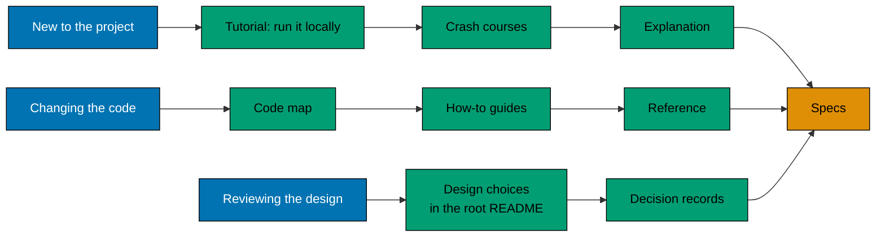

# Documentation

This folder helps you use, change, and understand the flash sale project. It follows the
[Diátaxis](https://diataxis.fr/) model: each page does one job, and the four jobs sit in four folders.

## Where to start

Pick the path that matches what you want to do now. Each step links the next one, so you never need the whole folder.

Reviewing the design? Read the [design choices and trade-offs](../README.md#design-choices-and-trade-offs) in the root
README, then the [decision records](explanation/decisions/README.md).

## Directory Map

- [tutorials/](tutorials/README.md) - learn by doing: run the project from a fresh clone, then one crash course per tool
  and pattern in the stack.
- [how-to/](how-to/README.md) - solve one task: short guides for people who already know the basics.
- [reference/](reference/README.md) - look up facts: endpoints, test layers, the load test, retry policies and where code
  lives.
- [explanation/](explanation/README.md) - understand why: how each part works, and the decision records behind it.

## Specs win

The behaviour and architecture of the product are in [specs/](../specs/README.md). The Gherkin scenarios there are
the canonical statement of what the system must do. If a page here disagrees with a spec, the spec is right and the
page is a bug.

Contributor rules are in [AGENTS.md](../AGENTS.md), not here.
