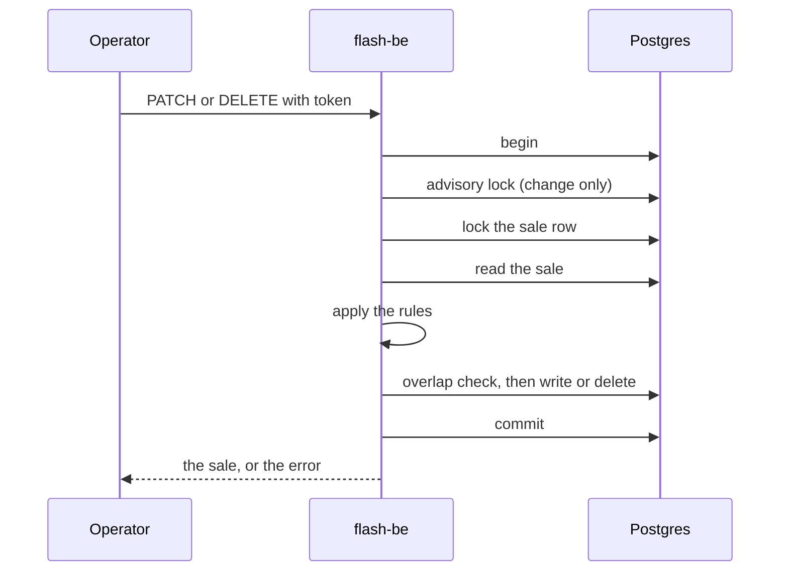

# Admin and sale windows

An operator can create a sale in two ways: the seed command, which needs a shell on the server, and `POST /admin/sales`,
which needs a token. The same token also changes, removes and lists sales. This page explains the product rule behind
the sales, why a started sale is limited, and where the rules stop.

## What is for sale

The brief sells one type of product in limited quantity, and each user may buy one unit. In the code:

- A sale is one product type with `stock` units. There is no product table and no product per sale.
- One user gets one unit and holds one item at a time in a sale. The tables keep it with `UNIQUE(sale_id, user_id)` on
  reservations and on purchases, and Redis keeps a set of buyers in front of them.
- A user is a name the shopper types. It is trimmed and lowercased (`domain/user.ts`), so `Ana ` and `ana` are one person.
  There is no sign-in for shoppers; this is a choice, because the brief asks for "a username or email" and nothing more.
  Anyone can use any name.

## Changing and removing a sale

The routes are `PATCH /admin/sales/:saleId` and `DELETE /admin/sales/:saleId`. A sale that has queues, holds or purchases
is data that other rules depend on, so the rules follow how far the sale has gone:

| The sale is     | Change                                                                                | Remove                |
| --------------- | ------------------------------------------------------------------------------------- | --------------------- |
| not started yet | every field                                                                           | yes                   |
| running         | more `stock`, a new `endsAt`, `name`, `holdSeconds`, `admitPerSecond`; not `startsAt` | yes, if nobody bought |
| over            | nothing (`sale_locked`)                                                               | yes, if nobody bought |

Why a running sale keeps its start and cannot lose stock:

- A hold is valid because of the window it was taken in. Moving the start under live shoppers would change what a
  hold means, and it could turn a running sale back into an upcoming one.
- Less stock than the sale already has could drop below the items that are held or sold. More stock is always safe.
- A new `endsAt` is allowed, so an operator can end a sale early or give it more time.
- A sale that is over stays as it was, so what it sold stays readable. It can still be removed when nobody bought.

A sale with a purchase is never removed (`409 sale_has_purchases`), because the shopper has paid. Holds do not stop a
removal: they go with the sale. The next reservation of a shopper then finds no sale.

The sale row lock is the same one that `commit` takes in the purchase repository, so the two take turns. A stock or hold
time that changes applies to the next reservation at once, because the reservation path reads it from Postgres each time.
Redis needs no reset. See [reservations and recovery](reservations-and-recovery.md).

## The token

The token comes from `ADMIN_TOKEN`. Without it the admin routes answer `404 not_found`, as if they did not exist, so a
deployment that never set it exposes nothing. The value must be at least 16 characters, or the API refuses to start.

- It is sent as `Authorization: Bearer <token>`.
- Both sides are hashed with SHA-256 before the comparison, which runs in constant time, so the length and content of a
  guess leak nothing.
- It runs in the `onRequest` hook, before the body is read, so a client without the token learns nothing from a broken
  body. The address is counted by the rate limiter first, so guesses are counted too.
- It is never logged: the start-up line only says `admin=on` or `admin=off`.
- The web server does not pass `/api/admin` on. Its proxy has an allow-list of method and path pairs, no `/admin` route
  is on it, and a test fails if one ever is.

## Windows may not overlap

The brief sells one product at a time, and "the current sale" is the one that is running, or the next one to open. Two
overlapping sales would make "current" a guess. So the API refuses a window that overlaps another sale with
`409 sale_overlaps`, on create and on change. A sale may open at the moment another one closes. A sale that is scheduled
for later does not take the place of the one that is running.

The check and the write run in one transaction that holds a Postgres advisory lock, so two operators who create the
same window at once get one sale and one `409`. This is checked with a real Postgres in the scenario "Operators who
create the same window at once get one sale".

### Where the rule stops

The rule lives in the admin routes only. The seed command and the test fixtures insert rows directly, and many tests rely
on creating several sales that overlap in time. A database constraint would make the rule absolute, but it would also
break those tests, so it was left out. If you need the rule everywhere, add an exclusion constraint on the window and
change the fixtures first.
