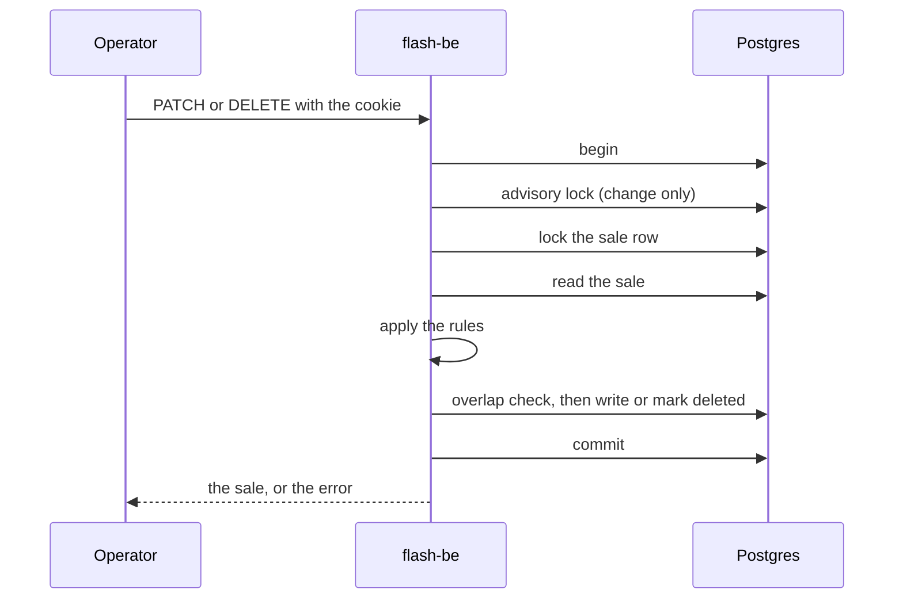

# Admin and sale windows

An operator can create a sale in two ways: the seed command, which needs a shell on the server, and `POST /admin/sales`,
which needs the login of an operator. The same login also changes, removes and lists sales. This page explains the product rule behind
the sales, why a started sale is limited, and where the rules stop.

## What is for sale

The brief sells one type of product in limited quantity, and each user may buy one unit. In the code:

- A sale sells one product, a row of the `products` table, with `stock` units. A product can have many sales over time
  (`sales.product_id`). `POST /admin/sales` takes an optional `productId`; without it, the sale gets the product of that
  `name`, which is made when there is none.
  There is no product CRUD and no price: the brief needs neither.
- One user gets one unit and holds one item at a time in a sale. The tables keep it with `UNIQUE(sale_id, user_id)` on
  reservations and on purchases, and Redis keeps a set of buyers in front of them.
- A user is a row of the `users` table with a user name and a password hash. The name is trimmed and lowercased
  (`domain/user.ts`), so `Ana ` and `ana` are one person. A shopper signs up and logs in with a cookie session; see
  [authentication](authentication.md). A name belongs to the one who signed up first.

## Changing and removing a sale

The routes are `PATCH /admin/sales/:saleId` and `DELETE /admin/sales/:saleId`. A sale that has queues, holds or purchases
is data that other rules depend on, so what may change follows how far the sale has gone: every field before it starts,
less once it runs, nothing once it is over. The exact fields and errors are in
[HTTP endpoints](../reference/http-endpoints.md#changing-a-sale-operator).

Why a running sale keeps its start and cannot lose stock:

- A hold is valid because of the window it was taken in. Moving the start under live shoppers would change what a
  hold means, and it could turn a running sale back into an upcoming one.
- Less stock than the sale already has could drop below the items that are held or sold. More stock is always safe.
- A new `endsAt` is allowed, so an operator can end a sale early or give it more time.
- A sale that is over stays as it was, so what it sold stays readable. It can still be removed when nobody bought.

A sale with a purchase is never removed (`409 sale_has_purchases`), because the shopper has paid. Holds do not stop a
removal: they go with the sale. The next reservation of a shopper then finds no sale.

Nothing is deleted from the database. A removal sets `deleted_at` and `deleted_by` on the sale and on its holds, in one
transaction, and every read leaves out rows that have `deleted_at`. The row stays for the record, and the unique indexes
(`UNIQUE(sale_id, user_id)`) only count rows that are not deleted, so a shopper's name is free again in a new sale.

The sale row lock is the same one that `commit` takes in the purchase repository, so the two take turns. A stock or hold
time that changes applies to the next reservation at once, because the reservation path reads it from Postgres each time.
Redis needs no reset. See [reservations and recovery](reservations-and-recovery.md).

## Who may use the operator routes

The routes need a session whose account has the role `operator`. A request without a login is refused with `401`
`not_authenticated`, and a shopper who is logged in with `403` `forbidden`. How the session works is in
[authentication](authentication.md).

- The first operator is made on the server with `create-operator` (see [seed a sale](../how-to/seed-a-sale.md)). Nobody can
  become an operator through the API.
- The check runs in the `onRequest` hook, before the body is read, so a client without the login learns nothing from a
  broken body. The address is counted by the rate limiter first, so guesses are counted too.
- The author of each change is kept: `created_by`, `updated_by` and `deleted_by` of the sale hold the operator's user id.
  The seed command writes the `$system` user instead.
- The web server does not pass `/api/admin` on. Its proxy has an allow-list of method and path pairs, no `/admin` route
  is on it, and a test fails if one ever is.

## Windows may not overlap

The brief sells one product at a time, and "the current sale" is the one that is running, or the next one to open. Two
overlapping sales would make "current" a guess. So the API refuses a window that overlaps another sale with
`409 sale_overlaps`, on create and on change. A sale may open at the moment another one closes. A sale that is scheduled
for later does not take the place of the one that is running.

The check and the write run in one transaction that holds a Postgres advisory lock, so two operators who create the
same window at once get one sale and one `409`. This is checked with a real Postgres in the scenario "Operators who
create the same window at once get one sale".

### Where the rule stops

The rule lives in the admin routes only: the seed command and the test fixtures insert rows directly, and many tests
create sales that overlap. Why no database constraint holds it is in [decision 010](decisions/010-one-sale-at-a-time.md).
