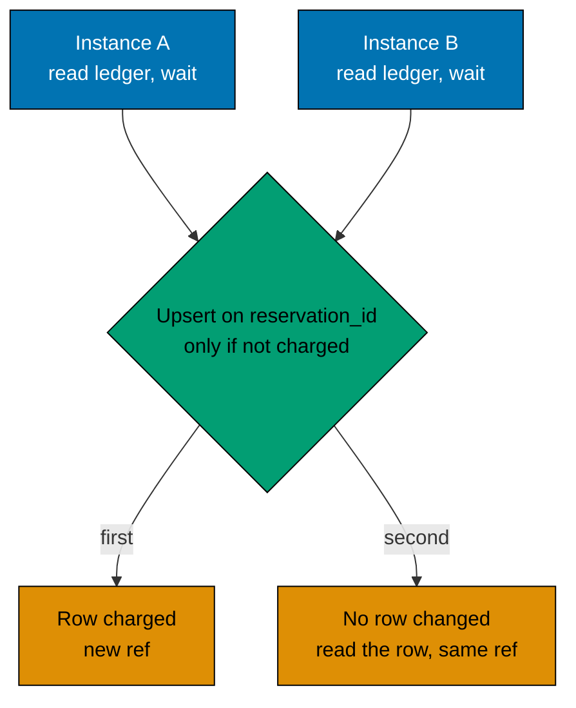

# 009: A mock payment with real rules and a ledger in Postgres

## Status

Accepted. The payment provider is a mock in the API process. The rules around it (idempotency, refund, retry) are real,
and it keeps its charges in a `payments` table, so a charge is idempotent across every API instance.

## Context

The task is about the sale, not about money. But paying is the step that must be safe to repeat and safe to fail, and
the load test needs a payment that is slow like a real one.

Three API instances run behind nginx, so two confirms of one hold can land on two instances. A real provider honours an
idempotency key for every caller, so the mock must too, or the tests prove a property that the system does not have.
Postgres has the last word, and Redis may be down while the sale keeps selling, so the memory of a charge cannot live
in Redis or in one process.

## Decision

- The `Payment` port has `charge` and `refund`. The mock waits `PAYMENT_LATENCY_MS` (150 by default) and declines
  `PAYMENT_FAILURE_RATE` (2 percent by default) of the charges.
- The reservation id is the idempotency key. The mock keeps one row per reservation id in a `payments` table, its own
  ledger. `reservation_id` is unique for good, like `purchases.reservation_id`, so the key is never reused. A row is
  `charged`, `declined` or `refunded`.
- `charge(reservationId)` reads the row first. A `charged` row answers at once with the same ref and no new charge.
  Otherwise the mock waits for the latency with no connection held, draws its decline, and settles with one
  `INSERT ... ON CONFLICT (reservation_id) DO UPDATE ... WHERE payments.status <> 'charged' RETURNING ...`. If another
  instance charged first, the update touches no row, the mock reads the row, and both callers get the same ref.
- A decline is written as `declined`. A retry finds no `charged` row and is a new attempt, and the hold stays.
- Each charged write gets a new ref (`mock-<uuid>`). `refund(ref)` sets `refunded` only `WHERE ref = $1 AND status =
  'charged'`, so a second refund, or a stale refund of a ref that a later charge replaced, changes no row.
- If the commit in Postgres says `sold_out` or `already_purchased`, the charge is refunded and the shopper gets `409`.
- The check of the hold runs before the charge. A hold that ends during the payment is sold if the item is still free.
- The ledger is an adapter detail of the mock, not an application port: a Postgres ledger for the app and a memory one
  for the unit scenarios. The purchase service does not know it exists. The table is in the single migration, with the
  six audit columns; the provider is the `$system` user.

## Alternatives considered

- **A real provider's sandbox (for example a test mode account).** It needs an account and keys, and the network in every
  test. A load test of thousands of charges would hit the provider's rate limits and measure the provider, not the sale.
- **A payment that always succeeds.** The refund path and the decline path would never run, and they are the risky part.
- **No payment step.** The hold would turn into a purchase with nothing to fail, and the order of steps (charge, then
  commit, then refund on refusal) would not be tested.
- **Charges in the memory of each process.** Two instances would not share them: the purchase commit stops a double
  purchase, but not a double charge.
- **A Redis ledger.** Faster, but Redis may be down while the sale sells, and then the second charge would come back.
- **An advisory lock on the reservation id around the charge.** It would hold a connection for the 150 ms latency on
  every confirm, which the load test would show as pool pressure. The upsert holds no lock across the wait.
- **Claim the key before the latency (a `pending` row).** It would save the loser's wait, but a crashed instance would
  leave a `pending` row that needs a timeout and a sweep. For a real provider, whose charge cannot be atomic with our
  write, an intent row of that shape is the right design; it belongs to that provider's adapter.

## Consequences

- It costs honesty about what is proved: nothing about a real provider. The mock cannot fail a refund. There is no
  price, only the reservation id. Each charge costs one read and one write on Postgres, outside the sale lock and the
  purchase transaction, and the loser of a race also waits the full latency.
- A charge whose commit never comes (a crash, or Postgres down between the charge and the commit, and no later retry)
  leaves a `charged` row with no purchase. The ledger makes it visible; a reconciliation that refunds such rows is not
  built.
- It buys one charge per key across any number of instances, a refund that is safe to repeat, a flow that is tested end
  to end with no outside service, and a latency (150 ms) that shows in the purchase p95 of the load runs.

## Revisit when

- A real provider is wanted: implement the same port with the provider's own idempotency key, keep a row of our own only
  if the provider cannot be asked what it charged, and queue refunds so a failed one is retried.
- Orphaned `charged` rows appear in a load run: add the reconciliation.
- A product has a price: the charge needs an amount and a currency.

## Related

- [Payment, idempotency and refunds](../payment-and-refunds.md), [002](002-redis-gate-postgres-last-word.md) and
  [011](011-soft-delete-everywhere.md).
- Code: [`mock-payment.ts`](../../../apps/flash-be/src/adapters/outbound/payment/mock-payment.ts),
  [`purchase-service.ts`](../../../apps/flash-be/src/application/purchase-service.ts),
  [`ports/`](../../../apps/flash-be/src/application/ports/) and
  [`0001_schema.ts`](../../../apps/flash-be/src/adapters/outbound/postgres/migrations/0001_schema.ts).
