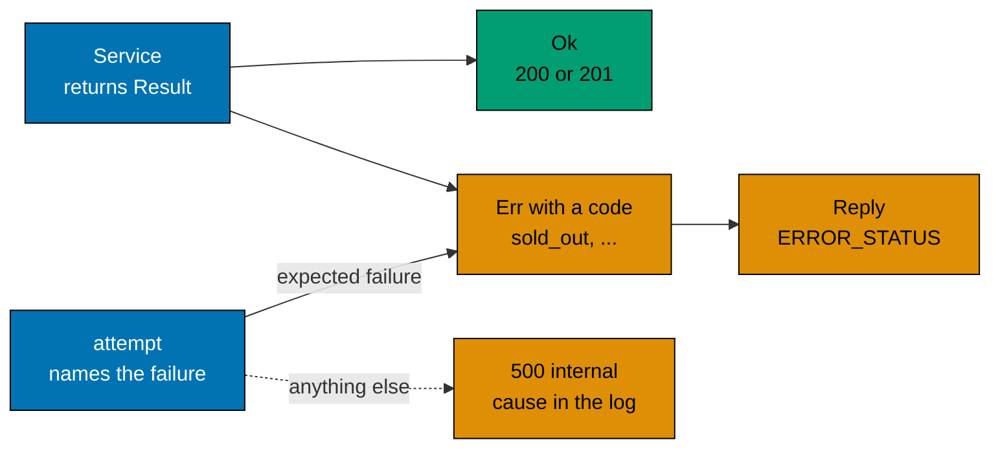

# Failures as values

`flash-be` and `flash-web` return failures instead of throwing, and they return `undefined` for a value that may be
missing. The library is [`@flash/typekit`](../../libs/typekit/README.md).

## Why not exceptions

A thrown error is invisible in a function's type. A caller can forget it, and nothing says which errors can come out.
On the sale path that is costly: "sold out", "hold expired" and "payment declined" are normal answers, not accidents, and
each has its own status code. A `Result<Purchase, ConfirmError>` lists them in the type, so the route must map every one,
and a new error fails the build until it is mapped.

Exceptions still exist for what the code does not expect: a bug, or a store that is down. `attempt` catches only what a
call site names, and anything else goes on. That is why there is no catch-all by default.

## Why absence is undefined

A lookup that may find nothing returns `T | undefined`. TypeScript already tracks it, and strict mode makes the caller
check before it reads the value. An extra wrapper type would add a second way to say the same thing, so the library does
not have one.

## Why exhaustive match

TypeScript has no `match` statement. A `switch` over a union that ends without a case is silent unless the build checks it.
Biome's `useExhaustiveSwitchCases` turns a forgotten case into an error at build time, which is when a new error code or a new sale status is added.

## How the rules are kept

- **No `catch` in product code.** A Biome plugin, [`.biome/no-catch.grit`](../../.biome/no-catch.grit), errors on a `catch` clause and on a `.catch(` call
  in `apps/*/src` and `libs/*/src`. `try` with `finally` is allowed, because it cleans up and handles nothing. Tests,
  `src/bdd` and the library's own [`boundary.ts`](../../libs/typekit/src/boundary.ts) are exempt.
- **Exhaustive switches.** `useExhaustiveSwitchCases` is an error.
- **Inner layers may use it.** The domain and application layers import `@flash/typekit`, because it has no dependency and
  no I/O. [`architecture_tests.ts`](../../apps/flash-be/src/architecture_tests.ts) allows it and the main entry of `@flash/flash-commons` (not `/timers`), and no other
  package.
- **The rules have tests.** `npm run lint:rules:test` runs the real linter on sample code. It runs in the pre-push hook.

## What it costs

A few more allocations on the hot path, and steps that check each result and return early. The trade-off and the
options weighed are in [decision 005](decisions/005-failures-as-values.md).
