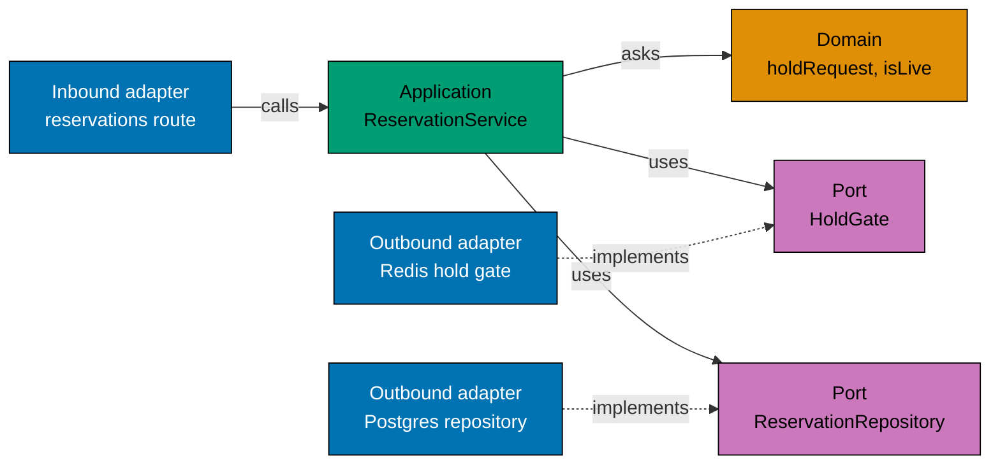

# Hexagonal architecture

`flash-be` is split by the direction of its dependencies, not by feature. The reason is the sale path: its rules must
hold whatever sits behind them. Redis can be empty or down, and the payment provider is a mock. A rule that does not
know about Redis or Fastify cannot break when they change.

The folder tree, file by file, is in the [flash-be README](../../apps/flash-be/README.md).

## The three layers

- **Domain.** Plain types and functions: the status of a sale, who may queue or reserve, how long a hold lives, whether
  a hold is still live, how many shoppers one tick admits, a user id and a ticket. They take values and return values.
  There is no I/O and no clock read, so a unit test needs no fake.
- **Application.** One service per use case (sale status, queue, reserve, pay, rate limit, login, operator changes, seed). A service orders the steps
  and calls ports. It decides nothing that a domain function can decide. Ports are small types in
  [`application/ports/`](../../apps/flash-be/src/application/ports), named in the language of the sale: `HoldGate`, `QueueStore`, `PurchaseRepository`. The suffix says what a port is: a
  **Repository** is the Postgres record of a thing, a **Store** holds keyed state, and a **Gate** is the fast check in
  front of Postgres. Randomness is a port too (`TokenSource`), so the domain only takes values.
- **Adapters.** Inbound adapters drive the application (HTTP, and the `seed-sale` and `create-operator` commands). Outbound adapters implement ports
  (Postgres through Kysely, Redis scripts, an in-process rate counter, the mock payment, the system clock).

## One request through the layers

A shopper asks for an item: `POST /api/v1/sales/:saleId/reservations`. The diagram follows that request. Solid arrows are calls.
Dotted arrows say which port an adapter implements, so the code dependency always points inward.

1. The route reads the request and hands the user, the sale and the ticket to the service. It knows HTTP, and nothing else.
2. The service checks the sale and the queue, asks the domain whether a hold may be taken, then calls the ports in the
   order the rules need.
3. The Redis gate says yes or no fast. The Postgres repository writes the hold, and Postgres has the last word.
4. When Redis is down, the guarded gate fails at once and the Postgres repository decides alone. The route and the
   service do not change (see [serving without Redis](serving-without-redis.md)).

## The rule and how it is kept

Dependencies point inward: adapters know the application and the domain, the application knows the domain, and the
domain knows nothing. The only packages the inner layers may import are [`@flash/typekit`](../../libs/typekit/README.md)
(see [failures as values](failures-as-values.md)) and [`@flash/flash-commons`](../../libs/flash-commons/README.md). Both are
pure: no I/O, no timer and no randomness of their own. The one timer helper, `@flash/flash-commons/timers`, is refused
in the domain and the application; [`composition.ts`](../../apps/flash-be/src/composition.ts) passes the real `sleep` in, and a test passes its own. The HTTP words (error codes, statuses, sentences, cookies) live in
the inbound HTTP adapter, and the rules the domain needs, such as the user id rule, live in the domain.
Inbound adapters never import outbound adapters, and outbound adapters import only ports and the
domain. Only [`composition.ts`](../../apps/flash-be/src/composition.ts) and the entry points see both sides.

[`apps/flash-be/src/architecture_tests.ts`](../../apps/flash-be/src/architecture_tests.ts) reads the imports of every source file and fails when one crosses a layer
it must not know. It runs with the unit tests, so the pre-push hook enforces it.

## What it buys, and what it costs

- A rule moves to the domain and gets a test without Redis or Postgres. The memory copies of the ports let the
  behaviour scenarios run at unit level against the same services that run in production.
- A store can change behind its port. Redis down is one more adapter state: the guarded gate and the Postgres fallback
  sit behind the same ports.
- Most ports have one real implementation, and that is on purpose. They are not there so that a store can be swapped
  one day. They keep a service from naming Redis or Postgres, and they let a scenario run the same service against an
  in-memory copy (`src/bdd/support/memory-*.ts`). The two ports with a real second life are the payment (a mock now) and
  the clock (a fixed one in tests).
- What it costs, and the options weighed against it, are in [decision 004](decisions/004-hexagon-in-the-api-only.md).

## Where the ports bend

Three ports carry a callback because the store must run the caller's code inside a lock: `ReservationRepository.rebuild`
hands the snapshot to a function while the sale row is locked, `reserveWithoutGate` asks whether the gate (Redis) is ready
again under the same lock, and `SaleAdmin.update` hands the stored sale to the domain's `changeSaleFrom`, which decides
the change. The lock is a Postgres detail, but the order of steps is a rule, so the callback is the smallest port that
keeps both.

The cost: in the first two, a Redis call (the restore, the readiness check) runs while the Postgres row lock of the sale
is held, so a slow Redis would hold every shopper of that sale. The Redis client fails at once instead of waiting
(no offline queue, single scripts), which bounds that wait; a Redis that accepts connections and never answers is the
case [decision 003](decisions/003-keep-selling-without-redis.md) names for a second look.

## The sale as the consistency boundary

In DDD terms the sale is the aggregate: its row is the root, and its holds and purchases belong to it by `sale_id`.
The rules that must hold at every moment are about one sale: `sold` never passes `stock`, and one shopper has at most one
purchase in it. Every write that can break them takes the sale row lock first (`SELECT ... FOR UPDATE`): the commit of a
purchase, a reservation without Redis, a rebuild, and an operator's change or removal. So the lock of the root is the
boundary, and a shopper waits only behind shoppers of the same sale.

These rules are not methods on a `Sale` object. Two shoppers paying at the same moment read the same `sold`, so a check
in memory would pass for both; only the database can decide under the lock. The SQL (`UPDATE ... WHERE sold < stock`,
the `CHECK`, the partial unique index) is therefore the rule's last word, and the domain holds the same rule as pure
functions (`hasRoom` and the reservation decision) that the memory copies and the fast path follow. The Redis script is
the third copy, for speed, and Postgres can rebuild it ([decision 002](decisions/002-redis-gate-postgres-last-word.md)).

One step crosses the boundary: a commit or a reservation looks up the shopper's user row by name inside the sale's
transaction, and creates it for a name that has none (a rebuild or a test). It is one indexed read, and the user row is
not locked, so it adds no wait between sales.

## Two names for a shopper

A shopper has a user name and a user id. The queue, the holds, the purchases and the Redis keys use the name
(`Username`), because it is what the session knows and what a shopper sees. The Postgres foreign keys use the id
(`UserId`), because a row points at a row. `Principal` carries both, and the Postgres adapter turns a name into an id
where a row needs it. One identity would be cleaner; two keep the hot path free of a lookup and the API free of ids
(no route takes a user id). The reply field `"userId"` holds the name, kept for the contract.

## Words

- **Hold** is the shopper's word: one item kept for a short time. **Reservation** is its record: the row, the route
  (`/reservations`) and its id. They are the same thing.
- **Gate** is the fast check in front of Postgres. Today it is Redis.
- **Admitted** means the queue let the shopper through; only an admitted shopper may hold an item.
