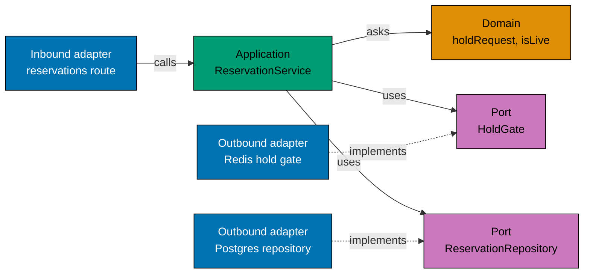

# Hexagonal architecture

`flash-be` is split by the direction of its dependencies, not by feature. The reason is the sale path: its rules must
hold whatever sits behind them. Redis can be empty or down, and the payment provider is a mock. A rule that does not
know about Redis or Fastify cannot break when they change.

```text
src/
  domain/          rules and values; imports only Node built-ins and @flash/typekit
  application/     services (use cases) and ports/
  adapters/
    inbound/       http (Fastify routes, SSE), cli (seed and create-operator options)
    outbound/      postgres, redis, crypto (scrypt), memory, payment, system (clock)
  composition.ts   the one place that picks an adapter for a port
  main.ts          entry points: main, migrate, seed-sale, create-operator
```

## The three layers

- **Domain.** Plain types and functions: the status of a sale, who may queue or reserve, how long a hold lives, whether
  a hold is still live, how many shoppers one tick admits, a user id and a ticket. They take values and return values.
  There is no I/O and no clock read, so a unit test needs no fake.
- **Application.** One service per use case (sale status, queue, reserve, pay, rate limit). A service orders the steps
  and calls ports. It decides nothing that a domain function can decide. Ports are small types in
  `application/ports/`, named in the language of the sale: `HoldGate`, `QueueStore`, `PurchaseRepository`.
- **Adapters.** Inbound adapters drive the application (HTTP, the seed command). Outbound adapters implement ports
  (Postgres through Kysely, Redis scripts, an in-process rate counter, the mock payment, the system clock).

## One request through the layers

A shopper asks for an item: `POST /sales/:saleId/reservations`. The diagram follows that request. Solid arrows are calls.
Dotted arrows say which port an adapter implements, so the code dependency always points inward.



1. The route reads the request and hands the user, the sale and the ticket to the service. It knows HTTP, and nothing else.
2. The service checks the sale and the queue, asks the domain whether a hold may be taken, then calls the ports in the
   order the rules need.
3. The Redis gate says yes or no fast. The Postgres repository writes the hold, and Postgres has the last word.
4. When Redis is down, the guarded gate fails at once and the Postgres repository decides alone. The route and the
   service do not change (see [serving without Redis](serving-without-redis.md)).

## The rule and how it is kept

Dependencies point inward: adapters know the application and the domain, the application knows the domain, and the
domain knows nothing. The only package the inner layers may import is [`@flash/typekit`](../reference/typekit.md),
which has no dependency and no I/O (see [failures as values](failures-as-values.md)). The HTTP words (error codes, statuses,
sentences) live in the inbound HTTP adapter, and the rules the domain needs, such as the user id rule, live in the domain.
Inbound adapters never import outbound adapters, and outbound adapters import only ports and the
domain. Only `composition.ts` and the entry points see both sides.

`apps/flash-be/src/architecture_tests.ts` reads the imports of every source file and fails when one crosses a layer
it must not know. It runs with the unit tests, so the pre-push hook enforces it.

## What it buys, and what it costs

- A rule moves to the domain and gets a test without Redis or Postgres. The memory copies of the ports let the
  behaviour scenarios run at unit level against the same services that run in production.
- A store can change behind its port. Redis down is one more adapter state: the guarded gate and the Postgres fallback
  sit behind the same ports.
- Most ports have one real implementation, and that is on purpose. They are not there so that a store can be swapped
  one day. They keep a service from naming Redis or Postgres, and they let a scenario run the same service against an
  in-memory copy (`src/bdd/support/memory-*.ts`). The two ports with a real second life are the payment (a mock now) and
  the clock (a fixed one in tests).
- It costs more files and one place of wiring. A change to a port touches the port, its adapters and its memory copy.

## Where the ports bend

Two ports carry a callback because the store must run the caller's code inside a lock: `ReservationRepository.rebuild`
hands the snapshot to a function while the sale row is locked, and `reserveWithoutRedis` asks whether Redis is ready
again under the same lock. The lock is a Postgres detail, but the order of steps is a rule, so the callback is the
smallest port that keeps both.
