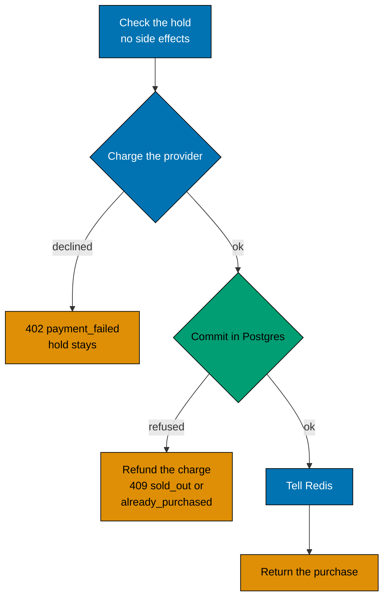

# Payment, idempotency and refunds

Paying is the one step that touches money, so it is the step that must be safe to repeat and safe to fail. This page
explains how a hold becomes a purchase, and what happens when something goes wrong in between.

## The steps

1. **Check, without side effects.** The hold must exist, belong to the user and not be expired. A purchase for the same
   reservation id returns at once with the same body.
2. **Charge.** The payment provider is called with the reservation id.
3. **Commit.** One short Postgres transaction turns the hold into a purchase.
4. **Tell Redis.** The user becomes a buyer in the gate and the hold is dropped.

The provider is a mock that lives in the process. It waits `PAYMENT_LATENCY_MS` (150 by default) and declines
`PAYMENT_FAILURE_RATE` of the charges (2 percent by default). A real provider would replace it behind the same port.

## Idempotency

The reservation id is the key. A second request for the same reservation does not charge again, in two places:

- The mock remembers a charge while it runs and after it succeeds, so two requests at the same moment share one charge.
  A declined charge is forgotten, so a retry is a new attempt.
- The commit looks for a purchase with the same reservation id and returns it. The `purchases` table repeats this with a
  unique constraint on `reservation_id`.

## The commit

The transaction first locks the sale row, which lines up everyone who confirms for that sale. Then, in order:

1. If a purchase with this reservation id exists, return it.
2. If the user already has a purchase in the sale, answer `already_purchased`.
3. `UPDATE sales SET sold = sold + 1 WHERE id = $1 AND sold < stock`. If no row changes, answer `sold_out`.
4. Insert the purchase and mark the reservation row deleted (`deleted_at`, `deleted_by`): the hold is spent, and the
   row stays as a record.

The lock is held for a few statements and never across the payment. The `CHECK (sold <= stock)` on the table and the
unique constraint on `(sale_id, user_id)` stay as the last walls if a bug ever skips a step above.

## When the hold ends during the payment

The hold is checked before the charge, not after. A hold that ends while the provider is working is not a failure by
itself: if the item is still free, the commit sells it. If another shopper took it in between, the commit answers
`sold_out`, and the service refunds the charge. The shopper is told `409 sold_out`, and no money is kept.

## When a step fails

| Failure                             | Result                                                                                                                                                                                                                                                                   |
| ----------------------------------- | ------------------------------------------------------------------------------------------------------------------------------------------------------------------------------------------------------------------------------------------------------------------------ |
| The provider declines               | `402 payment_failed`. The hold stays, so the shopper can try again until it ends.                                                                                                                                                                                        |
| The commit says `sold_out`          | The charge is refunded, `409 sold_out`.                                                                                                                                                                                                                                  |
| The commit says `already_purchased` | The charge is refunded, `409 already_purchased`.                                                                                                                                                                                                                         |
| Redis fails after the commit        | The purchase stands. The next rebuild from Postgres fixes the gate.                                                                                                                                                                                                      |
| The commit fails (Postgres error)   | The service looks for the purchase of this reservation. If it is there, the commit landed and only its reply was lost: the shopper gets the purchase and nothing is refunded. If it is not there, or the lookup fails too, the charge is refunded and the request fails. |

## Trade-offs

- **The mock keeps its memory in the process.** Two instances do not share charges, so idempotency across instances rests
  on the commit and the unique constraint. A real provider would offer an idempotency key of its own.
- **A refund can fail.** The mock cannot fail a refund. A real system would queue refunds and retry them.
- **No price.** The sale has one product and no amount; the charge carries only the reservation id.

## Where to read more

- The exact behaviour: [`purchase/`](../../specs/apps/flash/be/behaviours/purchase/README.md) in the specs.
- The routes: [HTTP endpoints](../reference/http-endpoints.md).
