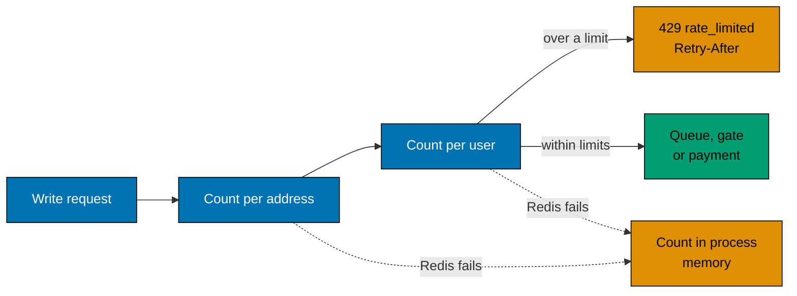

# Rate limiting

The queue, the gate and the payment each cost real work. One client that sends them in a loop would use up that work
and slow every other shopper down. The API therefore limits write requests before they reach any of those steps.

## What is limited

The three write routes (join the queue, reserve and confirm) and, apart, the auth routes. Reads are cheap and are not limited.
A rejected request gets status `429`, the body `{"errorCode":"rate_limited","errorMessage":"...","retryAfterSeconds":n}` and a
`Retry-After` header, so a well-behaved client knows when to come back.

## The counters

- **Per user** (30 requests in 10 seconds in one sale by default). It stops one shopper who presses the button in a loop.
  It does not harm a user who is behind a shared address.
- **Per address** (600 in 10 seconds in one sale by default). It stops one machine that sends many different accounts, which the
  per-user counter cannot see. It is higher because an office or a school may share one address.
- **Auth routes** (20 requests per address in 10 seconds by default, `AUTH_RATE_LIMIT_PER_IP`). Sign-up, login, refresh and
  logout have a count of their own, so a crowd that arrives for a sale cannot lock itself out of the login, and a password
  cannot be guessed at speed. It is by address only, because a request that is not logged in has no user yet. The
  `/api/v1/admin` routes are counted by address too, under their own key (`admin`) and with the per-address limit of the sale
  routes (`RATE_LIMIT_PER_IP`).

A request is refused when either counter is over its limit. A refused request still counts, so a client that keeps
retrying does not get through earlier.

## The window

Each counter is a fixed window that starts at the first request. Redis does the work with `INCR`, then `PEXPIRE` on the
first hit, then `PTTL` to tell the client how long to wait. This is one round trip of three small commands, and it is
the same for every API process, so three processes share one count.

A fixed window lets a client send twice the limit around a boundary. That is accepted: the limit protects the system, it
is not a billing rule, and the gate and Postgres still hold the stock whatever the request rate is.

## When Redis is down

If the shared store throws, the limiter counts in the process memory instead. Each process then counts alone, so the
effective limit grows with the number of processes. This is the trade-off: the API keeps limiting, and keeps serving, at
the price of a looser limit. Failing closed would turn a Redis outage into a full outage, and failing open would leave
the payment step open to floods.

## Behind a proxy

The client address comes from the socket by default. Behind a load balancer every request would then share the balancer
address and one shopper could block everyone. Set `TRUST_PROXY=true` only when a proxy you control sets
`X-Forwarded-For`; if the API faces the internet directly, the header could be forged to dodge the limit.
