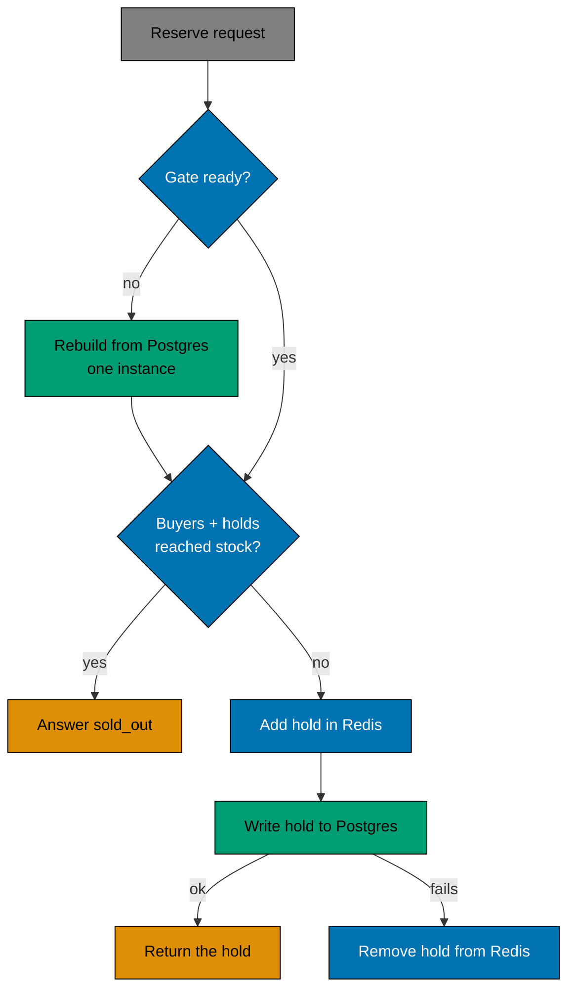

# Reservations and recovery

A reservation is a hold on one item for a short time. The shopper pays inside that time, and if they do not, the item
goes back. This page explains how the hold is counted, why two stores are involved, and what happens when Redis loses
its state.

## The gate in Redis

The fast decision is made by one Lua script in Redis. For one sale it keeps:

- `buyers`: a set of users who bought.
- `holds`: a sorted set of users, scored by the time their hold ends.
- `ids`: the reservation id of each hold.
- `ready`: a flag that says the three above are complete.

The script counts the items that are not free: `SCARD(buyers) + ZCOUNT(holds, now, +inf)`. If that count has reached the
stock, the answer is `sold_out`. Otherwise it adds the hold. Because the count and the add run as one command, two
requests can never both take the last item.

A hold that has expired has a score in the past, so it stops counting without any work. There is no sweep job and no
counter that can drift away from the truth.

## Postgres is the source of truth

Redis answers fast, but it can be lost. So every new hold is also written to the `reservations` table, and a purchase is
written to `purchases`. The database has the last word: a sale cannot sell more than its stock (a `CHECK`), and a user
can buy once per sale (a unique index on `(sale_id, user_id)` over the rows that are not deleted). If the write to Postgres fails, the hold is removed from Redis again, so a
hold never exists only in Redis.

## When an operator changes the sale

A reservation reads the sale from Postgres each time (the `details` call, not the cache). The stock is sent to the Redis
script with every reserve, and the hold time is read for each new hold. So when an operator raises the stock or changes
`holdSeconds`, the next reservation uses the new number at once. Holds that already exist keep the time they were given.
Nothing in Redis needs to be reset, and nothing is invalidated. A removed sale is marked deleted, and so are its holds; its Redis keys are
never read again, because sale ids are unique. See [admin and sale windows](admin-and-sale-windows.md).

## When Redis loses its state

If Redis restarts empty, the `ready` flag is gone. The next reservation sees this, and one instance rebuilds the state
from Postgres: the users in `purchases` become `buyers`, and the live rows in `reservations` become `holds`. Then it sets
`ready`.

Three rules keep the rebuild safe:

1. **One rebuilder.** An instance takes a short lock (`SET ... NX PX`). The others wait for `ready`, up to three seconds,
   and then answer `503 unavailable` so the shopper can retry.
2. **A consistent snapshot.** The rebuild reads Postgres inside a transaction that holds a row lock on the sale, so no
   hold can be written between the snapshot and the moment `ready` is set.
3. **Expired holds are left out.** Only rows that have not expired are restored.

The result is that a restart of Redis never gives away an item that someone holds, and the holder gets the same hold
back.

## Trade-offs

- **Two writes per reservation.** The hold goes to Redis and to Postgres. The Postgres insert has no contention, because
  each user has one row, so it stays cheap. The price is one more round trip.
- **Clocks.** Expiry uses the clock of the instance that takes the request, and the Redis count uses that instance's
  `now` too. An instance whose clock runs fast can count a live hold as ended and give its item to a second shopper. It
  cannot oversell: the purchase commit checks `sold < stock` in Postgres, and the shopper who loses is refunded and told
  `sold_out`.
- **Old entries stay in Redis.** An expired hold is not deleted. It stays until the user reserves again or Redis is
  rebuilt. The number of such entries is at most the number of users who ever reserved.

## Where to read more

- The exact behaviour: [`reservation/`](../../specs/apps/flash/be/behaviours/reservation/README.md) and
  [`recovery/`](../../specs/apps/flash/be/behaviours/recovery/README.md) in the specs.
- The routes: [HTTP endpoints](../reference/http-endpoints.md).
