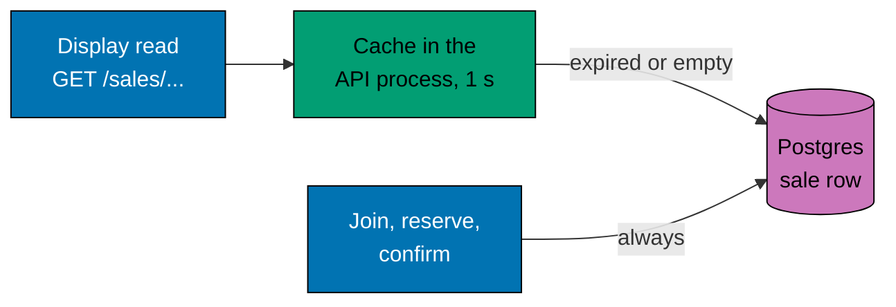

# The sale read cache

Everyone who has the page open asks for the sale again and again: is it open, how many are left? These reads are the
most frequent requests of the system, and they all ask for the same row. The cache makes them cheap.

## What is cached

`GET /sales/current` and `GET /sales/:saleId` read the sale row through a cache inside the API process. A row is kept for
`SALE_CACHE_MS` (one second by default). The first read after that goes to Postgres, and every other shopper in that
second gets the same row. One API process therefore reads one sale at most once a second, whatever the number of
shoppers. Callers that arrive while a read is running wait for it instead of starting their own.

The reply carries `Cache-Control: public, max-age=1`, so a browser or a proxy in front of the API may also keep it for
that second.

## What may be old

`GET /sales/current` is kept as one entry, apart from the rows kept by id. So the answer to "which sale is current" can be
up to the cache time old too: after an operator creates, changes or removes a sale, or when a window opens or closes
and another sale becomes current, readers may see the old sale for at most `SALE_CACHE_MS`. Each process has its own
cache, so two instances may differ for that long. The `status` of the sale they show is still computed from the clock.

Only `remaining`, the count of items sold, can be up to one second old. The `status` is computed on each request from
the cached row and the clock, so a sale still opens and closes on time. A shopper who sees `3 remaining` may find out
on the next step that the last item is gone. That is acceptable for a display and it is why the display never decides
anything.

## Why writes skip it

Joining the queue, reserving and paying read the sale through a separate call (`details`) that always goes to Postgres.
A decision to take or refuse an item must not rest on a number that could be a second old. Postgres still has the last
word on the stock, so a stale read can never sell an item twice; the rule for writes is stricter for a different
reason: a shopper should not be told "you may buy" and then "sold out" one second later because of the cache.

## What is left out

- A sale that is not found is not kept, so a sale created a moment later shows at once, and a flood of unknown ids is
  not answered from memory.
- There is no shared copy in Redis. Each process reads Postgres once a second per sale. With three processes that is
  three reads a second, which a single row can serve easily, and it keeps the read path alive when Redis is down. A
  shared cache would pay for itself only with many more processes.
- The cache is not cleared when a purchase happens. It expires by time, which is simple and has no failure mode.
