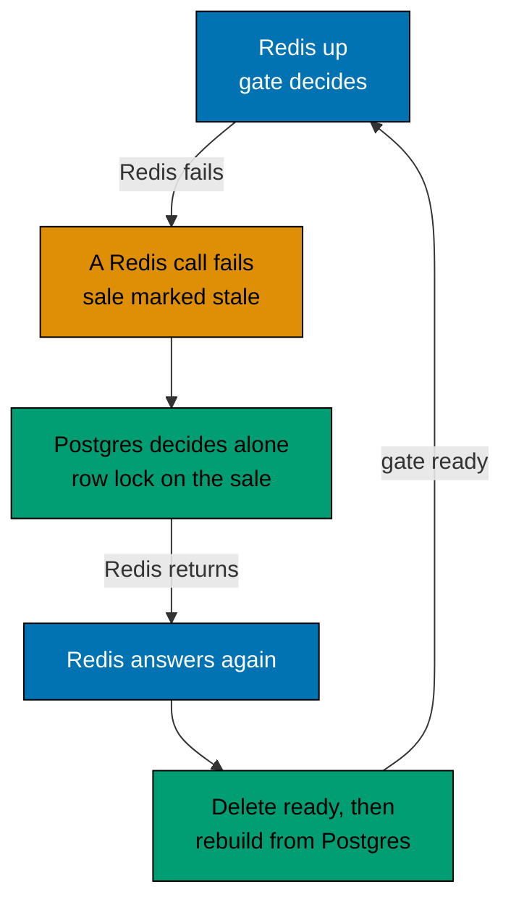

# Serving without Redis

Redis makes the hot path fast: the queue, the reservation gate and the rate counters all live there. It is not the source
of truth. Postgres is, so a Redis outage must slow the sale down and must not break its rules.

## What happens when Redis fails

The Redis client is set to fail at once while the connection is down, instead of queueing commands until it returns. A
request therefore learns within a few milliseconds that Redis is gone, and each step has its own answer:

| Step                 | Without Redis                                                                                                |
| -------------------- | ------------------------------------------------------------------------------------------------------------ |
| Join the queue       | The shopper gets a valid ticket and is admitted at once. There is no line to wait in.                        |
| Check the place      | A valid ticket is enough; the answer is `admitted`.                                                          |
| Reserve              | Postgres decides alone (see below).                                                                          |
| Confirm the purchase | Unchanged. It already works from Postgres. Telling Redis about the purchase fails at once and is ignored.    |
| Log in and out       | Unchanged. Sessions are in Postgres; Redis only caches them, so each request reads Postgres for its session. |
| Rate limits          | Each process counts in its own memory, so the limit stays on and grows with the number of processes.         |
| `GET /ready`         | `503` with `redis: error`. The process still serves the other routes.                                        |

Skipping the queue is a choice. The queue is there for fairness and for protecting Postgres from a stampede. The stock
and the one item per user do not depend on it, so a stalled queue would stop the sale for nothing. The cost is that
fairness is lost while Redis is down.

## The reservation in Postgres

The reserve step locks the sale row (`SELECT ... FOR UPDATE`), then counts `sold` plus the live holds of other users.
It refuses when the stock is used up. Otherwise it writes the hold to `reservations` and returns it. If the user already
bought, or already holds an item, it answers like the gate does. The lock is short, because it is never held across a
payment. A hold that has expired no longer counts, so no cleanup job is needed.

## Coming back

Nothing has to be done by hand to bring Redis back. In both compose files Redis has `restart: unless-stopped`, so Docker
starts a Redis process that exited again. The API's Redis client reconnects by itself, with backoff and no attempt limit
(see [retry policies](../reference/retry-policies.md)), and `/ready` answers `200` again once Redis answers. A Redis
stopped on purpose (`docker compose stop redis`, as the demo does) stays down until `docker compose start redis`.
`npm run smoke:prod` makes Redis exit and checks that every API instance is ready again.

Redis may come back empty (a restart) or with its old data (a network break, or a restart that loaded an old snapshot
from its volume). The two cases need different care:

- **Empty.** The `ready` key is missing, so the next reservation finds the gate not ready and one instance rebuilds
  it from Postgres. The rules for that rebuild are in [reservations and recovery](reservations-and-recovery.md#when-redis-loses-its-state).
- **With old data.** Redis looks ready but it missed the holds and purchases that Postgres decided meanwhile. Every
  failed call to the hold gate (a reserve, a release or a confirm) marks the sale as stale in the process. The next
  reservation first deletes `ready`, which forces the same rebuild.

The Postgres path also asks, under the sale lock, whether Redis is ready again. If it is, nothing is written there and the
gate is used, so a rebuild and a degraded reservation can never both think they hold the last item.

## What can still go wrong

- A process that never saw a failure, while another instance did, keeps using a Redis that is behind. For a short time
  more holds than the stock can exist. Purchases cannot exceed the stock: the confirm step guards `sold < stock` in
  Postgres, and a shopper who loses that race is refunded and told `sold_out`.
- A Redis that accepts connections but never answers (a black hole) is not detected; commands wait. A command timeout
  and a circuit breaker would be the next step.
- Every request still tries Redis first while it is down. That is cheap when the connection is closed, and it means
  recovery needs no probing.
