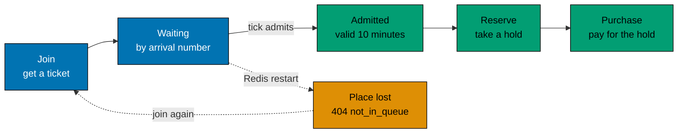

# The waiting queue

A flash sale gets most of its traffic in the first seconds. The queue puts a gate in front of the part that is
expensive and must stay correct, which is the reservation of an item. It does two things: it keeps a burst away from
Postgres, and it gives everyone a fair order.

## How it works

- A shopper who is logged in joins and gets a place and a **ticket**. The shopper is the account of the session cookie.
- Every second, one instance moves the first `admit_per_second` shoppers of the current sale from "waiting" to "admitted". An
  admission stays valid for ten minutes by default.
- Only an admitted shopper can reserve an item. This keeps the queue from being skipped by calling the reserve route
  directly.

The queue lives in Redis, in two sorted sets per sale: one for the waiting users (scored by arrival number) and one for
the admitted users (scored by the time the admission ends). A small Lua script joins a user, so a user is never both
waiting and admitted. The arrival number comes from a counter, not from the clock, so two users who join in the same
millisecond still keep their order.

## One admitter per tick, without an election

Every `flash-be` instance runs the same timer. Each tick, an instance tries to take a short lease on the sale
(`SET ... NX PX`, a little shorter than one tick). Only the instance that gets the lease admits. No instance is the
permanent leader, so a crashed instance never stops the queue; the next tick another instance takes over.

The timer admits for the **current sale** only (`admitCurrentSale` in `application/admission.ts`): the sale that is running, or
else the one that opens next. So when an operator schedules a later sale while one is running, the line of the running
sale keeps moving, and the later sale starts to admit when it becomes current. A sale that is over has no line to move.

## The ticket

The ticket is a signature (HMAC) of the sale id and the user id, made with `TICKET_SECRET`. Any instance can issue and
check it, so it needs no storage and it stays valid after a Redis restart. It proves that the holder asked the server
for a place for that user. It does not prove who the holder is. The login does: every queue route also needs the session
cookie, and the ticket is checked against the user of that session, so a ticket of another shopper is refused with
`invalid_ticket`. The queue is a fairness and load tool, and the login is what says who the shopper is.

## Trade-offs

- **The queue is not rebuilt after a Redis restart.** Places are short-lived, and the data that must not be lost
  (purchases) lives in Postgres. A shopper whose place was lost gets `404 not_in_queue` and joins again, at the end of
  the line.
- **The queue is always on while a sale runs.** A sale with little traffic admits the next shopper within one second,
  so the cost for a quiet sale is at most one tick.
- **Admission is approximate.** The rate is per tick, and a tick can be missed if no instance is up. The reserve step
  and Postgres still enforce the stock, so a late or doubled admission cannot oversell.

## Where to read more

- The exact behaviour: [`specs/apps/flash/be/behaviours/queue/`](../../specs/apps/flash/be/behaviours/queue/README.md).
- The routes: [HTTP endpoints](../reference/http-endpoints.md).
