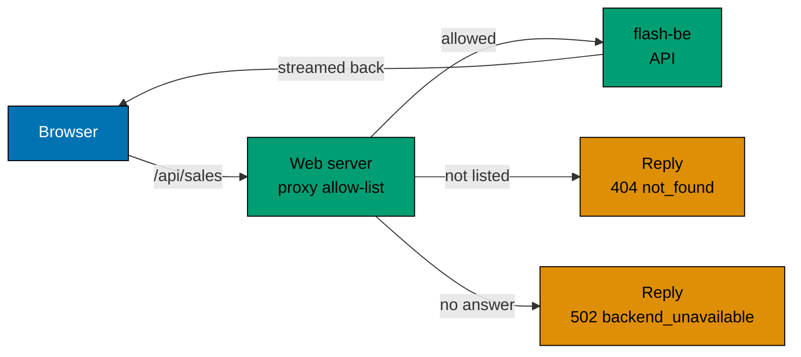

# The web server in front of the API

The page never calls `flash-be` itself. Every request goes to the web app's own server under `/api/sales` or `/api/auth`, and the
server passes it on, with the login cookies. This page gives the reasons and what it costs.

## Why not call the API from the browser

- **The address stays private.** `FLASH_BE_URL` is read on the server only. The page, its scripts and its data never
  contain it, so the API can sit on a private network. A scenario checks that the rendered page does not hold the
  address.
- **One origin.** The browser makes same-origin requests, so no CORS rules are needed and none can be got wrong.
- **One place to narrow the surface.** The server passes on a short list of method and path pairs (the `ALLOWED` list in
  `apps/flash-web/src/proxy.ts`) and nothing else, so a path such as `../ready` cannot be used to reach other routes. The
  operator routes (`/admin/sales` with POST, GET, PATCH and DELETE) are not on the list. A sale id must be a UUID, or the answer is `404 not_found`. The
  server also sends on only the headers the API needs (the `cookie` header among them), and moves the refresh cookie from
  `/auth` to `/api/auth`. A POST from another origin is refused with `403 cross_site`.

## What it costs

Each request has one more hop. The server streams the answer back as it arrives, so event streams are not buffered and
a stream closes upstream when the browser leaves. The extra hop shows up in latency, not in correctness. The web server
is stateless, so more copies can run behind a load balancer.

## What the page does

The page renders on the server from the current sale, so the first paint already shows the status and the items left.
After that it follows the sale stream and updates by itself. A shopper logs in (or signs up) and presses **Buy Now**:

1. The page joins the queue. If the line is moving, it shows the place and follows the place stream.
2. When the queue admits the shopper, the page reserves an item and shows a countdown for the hold.
3. **Confirm purchase** pays for the held item. A declined payment keeps the hold, so the shopper can try again.
4. **Check my status** answers "did I get it" for a shopper who closed the page.

A waiting shopper is told when the sale ends or sells out. The queue stops admitting then, so without this the page
would show the last place forever.

Names are checked in the page with the same pattern the API uses, so a bad name never leaves the browser. The web app
keeps its own copy of that rule and of the `not_found` reply; `same_as_be_tests.ts` fails if a copy drifts from
`flash-be`. The sale id rule is not copied: both apps take `isUuid` from `@flash/flash-commons`.

## Related

- [Live updates](live-updates.md): the streams the page follows.
- [Waiting queue](waiting-queue.md): how a place becomes an admission.
- [HTTP endpoints](../reference/http-endpoints.md#the-sale-routes): the allowed paths.
