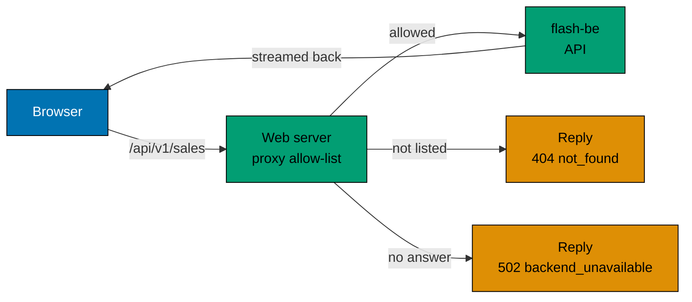

# The web server in front of the API

The page never calls `flash-be` itself. Every request goes to the web app's own server under `/api/v1/sales` or `/api/v1/auth`, and the
server passes it on, with the login cookies. This page gives the reasons and what it costs.

## Why not call the API from the browser

- **The address stays private.** `FLASH_BE_URL` is read on the server only. The page, its scripts and its data never
  contain it, so the API can sit on a private network. A scenario checks that the rendered page does not hold the
  address.
- **One origin.** The browser makes same-origin requests, so no CORS rules are needed and none can be got wrong.
- **One place to narrow the surface.** The server passes on a short list of method and path pairs (`BROWSER_ROUTES` in
  [`apps/flash-web/src/api-paths.ts`](../../apps/flash-web/src/api-paths.ts), which
  [`proxy.ts`](../../apps/flash-web/src/proxy.ts) turns into its allow-list) and nothing else, so a path such as
  `../ready` cannot be used to reach other routes. The operator routes (`/api/v1/admin/sales` with POST, GET, PATCH and
  DELETE) are not on the list. A sale id must be a UUID, or the answer is `404 not_found`. The server also sends on only
  the headers the API needs (the `cookie` header among them). The browser and the API use the same paths, so the path
  and the cookies pass unchanged. A POST from another origin is refused with `403 cross_site`.

## What it costs

Each request has one more hop. The server streams the answer back as it arrives, so event streams are not buffered and
a stream closes upstream when the browser leaves. The extra hop shows up in latency, not in correctness. The web server
is stateless, so more copies can run behind a load balancer.

## What the page does

The page renders on the server from the current sale, then follows the sale stream. What it does for a shopper, step by
step, is in its [behaviour scenarios](../../specs/apps/flash/web/behaviours/README.md) and the
[tutorial](../tutorials/run-flash-sale-locally.md#8-sign-up-and-buy-an-item).

## What the page checks itself

Names are checked in the page with the same pattern the API uses, so a bad name never leaves the browser. The web app
keeps its own copy of the user name and password rules, the ticket header and the `not_found` reply; [`same_as_be_tests.ts`](../../apps/flash-web/src/same_as_be_tests.ts) fails if a copy drifts from
`flash-be`. The sale id rule is not copied: both apps take `isUuid` from `@flash/flash-commons`.

## Related

- [Live updates](live-updates.md): the streams the page follows.
- [Waiting queue](waiting-queue.md): how a place becomes an admission.
- [HTTP endpoints](../reference/http-endpoints.md#the-sale-routes): the allowed paths.
