# Add a behaviour

First check that it is a behaviour: a shopper or an operator would see the difference if it broke. If only a developer
cares, write a plain test next to the code instead (see [scenario or plain test](../explanation/scenario-or-plain-test.md)).

Write the scenario first. Then bind it to the tests, so each layer proves what it can. Only the apps use scenarios, so this
guide applies to `apps/` only. It uses `flash-be`.
The steps are the same for `flash-web`, with its own folders.

```mermaid
flowchart LR
  accTitle: Add a behaviour
  accDescr: Write the scenario first. Then bind it at the unit layer, which is always required, then at the integration layer and the end-to-end layer unless a layer is exempt with a reason. Finish with the behaviour check, which fails when a binding is missing.
  write["1 Write the scenario"]
  unit["2 Bind unit"]
  integ["3 Bind integration"]
  e2e["4 Bind end-to-end"]
  check["6 npm run bdd:check"]
  exempt["5 Exempt, with a reason"]
  write --> unit --> integ --> e2e --> check
  integ -.->|cannot prove it| exempt
  e2e -.->|cannot prove it| exempt
  exempt -.-> check
  classDef step fill:#0173B2,stroke:#000000,color:#FFFFFF
  classDef gate fill:#029E73,stroke:#000000,color:#000000
  classDef warn fill:#DE8F05,stroke:#000000,color:#000000
  classDef default fill:#808080,stroke:#000000,color:#000000
  class write,unit,integ,e2e step
  class check gate
  class exempt warn
```



## 1. Write the scenario

Add it to a feature file under `specs/apps/flash/be/behaviours/`. Put it in the folder for its area, for example
`health/` or `queue/`. If the folder has no feature file for this behaviour yet, create one and link it from the
folder's `README.md`:

```markdown
- [shutdown.feature](shutdown.feature) - what the API does when it is asked to stop.
```

Every `.feature` file must be linked from the `README.md` next to it. The check fails without the link.

## 2. Bind the unit layer

Every scenario needs a unit binding. Add it to `apps/flash-be/src/bdd/<area>_tests.ts`. The title must match the
scenario title exactly:

```ts
describeFeature(
	await loadFeature(specFile("flash/be/behaviours/health/shutdown.feature")),
	({ Scenario }) => {
		Scenario("The API stops when asked", ({ Given, When, Then }) => {
			// Steps go here.
		});
	},
);
```

When the unit and integration layers run the same steps, write the steps once in
`apps/flash-be/src/bdd/support/bind-<area>.ts`. A binder takes a function that builds the layer's world and returns
one step function per scenario. Each test file then names the scenarios and passes the steps in, as
`queue_joining_tests.ts` does:

```ts
const steps = bindQueueJoining(unitShopLayer());

describeFeature(
	await loadFeature(specFile("flash/be/behaviours/queue/joining.feature")),
	({ Scenario }) => {
		Scenario(
			"Joining the queue returns a ticket and a place",
			steps.returnsTicket,
		);
	},
);
```

The shared checks (`statusIs`, `errorIs`) are in `support/steps.ts`, and the shared Given steps of a sale and a
shopper are in `support/shop-steps.ts`, `auth-steps.ts` and `operator-steps.ts`. Keep a step in the test file when
the two layers check different things, as the `db` and `seeding` bindings do.

Run the unit tests:

```bash
npx nx test:unit flash-be
```

## 3. Bind the integration layer

Unless the scenario is tagged `@integration-exempt`, bind it in `apps/flash-be/src/bdd/<area>_integration_tests.ts`.
Integration tests use the real Postgres and Redis from the dev stack. Start the stack first:

```bash
npx nx db:up flash-be
npx nx test:integration flash-be
```

## 4. Bind the end-to-end layer

Unless the scenario is tagged `@e2e-exempt`, its steps must match a step definition in `apps/flash-be-e2e/steps/`.
Each step is a regex or exact text. Run the browser-less API tests:

```bash
npx nx test:e2e flash-be-e2e
```

## 5. Exempt a layer only with a reason

If a layer cannot prove the scenario, tag it and write the comment directly above the tag. The format is fixed:

```gherkin
# Exemption(e2e): <why this layer cannot prove it>; alternative-proof: flash-be:integration / <scenario name>
@e2e-exempt
Scenario: The API stops when asked
```

The alternative proof must name a scenario that is bound at a different layer. The unit layer cannot be exempt.
Do not exempt a layer because the tests are slow or the work is not finished.

## 6. Check the corpus

```bash
npm run bdd:check
```

The check prints `behaviour coverage: N/N (100%)` when every scenario is bound. It also writes
`generated-reports/behaviour-status.md`, which lists each scenario and its layers. The check runs in the pre-push hook.
