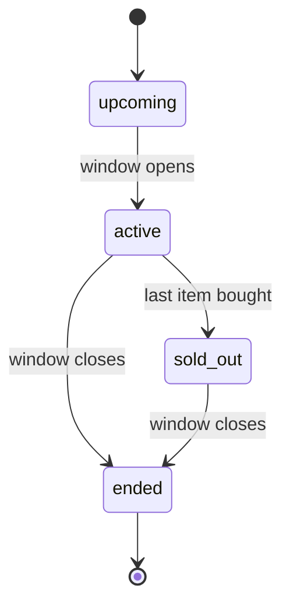
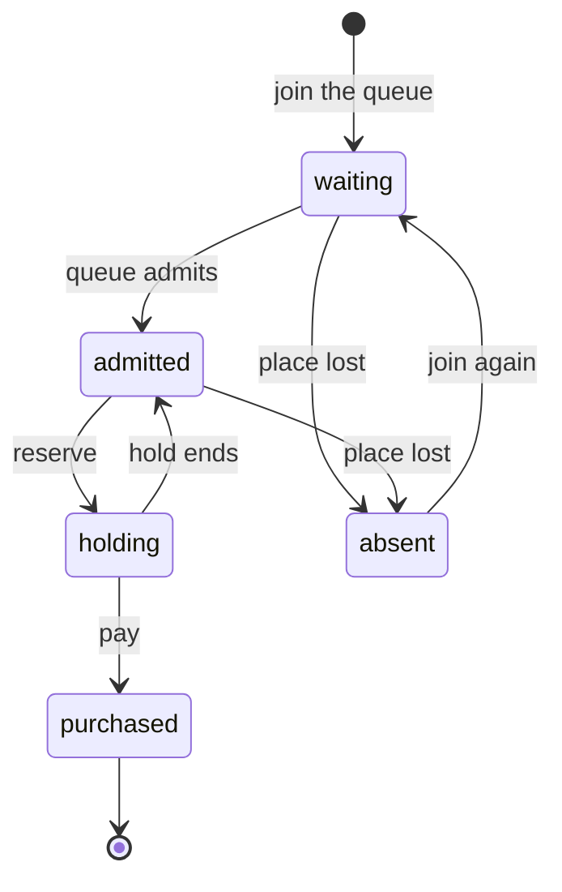
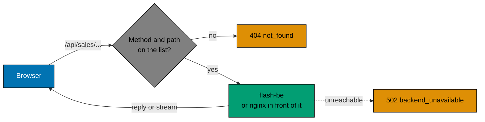

# HTTP endpoints

The routes of the two services, the shape of their replies, and the rules that a shape cannot say. The API routes are
registered in [`apps/flash-be/src/adapters/inbound/http/routes/`](../../apps/flash-be/src/adapters/inbound/http/routes), one file per area, and the error codes with their
statuses and sentences are in [`adapters/inbound/http/errors.ts`](../../apps/flash-be/src/adapters/inbound/http/errors.ts). The web routes are in [`apps/flash-web/src/routes/`](../../apps/flash-web/src/routes).

Every error is `{"errorCode": "<code>", "errorMessage": "<sentence>"}`, whether the route refused the request, the route
does not exist (`404` `not_found`), the body is not JSON (`400` `invalid_request`) or the server failed (`500` `internal`).
The status is the HTTP status of the reply and is not repeated in the body. `errorMessage` is one fixed English sentence per
code, for a developer. A `500` never says what failed; the cause goes to the log. A `429` also has `retryAfterSeconds`.

```json
{ "errorCode": "sold_out", "errorMessage": "No items are left." }
```

## flash-be (API, port 8080)

| Method | Path                             | Checks             | Notes                                                       |
| ------ | -------------------------------- | ------------------ | ----------------------------------------------------------- |
| GET    | `/health`                        | none; no I/O       | always `200`                                                |
| GET    | `/ready`                         | Postgres and Redis | `200`, or `503` when a check fails                          |
| GET    | `/sales/current`                 | Postgres           | `404` `sale_not_found` when no sale is running or ahead     |
| GET    | `/sales/:saleId`                 | Postgres           | `404` `sale_not_found` for an unknown or malformed id       |
| GET    | `/sales/:saleId/events`          | Postgres           | event stream of the sale (see Live updates)                 |
| POST   | `/sales/:saleId/queue`           | Postgres, Redis    | `201` on a new place, `200` when the user already has one   |
| GET    | `/sales/:saleId/queue/me`        | Postgres, Redis    | needs a login and the `x-queue-ticket` header               |
| GET    | `/sales/:saleId/queue/me/events` | Postgres, Redis    | event stream of a place; needs a login and `x-queue-ticket` |
| POST   | `/sales/:saleId/reservations`    | Postgres, Redis    | `201` on a new hold, `200` when the user already holds one  |
| POST   | `/sales/:saleId/purchases`       | Postgres, Redis    | `201` on a new purchase, `200` when it was already paid     |
| GET    | `/sales/:saleId/purchases/me`    | Postgres           | "did I get it?": a purchase, a live hold, or nothing        |
| POST   | `/auth/register`                 | Postgres, Redis    | makes a shopper account and logs it in (`201`)              |
| POST   | `/auth/login`                    | Postgres, Redis    | checks the password and sets the two cookies                |
| POST   | `/auth/refresh`                  | Postgres, Redis    | trades the refresh token for a new pair                     |
| POST   | `/auth/logout`                   | Postgres, Redis    | ends the session and clears the cookies                     |
| GET    | `/auth/me`                       | Postgres, Redis    | who the cookie says you are                                 |
| POST   | `/admin/sales`                   | Postgres           | operator only; needs the login of an operator               |
| GET    | `/admin/sales`                   | Postgres           | operator only; every sale, the one that opens last first    |
| PATCH  | `/admin/sales/:saleId`           | Postgres           | operator only; changes a sale (see the rules below)         |
| DELETE | `/admin/sales/:saleId`           | Postgres           | operator only; removes a sale that has no purchase          |

Every route under `/sales/:saleId` that writes or reads a shopper's own state needs a login (see
[Accounts and login](#accounts-and-login)). The shopper is the account the cookie belongs to, so no route takes a user id
in its path or body.

### Reply bodies

All bodies are JSON. Dates are ISO strings.

| Route                                                                           | Success body                                                                                                                                 |
| ------------------------------------------------------------------------------- | -------------------------------------------------------------------------------------------------------------------------------------------- |
| `GET /health`                                                                   | `{ "status": "ok" }`                                                                                                                         |
| `GET /ready`                                                                    | `{ "status": "ok" \| "unavailable", "checks": { "database": "ok" \| "error", "redis": "ok" \| "error" } }`                                   |
| `GET /sales/current`, `GET /sales/:saleId`                                      | `{ "id", "productId", "name", "status", "startsAt", "endsAt", "stock", "remaining" }` (a `SaleView`)                                         |
| `POST /sales/:saleId/queue`                                                     | `{ "userId", "ticket", "state": "waiting", "place" }` or `{ "userId", "ticket", "state": "admitted" }`                                       |
| `GET /sales/:saleId/queue/me`                                                   | `{ "userId", "state": "waiting", "place" }`, `{ "userId", "state": "admitted" }` or `{ "userId", "state": "absent" }`                        |
| `POST /sales/:saleId/reservations`                                              | `{ "userId", "reservationId", "expiresAt" }`                                                                                                 |
| `POST /sales/:saleId/purchases`                                                 | `{ "userId", "purchaseId", "reservationId", "purchasedAt" }`                                                                                 |
| `GET /sales/:saleId/purchases/me`                                               | `{ ...purchase, "state": "purchased" }`, `{ "userId", "state": "holding", "reservationId", "expiresAt" }` or `{ "userId", "state": "none" }` |
| `POST /auth/register`, `POST /auth/login`, `POST /auth/refresh`, `GET /auth/me` | `{ "username", "role" }` (the tokens are in the cookies only)                                                                                |
| `POST /auth/logout`                                                             | `{}`                                                                                                                                         |
| `POST /admin/sales`, `PATCH /admin/sales/:saleId`                               | a `SaleView`                                                                                                                                 |
| `GET /admin/sales`                                                              | `{ "sales": [...] }`: each sale is a `SaleView` with `"sold"`, `"holdSeconds"` and `"admitPerSecond"` added                                  |
| `DELETE /admin/sales/:saleId`                                                   | `{ "id" }`                                                                                                                                   |

`"userId"` in a reply is the user name of the account. Request bodies: the queue and reservation routes take none; a
purchase takes `{ "reservationId" }`; `register` and `login` take `{ "username", "password" }`. `register` refuses a
missing or wrong field with `400` and the code of that field (`invalid_user`, `invalid_password`); `login` answers any
body it cannot read with `401` `invalid_credentials`, so it never says which part was wrong. A purchase body without a
string `reservationId` is `400` `invalid_reservation`, after the rate limit and the login check. The ticket goes in the `x-queue-ticket` header.

`/ready` returns `503` when a check fails. Each failing check is `"error"`, and `status` is `"unavailable"`. For
example, with Postgres stopped:

```json
{ "status": "unavailable", "checks": { "database": "error", "redis": "ok" } }
```

## Accounts and login

A shopper signs up with a user name and a password, and an operator logs in the same way. A login is a session, kept in
two cookies. Both are `HttpOnly` (a script on the page cannot read them) and `SameSite=Lax`, and both are `Secure` when
`COOKIE_SECURE` is `true` (the default in production). The tokens are never in a body.

| Cookie          | Lives for  | Sent to | What it does                                                            |
| --------------- | ---------- | ------- | ----------------------------------------------------------------------- |
| `access_token`  | 15 minutes | `/`     | goes with every request and says who you are                            |
| `refresh_token` | 7 days     | `/auth` | only trades itself for a new pair; each use replaces it (it is rotated) |

`POST /auth/register` and `POST /auth/login` take `{ "username", "password" }`, set both cookies and answer with
`{ "username", "role" }` (`201` for a new account, `200` for a login). A user name is trimmed and lowercased, then must
match `[a-z0-9][a-z0-9._@+-]{0,63}`. A password has 8 to 128 characters. `POST /auth/refresh` reads the refresh cookie and
sets a new pair. When the old refresh token is used a second time, the whole session ends, because someone else holds a
copy. `POST /auth/logout` ends the session, clears the cookies and is safe to send twice. `GET /auth/me` answers who you
are, or `401`.

Only a hash of each token is stored (SHA-256), and only a scrypt hash of each password. A session row also keeps the
address and the user agent of the login. Why it is built this way is in [authentication](../explanation/authentication.md).

| Status | `errorCode`             | When                                                                                      |
| ------ | ----------------------- | ----------------------------------------------------------------------------------------- |
| `400`  | `invalid_user`          | sign-up only: the user name is missing or does not match the rule above                   |
| `400`  | `invalid_password`      | the password is missing or has fewer than 8 or more than 128 characters                   |
| `401`  | `invalid_credentials`   | the name or the password is wrong (the same answer for both, so a name cannot be guessed) |
| `401`  | `invalid_refresh_token` | the refresh cookie is missing, expired or already used; the cookies are cleared           |
| `401`  | `not_authenticated`     | the route needs a login and the access cookie is missing or has ended                     |
| `403`  | `forbidden`             | the account is a shopper and the route is for operators                                   |
| `409`  | `username_taken`        | an account with this name exists                                                          |
| `429`  | `rate_limited`          | too many tries from one address (`AUTH_RATE_LIMIT_PER_IP`, 20 per window)                 |

The first operator cannot sign up through the API. It is made on the server with
`npx nx db:create-operator flash-be --username=<name> --password=<password>` (or `node dist/create-operator.js` in the
image). The scenarios are in [`specs/apps/flash/be/behaviours/auth/`](../../specs/apps/flash/be/behaviours/auth/README.md).

## The sale

`GET /sales/current` and `GET /sales/:saleId` answer with the same body (`SaleView`).

The current sale is the sale whose window holds the present moment. When none is running, it is the one that opens next.
When none is running or ahead, `GET /sales/current` answers `404` `sale_not_found`. A sale that has ended is not current
any more, but `GET /sales/:saleId` still reads it, with `status` `ended`. `remaining` is `stock` minus the items already sold, never below `0`.

| `status`   | When                                                     |
| ---------- | -------------------------------------------------------- |
| `upcoming` | the sale has not opened yet                              |
| `active`   | the window is open and items remain                      |
| `sold_out` | the window is open and no item remains                   |
| `ended`    | the window has closed, whether or not the stock sold out |



The scenarios are in [`specs/apps/flash/be/behaviours/sale/status.feature`](../../specs/apps/flash/be/behaviours/sale/status.feature).

### Caching

Both sale reads come from a short in-process cache. `SALE_CACHE_MS` sets its time (1000 by default, 0 turns it off). A
cached `200` carries `Cache-Control: public, max-age=<seconds>`, rounded up. A `404` is never cached, and the write
routes never read the cache. Why `remaining` may be that old is in [the sale read cache](../explanation/sale-read-cache.md).

The scenarios are in [`specs/apps/flash/be/behaviours/sale/caching.feature`](../../specs/apps/flash/be/behaviours/sale/caching.feature).

## Creating a sale (operator)

`POST /admin/sales` creates a sale from a stock and a window, so an operator needs no shell on the server. The web
server never passes the operator routes on, so they are reached on the API port only.

```json
{
	"stock": 100,
	"startsAt": "2026-06-01T12:00:00.000Z",
	"endsAt": "2026-06-01T13:00:00.000Z"
}
```

`name` (default `Flash sale`), `productId` (a product that exists; default: the product with that `name`, made if there
is none),
`holdSeconds` (default `120`) and `admitPerSecond` (default `50`) are optional. The reply is `201` with the new sale
(`SaleView`).

| Status | `errorCode`         | When                                                                                                                                                          |
| ------ | ------------------- | ------------------------------------------------------------------------------------------------------------------------------------------------------------- |
| `401`  | `not_authenticated` | there is no login, or the access cookie has ended                                                                                                             |
| `403`  | `forbidden`         | the account is a shopper                                                                                                                                      |
| `400`  | `invalid_sale`      | the stock, hold or admission rate is not a positive whole number, the window is empty, the name is empty or over 120 characters, or `productId` is not a UUID |
| `404`  | `product_not_found` | `productId` names no product                                                                                                                                  |
| `409`  | `sale_overlaps`     | the window overlaps the window of another sale (a window may open when another closes)                                                                        |
| `429`  | `rate_limited`      | too many tries from one address; the login is checked after the count                                                                                         |

The login is checked before the body is read. The scenarios are in
[`specs/apps/flash/be/behaviours/sale/admin.feature`](../../specs/apps/flash/be/behaviours/sale/admin.feature). See
[admin and sale windows](../explanation/admin-and-sale-windows.md) for where the overlap rule stops.

## Changing a sale (operator)

`PATCH /admin/sales/:saleId` changes the fields that are in the body and keeps the others. Every field is optional, but
at least one must be there: `name`, `stock`, `startsAt`, `endsAt`, `holdSeconds` and `admitPerSecond`, with the same types
and limits as when the sale is created. The reply is `200` with the changed sale (`SaleView`).

| When the sale is | What may change                                                                                    |
| ---------------- | -------------------------------------------------------------------------------------------------- |
| not started yet  | every field                                                                                        |
| running          | `stock` (only up, never below the stock it has), `endsAt`, `name`, `holdSeconds`, `admitPerSecond` |
| over             | nothing                                                                                            |

A new `stock` or `holdSeconds` applies to the next reservation at once. Holds that exist keep the time they were given.

| Status | `errorCode`         | When                                                                                 |
| ------ | ------------------- | ------------------------------------------------------------------------------------ |
| `401`  | `not_authenticated` | there is no login, or the access cookie has ended                                    |
| `403`  | `forbidden`         | the account is a shopper                                                             |
| `400`  | `invalid_sale`      | the body has no field, a field has the wrong type, or the sale would not be valid    |
| `404`  | `sale_not_found`    | no sale has this id, or the id is not a UUID                                         |
| `409`  | `sale_locked`       | the sale is over, or it is running and the change moves `startsAt` or lowers `stock` |
| `409`  | `sale_overlaps`     | the new window overlaps another sale                                                 |
| `429`  | `rate_limited`      | too many tries from one address; the login is checked after the count                |

The scenarios are in
[`specs/apps/flash/be/behaviours/sale/operating.feature`](../../specs/apps/flash/be/behaviours/sale/operating.feature).

## Removing a sale (operator)

`DELETE /admin/sales/:saleId` removes a sale, with the holds on it. The reply is `200` with `{ "id": "<saleId>" }`. Nothing
is deleted from the database: the sale and its holds get `deleted_at` and `deleted_by` (the operator), and no read
returns them any more. A sale that has a purchase is never removed, because the shopper has paid: the answer is `409`
`sale_has_purchases`. The other errors are the login errors above, `404` `sale_not_found` and `429` `rate_limited`.

## Listing sales (operator)

`GET /admin/sales` answers `200` with `{ "sales": [...] }`: every sale, the one that opens last first, with the numbers
that only an operator needs (`sold`, `holdSeconds`, `admitPerSecond`). It has no paging.

## The waiting queue

Shoppers join a queue before they can reserve. The queue admits them in order, at the rate set on the sale
(`admit_per_second`, 50 by default).

`POST /sales/:saleId/queue` (the shopper is the account that is logged in) answers with the place and a `ticket`.
`GET /sales/:saleId/queue/me` with the header `x-queue-ticket: <ticket>` answers with the place.

`state` is `waiting` (with `place`, counted from 1) or `admitted`. An admission stays valid for
`ADMISSION_TTL_SECONDS` (600 by default).

Joining again returns the same place and the same ticket.

| Status | `errorCode`         | When                                                                                    |
| ------ | ------------------- | --------------------------------------------------------------------------------------- |
| `401`  | `not_authenticated` | there is no login                                                                       |
| `401`  | `invalid_ticket`    | the ticket is missing or is not the one issued for this sale and user                   |
| `404`  | `sale_not_found`    | the sale id is unknown or malformed                                                     |
| `404`  | `not_in_queue`      | the ticket is right but the queue has no place for the user (join again)                |
| `409`  | `sale_ended`        | the window has closed; the queue takes no new shoppers                                  |
| `409`  | `sold_out`          | no item remains; the queue takes no new shoppers                                        |
| `429`  | `rate_limited`      | the join was sent too often (see the rate limits); `Retry-After` says when to try again |

The scenarios are in [`specs/apps/flash/be/behaviours/queue/`](../../specs/apps/flash/be/behaviours/queue/README.md).

## Reservations

An admitted shopper holds one item for the sale's hold time (`reservation_ttl_seconds`, 120 by default).

`POST /sales/:saleId/reservations` needs a login and the header `x-queue-ticket: <ticket>`, and answers with the
`reservationId` and when the hold ends (`expiresAt`).

Asking again while the hold lasts returns `200` with the same body. A hold that has expired stops counting at once, and
the item can go to someone else.

| Status | `errorCode`         | When                                                                       |
| ------ | ------------------- | -------------------------------------------------------------------------- |
| `401`  | `not_authenticated` | there is no login                                                          |
| `401`  | `invalid_ticket`    | the ticket is missing or is not the one issued for this sale and user      |
| `403`  | `not_admitted`      | the user is still waiting, or has no place in the queue and has not bought |
| `404`  | `sale_not_found`    | the sale id is unknown or malformed                                        |
| `409`  | `sale_not_started`  | the window has not opened yet                                              |
| `409`  | `sale_ended`        | the window has closed                                                      |
| `409`  | `sold_out`          | no item is free: sold items plus live holds fill the stock                 |
| `409`  | `already_purchased` | the user already bought an item in this sale                               |
| `429`  | `rate_limited`      | too many requests from this user or this address (see Rate limits)         |
| `503`  | `unavailable`       | the reservation state could not be rebuilt in time; try again              |

A sale that is not selling answers before the ticket is checked. The scenarios are in
[`specs/apps/flash/be/behaviours/reservation/`](../../specs/apps/flash/be/behaviours/reservation/README.md).

## Purchases

`POST /sales/:saleId/purchases` pays for the held item of the shopper who is logged in. The body holds the reservation id
from the reservation reply: `{ "reservationId" }`.

The reservation id is the idempotency key. Sending the same request again returns `200` with the same purchase, and the
shopper is charged once.

`purchaseId` is the id of the purchase row. flash-web shows it to the shopper as the **Purchase ID**, the number to keep.
The payment reference stays in the database for refunds and is not in any reply.

| Status | `errorCode`             | When                                                                                              |
| ------ | ----------------------- | ------------------------------------------------------------------------------------------------- |
| `400`  | `invalid_reservation`   | the reservation id is missing or is not an id                                                     |
| `401`  | `not_authenticated`     | there is no login                                                                                 |
| `402`  | `payment_failed`        | the payment provider declined; the hold stays, so the shopper can try again until it ends         |
| `404`  | `sale_not_found`        | the sale id is unknown or malformed                                                               |
| `404`  | `reservation_not_found` | no hold of this user has this id (also for somebody else's reservation id)                        |
| `409`  | `hold_expired`          | the hold ended before the payment started                                                         |
| `409`  | `already_purchased`     | the user already bought an item in this sale                                                      |
| `409`  | `sale_ended`            | the window has closed                                                                             |
| `409`  | `sold_out`              | the hold ended during the payment and the last item went to someone else; the payment is refunded |
| `429`  | `rate_limited`          | too many requests from this user or this address (see Rate limits)                                |

`GET /sales/:saleId/purchases/me` answers "did I get it?" for the shopper who is logged in (`401` `not_authenticated`
without a login). `state` is one of:

| `state`     | Meaning                                              |
| ----------- | ---------------------------------------------------- |
| `purchased` | the shopper bought an item; the body is the purchase |
| `holding`   | the shopper holds an item that has not expired       |
| `none`      | nothing, also when the hold has expired              |

The scenarios are in [`specs/apps/flash/be/behaviours/purchase/`](../../specs/apps/flash/be/behaviours/purchase/README.md).

## A shopper's path

The three reads (`queue/me`, `purchases/me` and the place stream) report where the shopper is on this path.



## Live updates (Server-Sent Events)

| Method | Path                             | What it streams                                                                                  |
| ------ | -------------------------------- | ------------------------------------------------------------------------------------------------ |
| GET    | `/sales/:saleId/events`          | `event: sale`, with the same body as `GET /sales/:saleId`                                        |
| GET    | `/sales/:saleId/queue/me/events` | `event: place`, with the body of `GET /sales/:saleId/queue/me`; log in and send `x-queue-ticket` |

A frame is `event: <name>`, `data: <JSON>` and a blank line.

Both answer `Content-Type: text/event-stream`. The first event comes at once. Later events come only when the data
changed, checked every `EVENTS_INTERVAL_MS` (1000). When nothing changes for 15 seconds, a `: keep-alive` comment line is
sent. If the sale, the user or the ticket is wrong, the answer is a normal JSON error (such as `404 sale_not_found` or
`401 invalid_ticket`) and no stream opens. If a shopper's place is lost while watching, the stream sends `{"userId":"<name>","state":"absent"}`.

The scenarios are in [`specs/apps/flash/be/behaviours/events/`](../../specs/apps/flash/be/behaviours/events/README.md).

## Rate limits

The three write routes (`POST .../queue`, `POST .../reservations` and `POST .../purchases`) count each request against
the user who is logged in and against the client address. Reads are not limited. The `/admin` routes are counted by address only, before the login is read, so a wrong guess is
counted too. The `/auth` write routes have a limit of their own per address (`AUTH_RATE_LIMIT_PER_IP`, 20), so a crowd that signs up does not use the sale limit up, and a password cannot be guessed at speed. When either count passes its limit in
the current window, the answer is `429` `rate_limited`, with `retryAfterSeconds` in the body and a `Retry-After` header that
holds the same number of seconds (at least 1). The window starts at
the first request, not at a fixed clock tick. The limits are `RATE_LIMIT_PER_USER` (30), `RATE_LIMIT_PER_IP` (600) and
`RATE_LIMIT_WINDOW_SECONDS` (10). Set `TRUST_PROXY=true` only behind a proxy you control, so that the client address is
read from `X-Forwarded-For`.

The scenarios are in [`specs/apps/flash/be/behaviours/rate-limit/`](../../specs/apps/flash/be/behaviours/rate-limit/README.md).

## While Redis is down

`POST .../queue` answers `200` with a ticket and `"state":"admitted"`, `GET .../queue/me` answers `admitted` for a
valid ticket, and reservations are decided by Postgres alone. `GET /ready` answers `503` with `"redis":"error"`. The rest
of the API behaves as usual. See [serving without Redis](../explanation/serving-without-redis.md).

The scenarios are in [`specs/apps/flash/be/behaviours/degraded/`](../../specs/apps/flash/be/behaviours/degraded/README.md).

## flash-web (port 3000)

| Method    | Path           | Response                                                                                                                                       |
| --------- | -------------- | ---------------------------------------------------------------------------------------------------------------------------------------------- |
| GET       | `/`            | HTML page. It shows the current sale, a login form or Buy Now, and `Backend: ok` when `flash-be` answers `GET /health` with `{"status":"ok"}`. |
| GET       | `/api/health`  | `200` `{"status":"ok"}`                                                                                                                        |
| GET, POST | `/api/sales/*` | The routes below, passed on to `flash-be`. Any other `GET` or `POST` under this path answers `404` with `errorCode` `not_found`.               |
| GET, POST | `/api/auth/*`  | The login routes below, passed on to `flash-be`, with the cookies.                                                                             |

### The sale routes

The browser reaches the sale and the login only through `/api/sales` and `/api/auth`. The web server passes each request to `flash-be` at
`/sales/...` and sends the answer back, including event streams. The allowed method and path pairs are:

| Method | Path under `/api/sales`    | Passed to              |
| ------ | -------------------------- | ---------------------- |
| GET    | `/current`                 | the current sale       |
| GET    | `/:saleId`                 | one sale               |
| GET    | `/:saleId/events`          | the sale event stream  |
| POST   | `/:saleId/queue`           | join the waiting queue |
| GET    | `/:saleId/queue/me`        | a place in the queue   |
| GET    | `/:saleId/queue/me/events` | the place event stream |
| POST   | `/:saleId/reservations`    | hold an item           |
| POST   | `/:saleId/purchases`       | pay for the held item  |
| GET    | `/:saleId/purchases/me`    | "did I get it"         |

Under `/api/auth` the pairs are `POST /register`, `POST /login`, `POST /refresh`, `POST /logout` and `GET /me`. The
operator routes are in no list: `/api/admin/...` is not passed on and answers the page's `404` (HTML, not JSON).

A request is refused at once with `404 not_found`, and `flash-be` is not asked, when its method and path are not in the
table, or when a sale id is not a UUID. A `POST` that a browser sends from another site is refused with `403`
`cross_site` (its `Origin` is not this host), as a second lock beside `SameSite=Lax`.



Only `content-type`, `accept`, `cookie`, `x-queue-ticket` and `x-forwarded-for` are sent on. Only `content-type`,
`cache-control`, `retry-after` and every `set-cookie` come back. The refresh cookie is set for `/auth` by `flash-be`, and
the web server moves it to `/api/auth`, the path the browser really calls. When `flash-be` cannot be reached the answer is `502`
with `errorCode` `backend_unavailable`. The address of `flash-be` is read on the server and never reaches the page. See
[the web server in front of the API](../explanation/web-server-proxy.md).

The scenarios are in [`specs/apps/flash/web/behaviours/proxy/`](../../specs/apps/flash/web/behaviours/proxy/README.md) and
[`sale/`](../../specs/apps/flash/web/behaviours/sale/README.md).

## Configuration

Environment variables are listed in [`.env.example`](../../.env.example), with a comment for each one. The defaults for
local development are there too. [`apps/flash-be/src/config.ts`](../../apps/flash-be/src/config.ts) builds the API configuration from them. In production,
the API stops at start-up when `DATABASE_URL`, `REDIS_URL` or `TICKET_SECRET` is missing. `PAYMENT_LATENCY_MS` (150) and
`PAYMENT_FAILURE_RATE` (0.02) tune the mock payment provider. The `RATE_LIMIT_*` and `TRUST_PROXY` variables tune the
rate limits. `SALE_CACHE_MS` (1000) sets the sale read cache. `EVENTS_INTERVAL_MS` (1000) sets how often an event stream reads. `AUTH_RATE_LIMIT_PER_IP` (20) limits the `/auth`
routes per address. `COOKIE_SECURE` (`true` in production) puts `Secure` on the login cookies; set it to `false` only to try the
stack over plain HTTP.

## Manual requests

Three files at the root hold requests in the [kulala.nvim](https://github.com/wahidyankf/kulala.nvim) format. A request
named with `# @name` keeps its reply, so later requests read the sale id, the ticket and the reservation id from it, and
a `Shared` block attaches kulala's cookie jar to every request, so a login is kept. To send them, open a file in Neovim
with the kulala.nvim plugin installed.

| File                                               | What it holds                                                           |
| -------------------------------------------------- | ----------------------------------------------------------------------- |
| [`api-flash-be.http`](../../api-flash-be.http)     | every route of the API, one request each                                |
| [`api-flash-web.http`](../../api-flash-web.http)   | every route the web server passes on, and what it refuses               |
| [`api-flash-demo.http`](../../api-flash-demo.http) | the demo story in order (see [run the demo](../how-to/run-the-demo.md)) |

The operator account is made first with `npx nx db:create-operator flash-be --username=<name> --password=<password>`
or `npm run demo:setup`, which makes `ops` (see [seed a sale](../how-to/seed-a-sale.md)).
