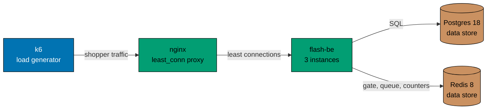

# Load test

Facts about the load test in `apps/flash-load`: the stack, the profiles, the limits a run must meet and the checks that
decide whether it passed. To run it, see [how-to: run the load test](../how-to/run-the-load-test.md).

## The stack

`apps/flash-load/compose.yaml` starts Postgres 18, Redis 8 (no snapshots), a migration job, three `flash-be` instances
and nginx with `least_conn`. k6 runs as a container on the same network and reaches nginx by name. nginx publishes one
port on the loopback address only. Each instance runs with the product defaults for payment (150 ms, 2 percent
declined), rate limits (30 per user and 600 per address in 10 seconds) and the sale cache (1 second). `TRUST_PROXY` is
on, so each virtual shopper gets an address of their own through `X-Forwarded-For`.

## Profiles

| Profile | Stock | Shoppers | Arrival rate | Late | Hold | Admission | Notes                                  |
| ------- | ----- | -------- | ------------ | ---- | ---- | --------- | -------------------------------------- |
| smoke   | 20    | 500      | 50 a second  | 50   | 10 s | 100 a sec | Short enough to run in a few minutes   |
| full    | 100   | 5,000    | 250 a second | 100  | 10 s | 300 a sec | Many more shoppers than items          |
| chaos   | 1,000 | 2,000    | 100 a second | 150  | 10 s | 200 a sec | Redis stops at +4 s and starts at +9 s |

The numbers live in [`apps/flash-load/k6/profiles.ts`](../../apps/flash-load/k6/profiles.ts), which both k6 and the
runner read. Shoppers arrive at a fixed rate, one new shopper per iteration, so the load does not slow down when the
system does. Each shopper joins the queue, waits to be admitted, reserves once, usually confirms, and asks "did I get
it". A waiting shopper also reads the sale and gives up when it is sold out or ended. One shopper in twenty walks away
with a hold. One in five of those who bought presses confirm and reserve again. "Late" shoppers arrive ten a second,
once every hold has lapsed, and take the items that abandoned holds gave back. Ten to twenty extra users flood the queue
to show that they get `429`, not an error.

The chaos stock is 1,000 so that Redis is stopped while items are still for sale. With a small stock the sale is over
before the stop and the run proves nothing.

## Limits

These were written down before the first run and are not changed to make a run pass.

| Measure                       | Limit        | Applies to     |
| ----------------------------- | ------------ | -------------- |
| Reserve, 95th percentile      | under 300 ms | smoke and full |
| Purchase, 95th percentile     | under 500 ms | smoke and full |
| Server errors (5xx, no reply) | 0            | smoke and full |

The purchase time includes the 150 ms of the mock payment. The chaos profile is not judged on these limits, because a
stopped Redis may fail the few requests that were in flight. k6 still reports its numbers, and
[explanation: what the load runs found](../explanation/load-test-findings.md) reads them.

## Checks

The runner decides the verdict from Postgres and Redis, then compares k6 with them.

| Check                                     | Passes when                                        |
| ----------------------------------------- | -------------------------------------------------- |
| No oversell                               | `sales.sold` is at most the stock                  |
| Sold count is true                        | `sales.sold` equals the number of `purchases` rows |
| One item per user                         | no user has more than one purchase                 |
| k6 and Postgres agree                     | the purchases k6 saw confirmed equal the rows      |
| The stock sold out                        | `sales.sold` equals the stock                      |
| Floods are limited                        | k6 saw replies of `429` from the flooding users    |
| Redis and Postgres agree (smoke and full) | the size of the Redis buyers set equals the rows   |
| Speed and errors (smoke and full)         | the three limits above hold                        |

A failed check is a finding about the system, to be investigated. It is not a reason to change a limit.

## Output

Each run writes to `generated-reports/load/` (ignored by Git): `<profile>.md` with the table above, `<profile>-k6.json`
with the k6 summary and `<profile>-k6.log` with the k6 output.
