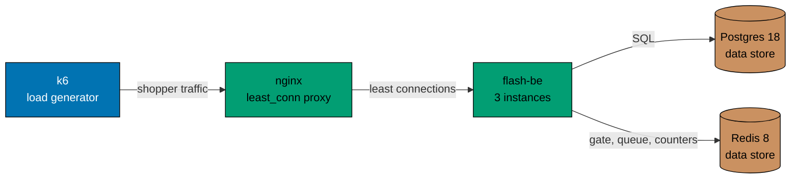

# Load test

Facts about the load test in `apps/flash-load`: the stack, the profiles, the limits a run must meet and the checks that
decide whether it passed. To run it, see [how-to: run the load test](../how-to/run-the-load-test.md).

## The stack

[`apps/flash-load/compose.yaml`](../../apps/flash-load/compose.yaml) starts Postgres 18, Redis 8 (no snapshots), a migration job, three `flash-be` instances
and nginx with `least_conn`. k6 runs as a container on the same network and reaches nginx by name. nginx publishes one
port on the loopback address only. Each instance runs with the product defaults for payment (150 ms, 2 percent
declined), rate limits (30 per user and 600 per address in 10 seconds) and the sale cache (1 second). `TRUST_PROXY` is
on, so each virtual shopper gets an address of their own through `X-Forwarded-For`. Every shopper signs up first
(`POST /auth/register`, with a real scrypt hash) and sends the `access_token` cookie that comes back. k6 keeps one cookie
jar for each virtual user, and one virtual user plays many shoppers, so the script builds the `cookie` header itself and
uses a fresh jar for each call. The sign-ups share the address-based limit of the auth routes (20 per address per window),
which is why each shopper has an address.

## Profiles

| Profile    | Stock | Shoppers | Arrival rate | Late | Hold | Admission | Notes                                              |
| ---------- | ----- | -------- | ------------ | ---- | ---- | --------- | -------------------------------------------------- |
| smoke      | 20    | 500      | 50 a second  | 50   | 10 s | 100 a sec | Short enough to run in a few minutes               |
| full       | 100   | 5,000    | 250 a second | 100  | 10 s | 300 a sec | Many more shoppers than items                      |
| chaos      | 1,000 | 2,000    | 100 a second | 150  | 10 s | 200 a sec | Redis stops at +4 s and starts at +9 s             |
| burst      | 100   | 700      | all in 1 s   | 100  | 10 s | 300 a sec | The herd arrives first and hits the queue          |
| contention | 50    | 700      | all in 1 s   | 100  | 10 s | 700 a sec | Everyone is admitted at once and reserves together |

The numbers live in [`apps/flash-load/k6/profiles.ts`](../../apps/flash-load/k6/profiles.ts), which both k6 and the
runner read. "Late" shoppers arrive ten a second once every hold has lapsed, and ten to twenty extra users flood the
queue. What a shopper does and the question each profile answers are in
[specification: profiles](../../specs/apps/flash/load/profiles.md).

## Limits and checks

The limits a run must meet are in [specification: limits](../../specs/apps/flash/load/limits.md). The checks that decide
the verdict, read from Postgres and Redis, are in [specification: checks](../../specs/apps/flash/load/checks.md). The
specification is the source; this page does not repeat them.

## Output

Each run writes to `generated-reports/load/` (ignored by Git): `<profile>.md` with the verdict table, `<profile>-k6.json`
with the k6 summary and `<profile>-k6.log` with the k6 output.
