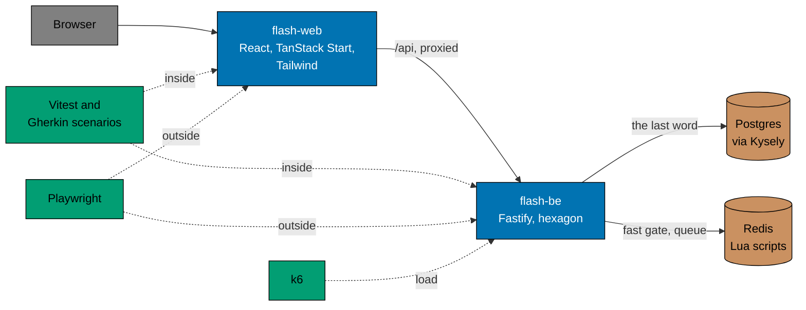

# Crash courses

Short lessons on the tools and patterns this repository is built with, one page each. Each page says why this project
uses it and walks through how it is used here, with excerpts from the real files and commands you can run. Read the ones
for the part you are about to change; the official docs and the [explanation](../../explanation/README.md) pages go
deeper.

New here? Read [TypeScript](typescript.md), [typekit](typekit.md), [hexagonal architecture](hexagonal-architecture.md),
then [concurrency control](concurrency-control.md). Together they show how the code is written and why the sale stays
correct.

TypeScript, Nx, Biome, Docker Compose and the Git hooks are not in the picture: they hold the whole repository
together. The patterns explain the shape of `flash-be` and why the sale stays correct under load.

## Directory Map

Patterns:

- [hexagonal-architecture.md](hexagonal-architecture.md) - rules in the middle, stores at the edge, and one file that
  wires them.
- [domain-driven-design.md](domain-driven-design.md) - the words of the sale, the Sale as the unit of consistency, and
  rules as plain functions.
- [concurrency-control.md](concurrency-control.md) - how the code never oversells and never sells one shopper twice.
- [resilience.md](resilience.md) - failing fast, falling back to Postgres, rebuilding Redis and retrying with jitter.

Back end:

- [fastify.md](fastify.md) - the HTTP server of `flash-be`: routes, hooks as guards, cookies and event streams.
- [postgres-and-kysely.md](postgres-and-kysely.md) - the tables, the query builder, transactions and the row lock that
  stops an oversell.
- [redis.md](redis.md) - the fast gate and the queue: keys, Lua scripts, expiry, and what happens when Redis is down.

Front end:

- [react-and-tanstack-start.md](react-and-tanstack-start.md) - the page of `flash-web`: file routes, the first render on
  the server, server routes and the proxy, hooks and live streams.
- [tailwind-css.md](tailwind-css.md) - styling with utility classes, from a phone to a desktop, in light and dark mode.

Tests:

- [vitest.md](vitest.md) - unit and integration tests next to the code, and the coverage floor.
- [gherkin-scenarios.md](gherkin-scenarios.md) - the behaviour scenarios in `specs/` and how one scenario is bound at
  three layers.
- [playwright.md](playwright.md) - the end-to-end tests of the API and of the page in a browser.
- [k6.md](k6.md) - the load test: the shopper's visit, the profiles, and the verdict read from the data.

Language and tooling:

- [typescript.md](typescript.md) - the strict compiler flags and the patterns they push the code towards.
- [typekit.md](typekit.md) - `@flash/typekit`: failures as values with `Result` and `attempt`, and why there is no `catch`.
- [nx.md](nx.md) - Nx as a command runner: targets, build order and affected runs.
- [biome.md](biome.md) - one tool to format and lint, with the size limits and the no-`catch` rule.
- [docker-compose.md](docker-compose.md) - the dev, production and load stacks.
- [git-hooks.md](git-hooks.md) - husky, lint-staged and commitlint: what runs before a commit and before a push.
