# k6 crash course

[k6](https://grafana.com/docs/k6/latest/) is a load testing tool: it runs a JavaScript function as many virtual users
(VUs) at once and measures the replies. This repository uses it in `flash-load` to send a crowd of shoppers at three
`flash-be` instances. k6 runs as the `grafana/k6:2.3.0` container, and the types come from `@types/k6` 2.3.

## Why this repo uses k6

**The problem.** The claim of the project is that the data stays right under a crowd: no oversell, and no shopper
buys twice. k6 can send thousands of shoppers at a fixed arrival rate, so the load does not slow down when the system
does. But a client sees only replies, and a reply can be lost or wrong. So k6 makes the load, and the runner reads the
verdict from Postgres and Redis ([decision 012](../../explanation/decisions/012-load-verdict-from-the-data.md)).

**What we did not pick.** Decision 012 turned down k6 thresholds only (they "cannot see an extra row in
`purchases`"), checks through the API after the run (not independent of the API), and looser limits or a pass for
speed on a laptop (that would hide a finding).

**What it costs.** Runner code and Docker. Times that are only relative, because k6 and every server share one
machine's CPUs. A build step, because k6 cannot read `node_modules`. And a ceiling on virtual users that the machine
sets, not the system.

```mermaid
flowchart LR
  accTitle: The phases of one load run
  accDescr: The runner starts a fresh stack and seeds a sale, starts the chaos timers and the Postgres sampler, runs k6, lets the stack settle, reads Postgres, Redis and the k6 summary, judges each check, and writes the report.
  stack["Start stack, seed sale"]
  timers["Chaos timers, sampler"]
  k6["Run k6"]
  settle["Settle"]
  collect["Read Postgres, Redis, k6"]
  verdict["Judge the checks"]
  report["Write the report"]
  stack --> timers --> k6 --> settle --> collect --> verdict --> report
  classDef step fill:#0173B2,stroke:#000000,color:#FFFFFF
  classDef gate fill:#029E73,stroke:#000000,color:#000000
  classDef default fill:#808080,stroke:#000000,color:#000000
  class stack,timers,k6,settle,collect,report step
  class verdict gate
```



## The ideas this repo uses

### One iteration is one shopper's visit

[`k6/shop.ts`](../../../apps/flash-load/k6/shop.ts) is the k6 script. Each step of a visit is a named function:

```ts
function visit(user: string, index: number): void {
	const ip = address(index);
	const cookie = signUp(user, ip);
	if (!cookie) return;
	const place = joinQueue(ip, cookie);
	if (!place) return;
```

It goes on to wait for admission, reserve, sometimes walk away with the hold, pay, and ask "did I get it".

### Profiles feed both k6 and the runner

[`k6/profiles.ts`](../../../apps/flash-load/k6/profiles.ts) holds the five profiles (`smoke`, `full`, `chaos`, `burst`,
`contention`) and the `LIMITS`. The script picks one from the environment (`const profileName = (__ENV.PROFILE ??
"smoke") as ProfileName;`), so the two never disagree. The table is in
[reference: load test](../../reference/load-test.md#profiles), and the rules are in
[`specs/apps/flash/load/`](../../../specs/apps/flash/load/README.md).

### Scenarios and executors

`options.scenarios` runs three groups. `constant-arrival-rate` starts new iterations at a fixed rate, whatever the
replies do:

```ts
		shoppers: {
			executor: "constant-arrival-rate",
			exec: "shopper",
			rate: profile.arrivalsPerSecond,
			timeUnit: "1s",
			duration: `${profile.users / profile.arrivalsPerSecond}s`,
		},
```

`latecomers` is a second arrival-rate group with a `startTime` after every hold has lapsed. `hammer` uses
`per-vu-iterations`: each of its VUs sends one flood of joins.

### Checks, thresholds and counters

A refusal such as `409` or `429` is a fair answer, so only a `5xx` or no answer counts as a failed request. The speed
limits are thresholds on tagged requests, and `check` records what one shopper saw:

```ts
http.setResponseCallback(
	http.expectedStatuses({
		min: HTTP_STATUS.ok,
		max: FIRST_SERVER_ERROR_STATUS - 1,
	}),
);

const speed = {
	"http_req_duration{name:reserve}": [`p(95)<${LIMITS.reserveP95Ms}`],
```

Counters such as `purchased` are compared with the Postgres rows after the run.

### Retries with backoff and jitter

A join refused with `429` and a payment declined with `402` are tried again with `retry` from
[`@flash/flash-commons`](../../../libs/flash-commons/README.md#retry). That is the sync form, made for k6, whose `sleep`
blocks the VU and returns nothing. `retry` takes `sleep` and `random` from the caller, and k6's `sleep` counts seconds,
so the script passes `waitMs`:

```ts
const waitMs = (ms: number) => sleep(ms / MS_PER_SECOND);

const last = retry(join, {
	...JOIN_BACKOFF,
	maxAttempts: JOIN_TRIES,
	sleep: waitMs,
	random: Math.random,
}).match({ ok: (answer) => answer, err: (answer) => answer });
```

Why every retry backs off is in [decision 017](../../explanation/decisions/017-retry-backoff-jitter.md), and the
numbers are in [retry policies](../../reference/retry-policies.md).

### The runner judges from the data

[`scripts/run.ts`](../../../apps/flash-load/scripts/run.ts) runs the phases in the diagram. It bundles the script, runs
k6 with `docker compose run`, then judges with `judgeRun` in
[`verdict.ts`](../../../apps/flash-load/scripts/verdict.ts). The exit code is the verdict: `0` when every check
passes. The checks are listed in [checks](../../../specs/apps/flash/load/checks.md). Each run writes
its report to `generated-reports/load/` ([output](../../reference/load-test.md#output)).

## Try it here

The runner's pure parts (verdict, report, sampler) have unit tests that need no Docker:

```bash
npx nx test:unit flash-load --output-style=static --skip-nx-cache
```

```text
 Test Files  3 passed (3)
      Tests  29 passed (29)
```

Then build the file that k6 runs, and look at its imports:

```bash
npm run bundle --workspace flash-load
grep -n '^import' apps/flash-load/k6/.bundle/shop.js
```

```text
102:import { check, sleep } from "k6";
103:import exec from "k6/execution";
104:import http from "k6/http";
105:import { Counter } from "k6/metrics";
```

`flash-commons` and `typekit` are inside the bundle; only the k6 modules stay as imports. A real run,
`npx nx load:smoke flash-load`, starts and removes its own stack and takes a few minutes. Follow
[run the load test](../../how-to/run-the-load-test.md) for it; this page does not show its output.

## Traps to avoid

- **One VU plays many shoppers.** k6 keeps one cookie jar for each VU, so a cookie would pass to the next shopper. The
  script uses `new http.CookieJar()` on every call and sends each shopper's own `cookie` header.
- **The machine can run out first.** On one laptop, k6 may stop starting VUs before the herd is complete. The runner
  treats a missing k6 summary as a failure of the load generator, which says nothing about the system
  ([`run.ts`](../../../apps/flash-load/scripts/run.ts)).
- **Shoppers who keep retrying hold every VU.** A shopper who retries a sold-out sale keeps its VU busy, and k6 drops
  iterations. So a shopper reserves once, and a dropped iteration fails the run (`0 dropped` in
  [`verdict.ts`](../../../apps/flash-load/scripts/verdict.ts)).
- **Chaos must hit while items are for sale.** If the stock sells out before Redis stops, the run proves nothing. The
  chaos profile sells 1,000 items, so the sale is still running when Redis goes down.

More are in [what the load runs found](../../explanation/load-test-findings.md#harness-changes-the-first-runs-forced).

## Read next

- k6: [scenarios and executors](https://grafana.com/docs/k6/latest/using-k6/scenarios/executors/),
  [checks](https://grafana.com/docs/k6/latest/using-k6/checks/),
  [thresholds](https://grafana.com/docs/k6/latest/using-k6/thresholds/).
- Here: [reference: load test](../../reference/load-test.md),
  [what the load runs found](../../explanation/load-test-findings.md), and the
  [`flash-load` README](../../../apps/flash-load/README.md).
