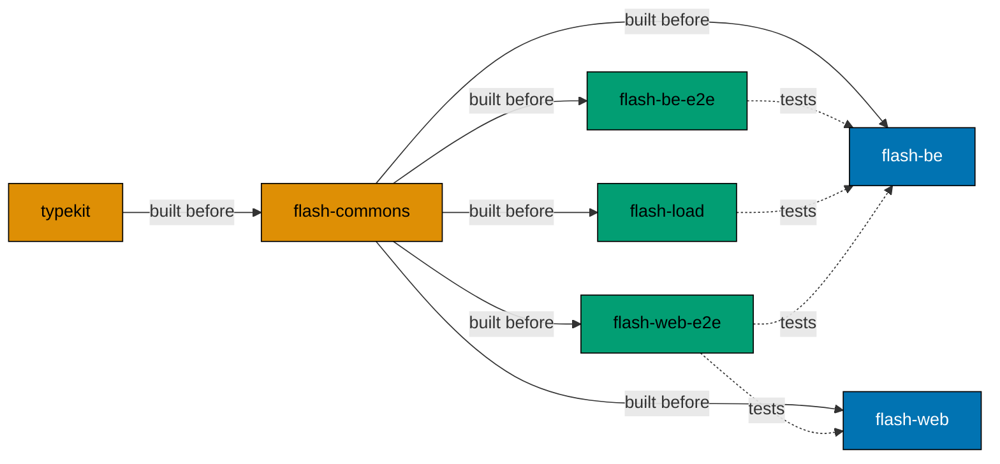

# Nx crash course

Nx is a task runner for a monorepo: it knows the projects, the order they must build in, and which ones a change
touches. Here it does only that. It runs commands written by hand, with no plugins
([013](../../explanation/decisions/013-nx-as-a-command-runner.md)). The repository installs `nx@24.0.4`.

## Why this repo uses it

**The problem.** Five apps and two libraries share one npm workspace. People, agents and the pre-push hook need one way
to say "typecheck this app", "test that one" and "check only what my change touches". The apps also import the built
`dist` of `libs/typekit` and `libs/flash-commons`, so the libraries must build first.

**What we did not pick** ([013](../../explanation/decisions/013-nx-as-a-command-runner.md)):

- Nx plugins (`@nx/vite`, `@nx/js`): they infer targets from config files, so the real command hides in a plugin.
- npm workspaces and scripts alone: they have no build order and no "affected by this change".
- Turborepo, Make or a script: the same result, with another tool to learn.

**What it costs.** Target config is copied into each `project.json`, with no generators and no inferred targets. A new
app copies the targets of another one.

## The ideas this repo uses

### A command runner, nothing more

[`nx.json`](../../../nx.json) is small. It names the default base branch and the two folders, and turns off Nx
analytics:

```json
"defaultBase": "main",
"workspaceLayout": {
	"appsDir": "apps",
	"libsDir": "libs"
},
"analytics": false
```

There is no `@nx/*` package in [`package.json`](../../../package.json), and AGENTS.md forbids adding one or running `nx init`.

### Targets in `project.json` with `nx:run-commands`

Each target calls an npm script or a command. Open the file and you see exactly what runs. From
[`apps/flash-be/project.json`](../../../apps/flash-be/project.json):

```json
"typecheck": {
	"executor": "nx:run-commands",
	"dependsOn": [
		{ "projects": ["typekit", "flash-commons"], "target": "build" }
	],
	"options": {
		"command": "npm run typecheck",
		"cwd": "apps/flash-be"
	}
}
```

### `dependsOn` builds the libraries first

The `dependsOn` above runs the `build` target of `typekit` and `flash-commons` before the app's own command.
`flash-commons` itself depends on `typekit` ([`libs/flash-commons/project.json`](../../../libs/flash-commons/project.json)),
so the order is always typekit, then flash-commons, then the app. The e2e and load apps add `implicitDependencies`
(for example `["flash-web", "flash-be"]` in [`apps/flash-web-e2e/project.json`](../../../apps/flash-web-e2e/project.json)),
so a change to an app also marks the tests of that app as affected.



A solid line is a build that must run first. A dotted line is an `implicitDependencies` entry: a change on the right
marks the project on the left as affected.

### One shape of command: `npx nx <target> <project>`

Every app has `typecheck`, `lint`, `test:quick` and `test:quick:watch`, and the same name means the same thing in each.
`test:quick` is a list of commands run in order (`"parallel": false`):

```json
"commands": [
	"npx nx typecheck flash-be",
	"npx nx lint flash-be",
	"npx nx test:unit flash-be"
]
```

[Test layers and coverage](../../reference/test-layers-and-coverage.md#nx-targets) has the full table of targets.

### `run-many` and `affected`

- `run-many` runs one or more targets on a list of projects. The `demo:dev` script in the root `package.json` starts
  both servers with `npx nx run-many -t dev -p flash-be flash-web --output-style=stream`.
- `affected` runs a target only on the projects that a change touches. The pre-push hook
  ([`.husky/pre-push`](../../../.husky/pre-push)) uses it against `origin/main`:

```sh
npx --no -- nx affected -t test:quick --base=origin/main
npx --no -- nx affected -t test:coverage --base=origin/main
```

### No cache is relied on

No target sets `"cache": true` and `nx.json` has no `targetDefaults`, so Nx runs every task each time and the summary
says `Cache: 0/2 hit (0%)`. Decision 013 says to look at caching only when `affected` runs become slow.

## Try it here

List the projects Nx found:

```bash
npx nx show projects
```

```text
["flash-commons","flash-web-e2e","flash-be-e2e","flash-load","flash-web","flash-be","typekit"]
```

Lint both libraries in one run:

```bash
npx nx run-many -t lint -p typekit flash-commons
```

```text
 NX   2 tasks: 2 succeeded

  Cache:             0/2 hit (0%)
```

See what your change touches with `npx nx show projects --affected --base=origin/main`. The list depends on your branch
and your working tree.

## Traps to avoid

- **Nx output hides the logs.** The summary prints only `2 tasks: 2 succeeded`. Add `--output-style=static` to see each
  command and its output, or `--output-style=stream` for a server that keeps running.
- **`affected` needs a current `origin/main`.** The hook compares with your local copy of `origin/main`. Fetch first, or
  the list of affected projects may be wrong.
- **A check changes in its own target.** `test:quick` only calls `typecheck`, `lint` and `test:unit`. Change a check in
  its own target, and keep `test:quick:watch` the same as `test:quick` (AGENTS.md).

## Read next

- Official: [run tasks](https://nx.dev/docs/features/run-tasks), [affected](https://nx.dev/docs/features/ci-features/affected),
  [project configuration](https://nx.dev/docs/reference/project-configuration),
  [executors](https://nx.dev/docs/reference/nx/executors) and [Nx commands](https://nx.dev/docs/reference/nx-commands).
- Ours: [decision 013](../../explanation/decisions/013-nx-as-a-command-runner.md),
  [test layers and coverage](../../reference/test-layers-and-coverage.md) and [`AGENTS.md`](../../../AGENTS.md).
