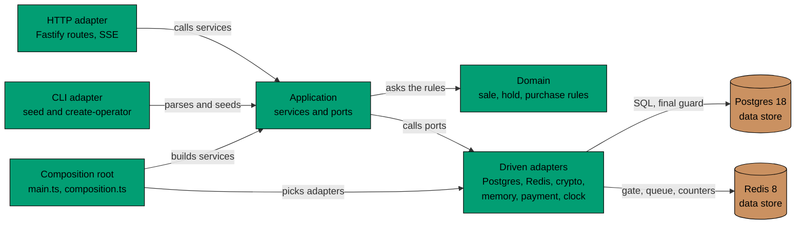

# Components of flash-be

C4 level 3, for the API container only. `flash-be` is a hexagon (ports and adapters) with a small domain model in the
middle. Driving adapters call the application; the application calls driven adapters only through ports. `flash-web`
is still a few routes and has no component view.

## Components in Prose

- **HTTP adapter** ([`adapters/inbound/http/`](../../../../apps/flash-be/src/adapters/inbound/http), with one file per area in `routes/`) maps paths to the services and turns their results into status codes.
  It also turns a sale or a shopper's place into Server-Sent Events, sets and clears the two login cookies, and guards the
  routes: a route that needs a login reads the access cookie, and the operator routes (create, change, remove and list a
  sale) need the role operator, checked before the body. It holds no rules.
- **CLI adapter** ([`adapters/inbound/cli/`](../../../../apps/flash-be/src/adapters/inbound/cli)) reads the options of the two commands and words their failures. The commands are
  [`seed-sale.ts`](../../../../apps/flash-be/src/seed-sale.ts) (a sale) and [`create-operator.ts`](../../../../apps/flash-be/src/create-operator.ts) (the first operator account). Each entry point wires itself to the
  database and calls a use case (the seed service, `createOperator`).
- **Application** (`application/`) has one service per use case: the sale status with its read cache, the waiting queue,
  reserving, paying, the rate limiter, the operator's sale service (create, change, remove, list), the seed service that the seed command calls, the auth service (sign up, log in, refresh, log out, and who a cookie is) and the admission step that serves the current sale. Its ports are in
  [`application/ports/`](../../../../apps/flash-be/src/application/ports): `SaleRepository`, `QueueStore`, `HoldGate`, `ReservationRepository`, `PurchaseRepository`,
  `RateLimitStore`, `LocalRateLimitStore`, `Payment`, `Clock`, `Logger`, `SaleSeeder`, `SaleAdmin`, `AccountRepository`, `SessionRepository`, `PasswordHasher` and `TokenSource`.
- **Domain** (`domain/`) holds the rules and does no I/O: when a sale is upcoming, active, sold out or
  ended, who may queue or reserve, how long a hold lives, how many shoppers one tick admits, what a user name, a
  password, a token and a role are, who is an operator, and whether a new sale has a usable window and overlaps another.
- **Driven adapters** ([`adapters/outbound/`](../../../../apps/flash-be/src/adapters/outbound)) implement the ports. `postgres/` reads and writes the sales, holds,
  purchases, users and sessions and runs the migrations. `redis/` holds the gate script, the queue, the rate counters and
  the cache of live sessions. `crypto/` hashes passwords with scrypt and makes random tokens. `memory/` counts
  rate limits when Redis fails and holds the memory payment ledger. `payment/` is the mock provider, which keeps its charges in a ledger: `postgres/payment-ledger.ts` in the app, a memory one in the unit scenarios. `system/` reads the clock.
- **Composition root** ([`main.ts`](../../../../apps/flash-be/src/main.ts), [`composition.ts`](../../../../apps/flash-be/src/composition.ts)) picks an adapter for each port of the API. The command entry
  points [`seed-sale.ts`](../../../../apps/flash-be/src/seed-sale.ts) and [`create-operator.ts`](../../../../apps/flash-be/src/create-operator.ts) pick their own. No other file does.

## Constraints

- Postgres wins every disagreement with Redis. The constraints `sold <= stock` and one live purchase per user and sale are
  in the schema, so no part can break them.
- Dependencies point inward. The domain imports nothing but Node built-ins, `@flash/typekit` and the main entry of `@flash/flash-commons` (both pure, no I/O; the timer helper on `/timers` is refused). The
  application imports the domain and its own ports. An inbound adapter never imports an outbound adapter, and an outbound adapter takes nothing from the
  application but its ports. No adapter imports the wiring ([`composition.ts`](../../../../apps/flash-be/src/composition.ts), [`config.ts`](../../../../apps/flash-be/src/config.ts)). [`apps/flash-be/src/architecture_tests.ts`](../../../../apps/flash-be/src/architecture_tests.ts) fails the unit tests when an import breaks this.
- The same rules run against memory in unit tests, because the ports `QueueStore`, `HoldGate`,
  `ReservationRepository`, `PurchaseRepository`, `SaleAdmin`, `AccountRepository` and `SessionRepository` have in-memory copies in [`src/bdd/support/`](../../../../apps/flash-be/src/bdd/support). They are
  test code. `RateLimitStore` has an in-memory adapter that product code also uses, when Redis fails, and `Payment` is
  a mock.
