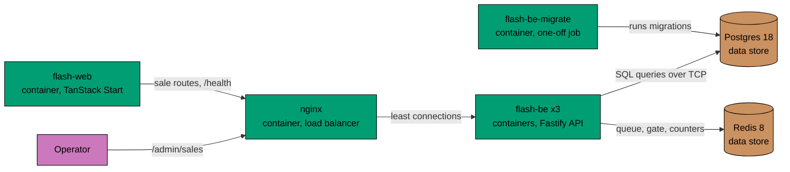

# Containers

C4 level 2. It shows the deployable units of the flash sale product and the data stores they use, as the production
compose file runs them. The API has its own
component view in [components.md](components.md). The web app is a page and a pass-through route, and has none.

## Relationships in Prose

- `flash-web` renders the sale page from `GET /sales/current` and shows the backend status from `GET /health`. It passes
  the browser's requests under `/api/sales` on to the API, streams included. The address comes from `FLASH_BE_URL`,
  read only on the server. In production that address is nginx.
- `nginx` is the one door to the API. It sends each request to the instance with the fewest open requests and sets
  `X-Forwarded-For` to the address it sees, so a caller cannot choose its own address for the rate limit. The operator
  manages sales through it with the `/admin/sales` routes (create, list, change, remove); the web server never passes them on.
- The three `flash-be` instances are identical. A queue ticket is signed with a shared secret, the state lives in
  Postgres and Redis, and one instance wins each admission tick, so any instance can serve any request.
- `flash-be` runs SQL queries against Postgres over TCP through its Kysely query builder.
- `flash-be` uses Redis over the RESP protocol for the waiting queue, the reservation gate and the rate limit counters,
  and pings it to answer its readiness check. Redis holds nothing that Postgres cannot rebuild.
- `flash-be-migrate` applies the hand-written migrations to Postgres over TCP. It runs once, before `flash-be` starts.

## Constraints

- `flash-be` registers the routes. `flash-web` calls the API with a small client and passes on only the sale paths
  it lists.
- The browser never receives `FLASH_BE_URL`: only the server reads it, and the pass-through route allows only the sale
  paths.
- `GET /health` on `flash-be` does no I/O. Only `GET /ready` touches Postgres and Redis.
- In production, `flash-be` refuses to start when `DATABASE_URL`, `REDIS_URL` or `TICKET_SECRET` is missing.
- When Redis is down, `flash-be` keeps selling from Postgres alone (see [sequences.md](sequences.md)).
- Compose in production does not publish Postgres, Redis or the API instances to the host. Only the web port and the
  API port (nginx) are published.
- The database and Redis are single instances. The API tier scales by adding instances; the data tier does not (see the
  README for what that would take).
