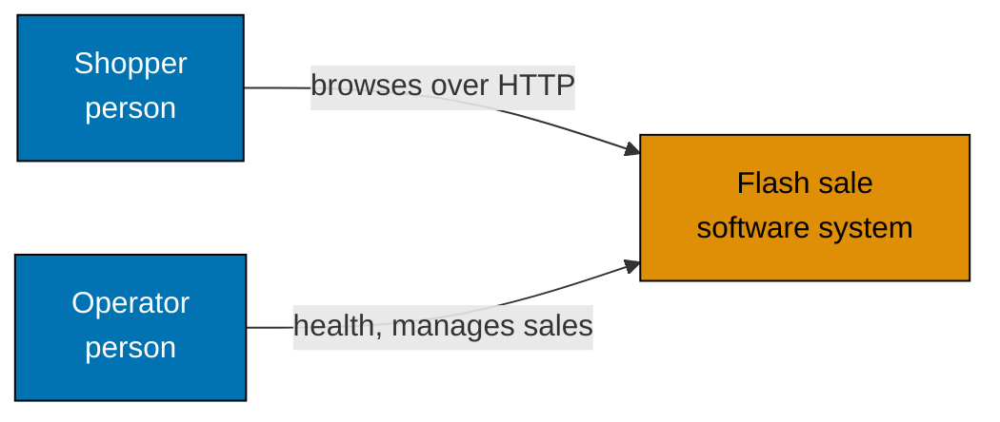

# System Context

C4 level 1. It shows who uses the flash sale product and what it depends on.

## Relationships in Prose

- A shopper opens the flash sale site in a browser. The request goes to the web app over HTTP. The repository ships no
  TLS; a real deployment puts a TLS proxy in front, which the `Secure` login cookies need. The shopper signs up and logs
  in with a user name and a password; the login is two cookies (see [sequences.md](sequences.md)).
- An operator calls the API directly over HTTP: the health endpoints, to check that the service is alive and ready, and
  the `/admin/sales` routes, logged in as an operator, to create, list, change and remove sales.
- The product has no runtime dependency outside itself: the sale data lives in its own Postgres database and cache.
  The system context therefore draws no external system.
