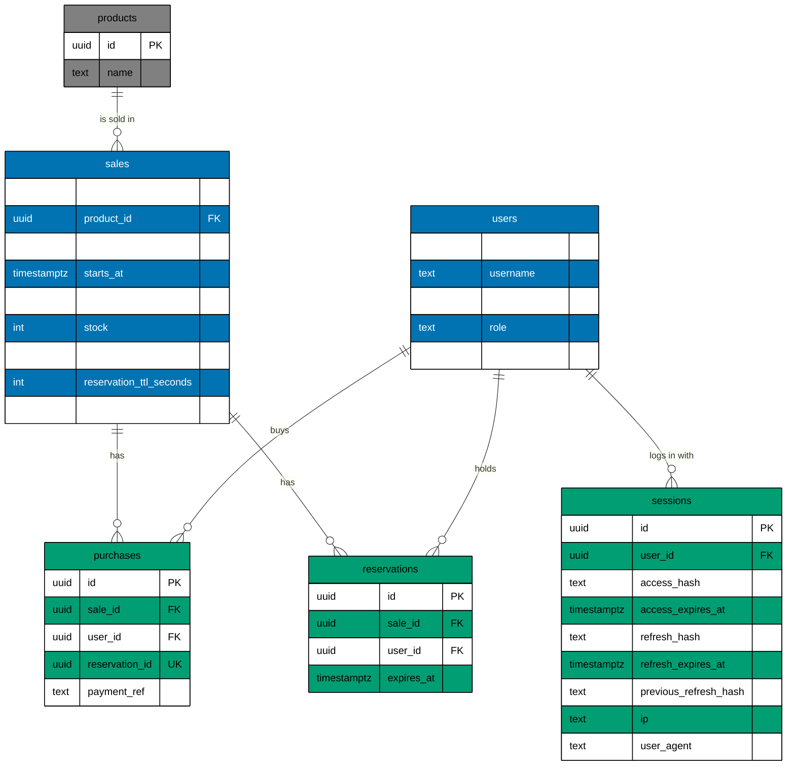

# Data model

The tables of the Postgres database, as the migrations build them. It sits beside the C4 views because Postgres
is the data store that has the last word on stock and on who bought (see [containers.md](containers.md)). The
sources are `apps/flash-be/src/adapters/outbound/postgres/migrations/`: `0002_create_sales.ts` makes the sale tables,
`0003_users_products_audit.ts` adds users, products, the audit columns and soft delete, and `0004_auth_sessions.ts` adds
passwords, roles and sessions.

Every table also has the six audit columns, which the diagram leaves out because they would hide the relations (see
[Audit columns](#audit-columns)). `created_by`, `updated_by` and `deleted_by` are foreign keys to `users.id`.

## Columns

The diagram shows how the tables relate. Mermaid fixes its column order (type, then name), so the columns are
listed here as name, type and note. The six audit columns of every table are in the next section.

### users

| column_name     | data_type     | note                                                                                             |
| --------------- | ------------- | ------------------------------------------------------------------------------------------------ |
| `id`            | `uuid`        | Primary key. Default `gen_random_uuid()`.                                                        |
| `username`      | `text`        | Not null. Unique among live rows. Trimmed and lowercased; a person's name never starts with `$`. |
| `password_hash` | `text`        | A scrypt hash with its salt. Empty for the `$system` user, which cannot log in.                  |
| `role`          | `text`        | Not null. Default `shopper`. One of `shopper` and `operator` (`users_role_known`).               |
| `last_login_at` | `timestamptz` | The last successful login or sign-up. Empty until the first.                                     |

### products

| column_name | data_type | note                                      |
| ----------- | --------- | ----------------------------------------- |
| `id`        | `uuid`    | Primary key. Default `gen_random_uuid()`. |
| `name`      | `text`    | Not null.                                 |

### sales

| column_name               | data_type     | note                                                          |
| ------------------------- | ------------- | ------------------------------------------------------------- |
| `id`                      | `uuid`        | Primary key. Default `gen_random_uuid()`.                     |
| `product_id`              | `uuid`        | Not null. Foreign key to `products.id`, `ON DELETE RESTRICT`. |
| `name`                    | `text`        | Not null.                                                     |
| `starts_at`               | `timestamptz` | Not null. The sale opens here.                                |
| `ends_at`                 | `timestamptz` | Not null. Must be after `starts_at`.                          |
| `stock`                   | `integer`     | Not null. At least 0.                                         |
| `sold`                    | `integer`     | Not null. Default 0. Never more than `stock`.                 |
| `reservation_ttl_seconds` | `integer`     | Not null. Default 120. How long a hold lasts.                 |
| `admit_per_second`        | `integer`     | Not null. Default 50. Shoppers the queue lets in.             |

### purchases

| column_name      | data_type | note                                                           |
| ---------------- | --------- | -------------------------------------------------------------- |
| `id`             | `uuid`    | Primary key. Default `gen_random_uuid()`.                      |
| `sale_id`        | `uuid`    | Not null. Foreign key to `sales.id`, `ON DELETE RESTRICT`.     |
| `user_id`        | `uuid`    | Not null. Foreign key to `users.id`.                           |
| `reservation_id` | `uuid`    | Not null. Unique. The key that makes a repeat confirm a no-op. |
| `payment_ref`    | `text`    | Not null. The payment reference.                               |

### reservations

| column_name  | data_type     | note                                                       |
| ------------ | ------------- | ---------------------------------------------------------- |
| `id`         | `uuid`        | Primary key. Default `gen_random_uuid()`.                  |
| `sale_id`    | `uuid`        | Not null. Foreign key to `sales.id`, `ON DELETE RESTRICT`. |
| `user_id`    | `uuid`        | Not null. Foreign key to `users.id`.                       |
| `expires_at` | `timestamptz` | Not null. A row past this time counts as free.             |

### sessions

One row is one login. It holds two tokens, and only their SHA-256 hashes.

| column_name             | data_type     | note                                                                                         |
| ----------------------- | ------------- | -------------------------------------------------------------------------------------------- |
| `id`                    | `uuid`        | Primary key. Default `gen_random_uuid()`.                                                    |
| `user_id`               | `uuid`        | Not null. Foreign key to `users.id`, `ON DELETE RESTRICT`. Indexed (`sessions_user`).        |
| `access_hash`           | `text`        | Not null. The hash of the access token. Unique among live rows.                              |
| `access_expires_at`     | `timestamptz` | Not null. 15 minutes after the login or the last refresh.                                    |
| `refresh_hash`          | `text`        | Not null. The hash of the refresh token. Unique among live rows.                             |
| `refresh_expires_at`    | `timestamptz` | Not null. 7 days after the login or the last refresh.                                        |
| `previous_refresh_hash` | `text`        | The refresh token before the last one. If it comes back, the session was copied and it ends. |
| `ip`                    | `text`        | The address of the login, so a session that is not yours can be recognised.                  |
| `user_agent`            | `text`        | The browser of the login, cut to 200 characters.                                             |

### Audit columns

Every table has these six columns, and nothing is ever hard-deleted: a row that is removed gets `deleted_at` and
`deleted_by`, and no read returns it.

| column_name  | data_type     | note                                                                        |
| ------------ | ------------- | --------------------------------------------------------------------------- |
| `created_at` | `timestamptz` | Not null. Default `now()`.                                                  |
| `created_by` | `uuid`        | Not null. Foreign key to `users.id`: the person, the operator or `$system`. |
| `updated_at` | `timestamptz` | Empty until the row changes.                                                |
| `updated_by` | `uuid`        | Foreign key to `users.id`. Empty until the row changes.                     |
| `deleted_at` | `timestamptz` | Empty while the row is live.                                                |
| `deleted_by` | `uuid`        | Foreign key to `users.id`. Empty while the row is live.                     |

`$system` (the migration, the seed command and `create-operator`) is a user that is its own
author. `$operator` was a stand-in for the operator before logins; `0004` marks it deleted.

## Tables in Prose

- `users` has one row per account: a shopper who signed up, an operator made with `create-operator`, and `$system`.
  Everything else points to it to say who did something.
- `products` has one row per thing for sale. A sale that is made without a product gets one named like the sale.
- `sales` has one row per sale. `stock` is the number of items and `sold` is how many are bought. A sale is
  running while `starts_at <= now < ends_at`. `reservation_ttl_seconds` is how long a hold lasts and
  `admit_per_second` is how many shoppers the queue lets in each second. The defaults are 120 and 50.
- `purchases` has one row per confirmed item. `reservation_id` is the key that makes a repeated confirm do nothing.
- `reservations` has one row per hold. A row past `expires_at` counts as free, so no sweep job runs. A hold that is
  paid for or removed is marked deleted.
- `sessions` has one row per login. A logout, a replayed refresh token or a refresh that comes too late marks it deleted.
- `kysely_migration` and `kysely_migration_lock` belong to the migrator. They are not part of the model.

## Constraints

- `sales_stock_not_negative`: `stock >= 0`.
- `sales_sold_within_stock`: `sold <= stock`. This is the last wall against overselling, whatever Redis said.
- `sales_window_is_ordered`: `ends_at > starts_at`.
- `purchases_one_per_user`: `UNIQUE(sale_id, user_id) WHERE deleted_at IS NULL`. A shopper never buys twice from one
  sale. A deleted row is history and does not count.
- `purchases.reservation_id` is `UNIQUE`, deleted or not: an idempotency key is never used twice.
- `reservations_one_per_user`: `UNIQUE(sale_id, user_id) WHERE deleted_at IS NULL`. A shopper holds at most one item of a sale.
- `users_username_live`: `UNIQUE(username) WHERE deleted_at IS NULL`. A name is free again once its user is deleted.
- `users_role_known`: `role IN ('shopper', 'operator')`.
- `sessions_access_live` and `sessions_refresh_live`: the token hashes are unique among live sessions.
- `sales.product_id`, `purchases.sale_id`, `reservations.sale_id` and `sessions.user_id` are foreign keys with
  `ON DELETE RESTRICT`. Since nothing is hard-deleted, a row is never removed from under the rows that point at it.
  The operator route marks a sale and its holds deleted, and refuses when the sale has a purchase (`sale_has_purchases`).
- Product code never calls `deleteFrom`: `architecture_tests.ts` fails if it does, and `schema_integration_tests.ts` checks
  that every table has the six audit columns and that the `Database` type matches the migrations.

## Not in the database

Redis holds the waiting queue, the hold gate, the rate counters and a short-lived copy of each live session (so a request
does not read Postgres to check a login), under keys that start with `sale:<saleId>:` or `session:`. It holds nothing
that Postgres cannot rebuild, so it has no place in this diagram.
