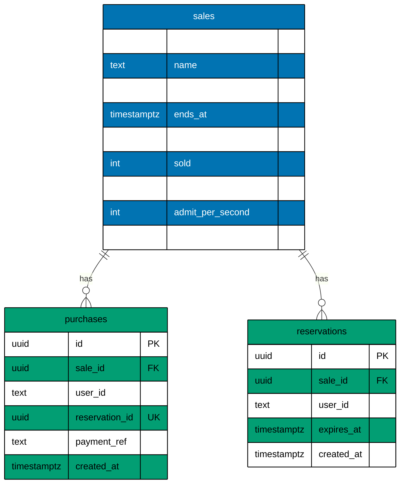

# Data model

The tables of the Postgres database, as the migrations build them. It sits beside the C4 views because Postgres
is the data store that has the last word on stock and on who bought (see [containers.md](containers.md)). The
source is `apps/flash-be/src/adapters/outbound/postgres/migrations/0002_create_sales.ts`.

## Columns

The diagram shows how the tables relate. Mermaid fixes its column order (type, then name), so the columns are
listed here as name, type and note.

### sales

| column_name               | data_type     | note                                              |
| ------------------------- | ------------- | ------------------------------------------------- |
| `id`                      | `uuid`        | Primary key. Default `gen_random_uuid()`.         |
| `name`                    | `text`        | Not null.                                         |
| `starts_at`               | `timestamptz` | Not null. The sale opens here.                    |
| `ends_at`                 | `timestamptz` | Not null. Must be after `starts_at`.              |
| `stock`                   | `integer`     | Not null. At least 0.                             |
| `sold`                    | `integer`     | Not null. Default 0. Never more than `stock`.     |
| `reservation_ttl_seconds` | `integer`     | Not null. Default 120. How long a hold lasts.     |
| `admit_per_second`        | `integer`     | Not null. Default 50. Shoppers the queue lets in. |
| `created_at`              | `timestamptz` | Not null. Default `now()`.                        |

### purchases

| column_name      | data_type     | note                                                           |
| ---------------- | ------------- | -------------------------------------------------------------- |
| `id`             | `uuid`        | Primary key. Default `gen_random_uuid()`.                      |
| `sale_id`        | `uuid`        | Not null. Foreign key to `sales.id`, `ON DELETE CASCADE`.      |
| `user_id`        | `text`        | Not null. Unique together with `sale_id`.                      |
| `reservation_id` | `uuid`        | Not null. Unique. The key that makes a repeat confirm a no-op. |
| `payment_ref`    | `text`        | Not null. The payment reference.                               |
| `created_at`     | `timestamptz` | Not null. Default `now()`.                                     |

### reservations

| column_name  | data_type     | note                                                      |
| ------------ | ------------- | --------------------------------------------------------- |
| `id`         | `uuid`        | Primary key. Default `gen_random_uuid()`.                 |
| `sale_id`    | `uuid`        | Not null. Foreign key to `sales.id`, `ON DELETE CASCADE`. |
| `user_id`    | `text`        | Not null. Unique together with `sale_id`.                 |
| `expires_at` | `timestamptz` | Not null. A row past this time counts as free.            |
| `created_at` | `timestamptz` | Not null. Default `now()`.                                |

## Tables in Prose

- `sales` has one row per sale. `stock` is the number of items and `sold` is how many are bought. A sale is
  running while `starts_at <= now < ends_at`. `reservation_ttl_seconds` is how long a hold lasts and
  `admit_per_second` is how many shoppers the queue lets in each second. The defaults are 120 and 50.
- `purchases` has one row per confirmed item. `reservation_id` is the key that makes a repeated confirm do nothing.
- `reservations` has one row per hold. A row past `expires_at` counts as free, so no sweep job runs.
- `kysely_migration` and `kysely_migration_lock` belong to the migrator. They are not part of the model.

## Constraints

- `sales_stock_not_negative`: `stock >= 0`.
- `sales_sold_within_stock`: `sold <= stock`. This is the last wall against overselling, whatever Redis said.
- `sales_window_is_ordered`: `ends_at > starts_at`.
- `purchases_one_per_user`: `UNIQUE(sale_id, user_id)`. A shopper never buys twice from one sale.
- `purchases.reservation_id` is `UNIQUE`.
- `reservations_one_per_user`: `UNIQUE(sale_id, user_id)`. A shopper holds at most one item of a sale.
- `purchases.sale_id` and `reservations.sale_id` are foreign keys to `sales.id` with `ON DELETE CASCADE`.
  Removing a sale removes its holds. The operator route refuses to remove a sale that has a purchase
  (`sale_has_purchases`).

## Not in the database

Redis holds the waiting queue, the hold gate and the rate counters, under keys that start with `sale:<saleId>:`.
It holds nothing that Postgres cannot rebuild, so it has no place in this diagram.
