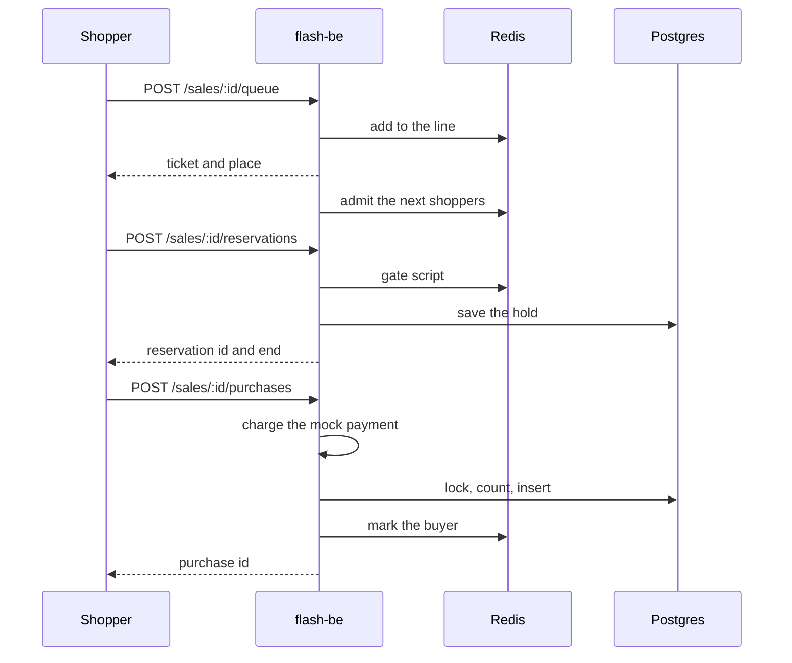
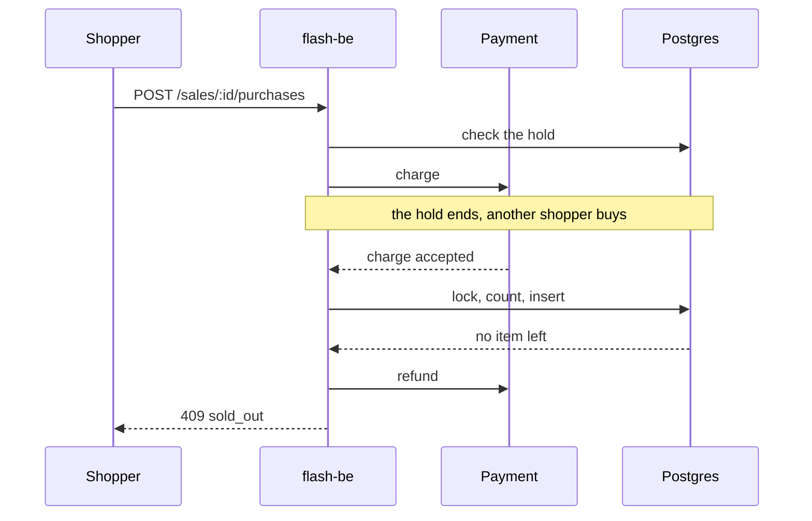
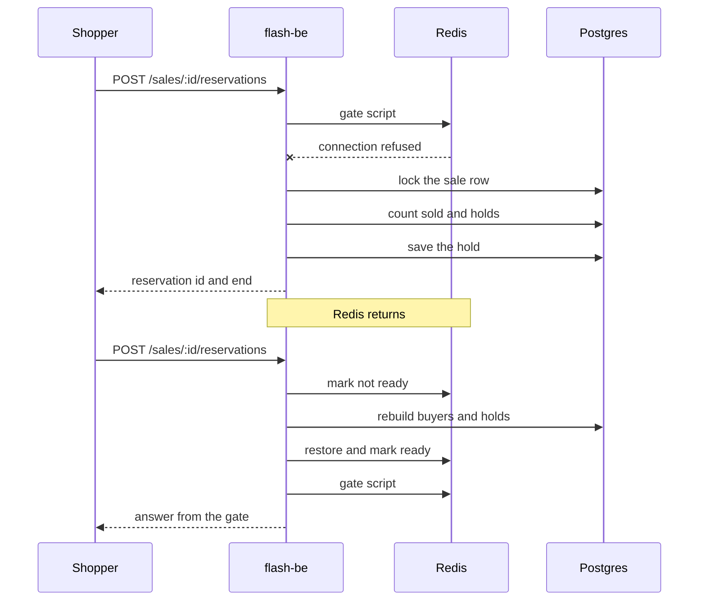

# Sequences

Three flows that cross the parts of `flash-be`. The sequence diagrams show the order of the calls. The prose below each
one states the rule behind it. A request from the shopper is written with its method and path, where `:id` is the
sale id. The paths are in the [endpoint reference](../../../../docs/reference/http-endpoints.md).

## Reserve and pay

- The line and the admission live in Redis. A tick admits shoppers at the sale's rate; one instance wins each tick.
- The gate script runs as one step in Redis. It refuses when buyers plus live holds reach the stock. An expired hold
  stops counting by its time, so nothing sweeps it.
- The hold is written to Postgres too. Without that row, a Redis that lost its data could not give the hold back.
- Confirming is safe to repeat. The reservation id is the key for the charge and for the purchase.

## The hold ends during payment

- The hold is checked before the charge, but the commit decides. Postgres guards `sold < stock` under the sale row lock.
- A charge that cannot become a purchase is always refunded, so a shopper never pays for nothing.

## Redis goes away

- The client fails at once while disconnected, so a request learns of the outage in milliseconds.
- Joining the queue returns a valid ticket and admits the shopper: the line only protects fairness, and the stock does
  not depend on it.
- After a failure the sale is marked stale in the process. The next reservation deletes the `ready` key, which makes one
  instance rebuild buyers and live holds from Postgres under the sale row lock.
