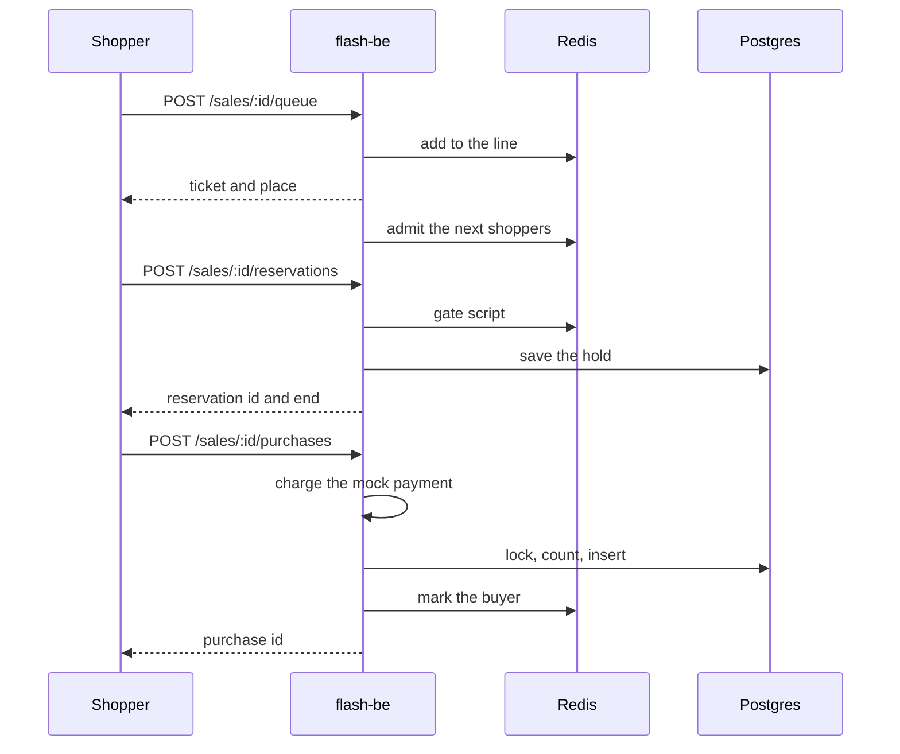
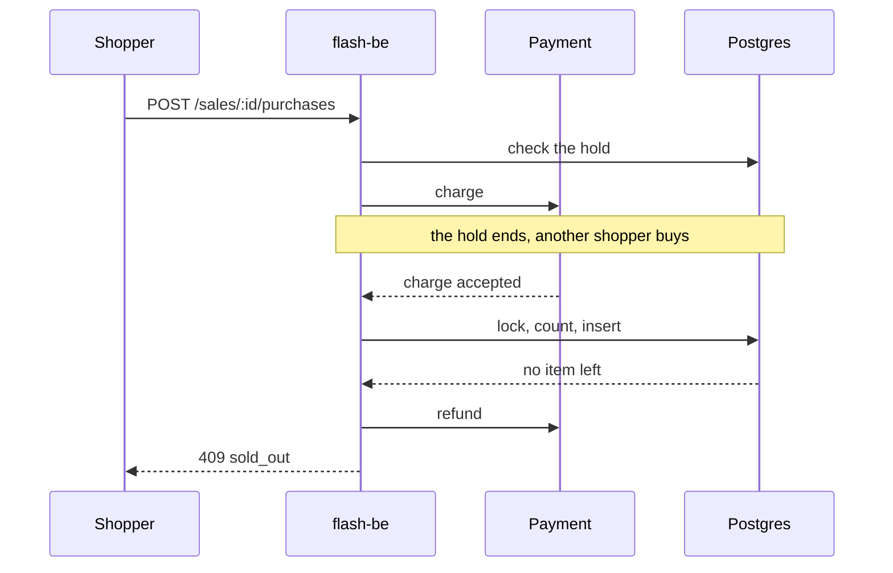
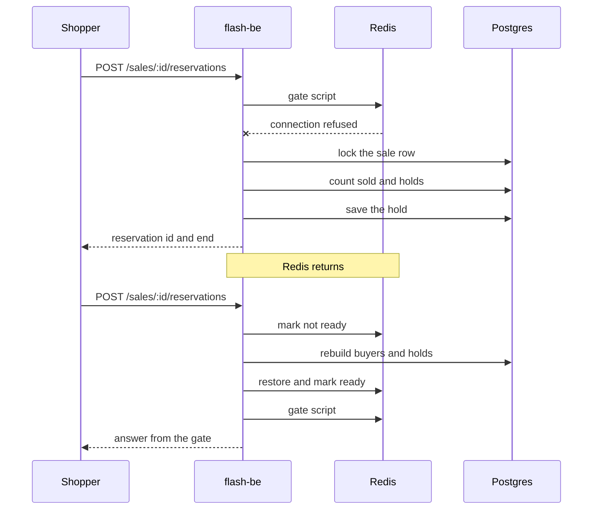

# Sequences

Three flows that cross the parts of `flash-be`. The sequence diagrams show the order of the calls. The prose below each
one states the rule behind it. A request from the shopper is written with its method and path, where `:id` is the
sale id. The paths are in the [endpoint reference](../../../../docs/reference/http-endpoints.md).

## Reserve and pay



- The line and the admission live in Redis. A tick admits shoppers at the sale's rate; one instance wins each tick.
- The gate script runs as one step in Redis. It refuses when buyers plus live holds reach the stock. An expired hold
  stops counting by its time, so nothing sweeps it.
- The hold is written to Postgres too. Without that row, a Redis that lost its data could not give the hold back.
- Confirming is safe to repeat. The reservation id is the key for the charge and for the purchase.

### The calls in full

Each call is written as the code sends it, and the comments use the labels of the diagram. In the SQL, `$1`, `$2`
and so on are parameters. The sources are `redis-queue-store.ts`, `redis-hold-gate.ts`,
`reservation-repository.ts` and `purchase-repository.ts` in `apps/flash-be/src/adapters/outbound`.

Redis, where each script runs as one step. `KEYS` and `ARGV` are the keys `sale:<saleId>:...` and the arguments of
the call.

```lua
-- add to the line (JOIN). KEYS: queue, admitted, queue-seq. ARGV: user, now.
local admitted = redis.call('ZSCORE', KEYS[2], ARGV[1])
if admitted and tonumber(admitted) > tonumber(ARGV[2]) then return {2, 0} end
local rank = redis.call('ZRANK', KEYS[1], ARGV[1])
if rank then return {1, rank + 1} end
local arrival = redis.call('INCR', KEYS[3])
redis.call('ZADD', KEYS[1], arrival, ARGV[1])
return {0, redis.call('ZRANK', KEYS[1], ARGV[1]) + 1}

-- admit the next shoppers (ADMIT). KEYS: queue, admitted. ARGV: how many, until, now.
redis.call('ZREMRANGEBYSCORE', KEYS[2], '-inf', ARGV[3])
local users = redis.call('ZRANGE', KEYS[1], 0, tonumber(ARGV[1]) - 1)
for _, user in ipairs(users) do
  redis.call('ZREM', KEYS[1], user)
  redis.call('ZADD', KEYS[2], ARGV[2], user)
end
return users

-- gate script (RESERVE). KEYS: ready, buyers, holds, ids. ARGV: user, now, expiresAt, stock, reservationId.
if redis.call('EXISTS', KEYS[1]) == 0 then return {4} end
if redis.call('SISMEMBER', KEYS[2], ARGV[1]) == 1 then return {2} end
local now = tonumber(ARGV[2])
local score = redis.call('ZSCORE', KEYS[3], ARGV[1])
if score and tonumber(score) > now then
  return {3, redis.call('HGET', KEYS[4], ARGV[1]), tostring(score)}
end
local used = redis.call('SCARD', KEYS[2]) + redis.call('ZCOUNT', KEYS[3], now, '+inf')
if used >= tonumber(ARGV[4]) then return {0} end
redis.call('ZADD', KEYS[3], ARGV[3], ARGV[1])
redis.call('HSET', KEYS[4], ARGV[1], ARGV[5])
return {1, ARGV[5], ARGV[3]}

-- mark the buyer (CONFIRM). KEYS: buyers, holds, ids. ARGV: user.
redis.call('SADD', KEYS[1], ARGV[1])
redis.call('ZREM', KEYS[2], ARGV[1])
redis.call('HDEL', KEYS[3], ARGV[1])
return 1
```

Postgres. The purchase is one transaction, in this order.

```sql
-- save the hold (the same statement runs when the hold is repeated)
INSERT INTO "reservations" ("id", "sale_id", "user_id", "expires_at")
VALUES ($1, $2, $3, $4)
ON CONFLICT ("sale_id", "user_id") DO UPDATE SET "id" = $5, "expires_at" = $6;

-- lock, count, insert: one transaction
SELECT "id" FROM "sales" WHERE "id" = $1 FOR UPDATE;
SELECT * FROM "purchases" WHERE "reservation_id" = $1;
SELECT "id" FROM "purchases" WHERE "sale_id" = $1 AND "user_id" = $2;
UPDATE "sales" SET "sold" = sold + 1 WHERE "id" = $1 AND sold < stock;
INSERT INTO "purchases" ("sale_id", "user_id", "reservation_id", "payment_ref")
VALUES ($1, $2, $3, $4) RETURNING *;
DELETE FROM "reservations" WHERE "sale_id" = $1 AND "user_id" = $2;
```

- The first `SELECT` locks the sale row, so shoppers who confirm take turns.
- The second `SELECT` finds a repeated confirm by its reservation id, and the third finds a shopper who already bought.
  Both end the transaction without a change.
- The `UPDATE` changes no row when the stock is gone, and the `CHECK` on the table repeats that rule. In that case the
  transaction stops with `sold_out`.
- The `CONFIRM` script runs after the commit.

## The hold ends during payment



- The hold is checked before the charge, but the commit decides. Postgres guards `sold < stock` under the sale row lock.
- A charge that cannot become a purchase is always refunded, so a shopper never pays for nothing.

The calls are those of the first flow. _check the hold_ is this statement, run before the charge:

```sql
SELECT * FROM "reservations" WHERE "sale_id" = $1 AND "user_id" = $2;
```

_lock, count, insert_ is the purchase transaction above. _no item left_ is its `UPDATE ... WHERE sold < stock` that
changed no row.

## Redis goes away



- The client fails at once while disconnected, so a request learns of the outage in milliseconds.
- Joining the queue returns a valid ticket and admits the shopper: the line only protects fairness, and the stock does
  not depend on it.
- After a failure the sale is marked stale in the process. The next reservation deletes the `ready` key, which makes one
  instance rebuild buyers and live holds from Postgres under the sale row lock.

The calls, in full. _gate script_ is the `RESERVE` script of the first flow.

```sql
-- lock the sale row, then count sold and holds: one transaction, no Redis
SELECT "sold" FROM "sales" WHERE "id" = $1 FOR UPDATE;
SELECT "id" FROM "purchases" WHERE "sale_id" = $1 AND "user_id" = $2;
SELECT "id", "expires_at" FROM "reservations" WHERE "sale_id" = $1 AND "user_id" = $2;
SELECT COUNT(*) AS "count" FROM "reservations"
WHERE "sale_id" = $1 AND "expires_at" > $2 AND "user_id" != $3;
-- save the hold
INSERT INTO "reservations" ("id", "sale_id", "user_id", "expires_at")
VALUES ($1, $2, $3, $4)
ON CONFLICT ("sale_id", "user_id") DO UPDATE SET "id" = $5, "expires_at" = $6;

-- rebuild buyers and holds: one transaction, under the same lock
SELECT "id" FROM "sales" WHERE "id" = $1 FOR UPDATE;
SELECT "user_id" FROM "purchases" WHERE "sale_id" = $1;
SELECT "user_id", "id", "expires_at" FROM "reservations"
WHERE "sale_id" = $1 AND "expires_at" > $2;
```

- The `sold` of the locked row plus the count is compared with the stock. A shopper who already holds or bought gets
  that answer instead.
- _mark not ready_ is `DEL sale:<saleId>:ready`.
- _restore and mark ready_ is one `MULTI`: `DEL` of `buyers`, `holds` and `ids`, then `SADD` of the buyers, `ZADD` and
  `HSET` for each live hold, and `SET sale:<saleId>:ready 1`.
