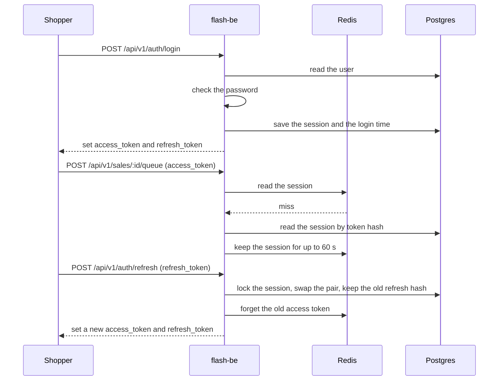
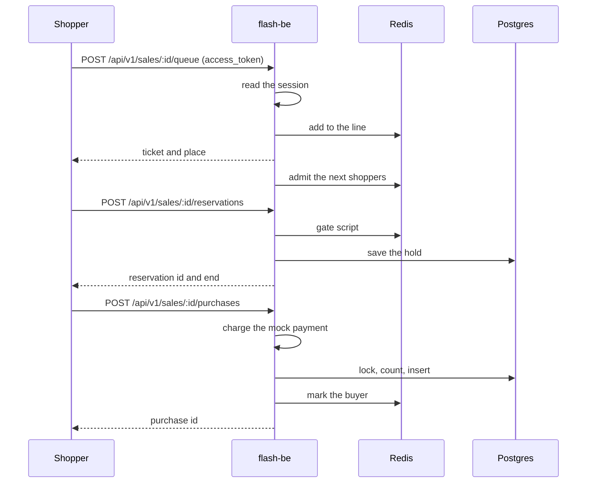
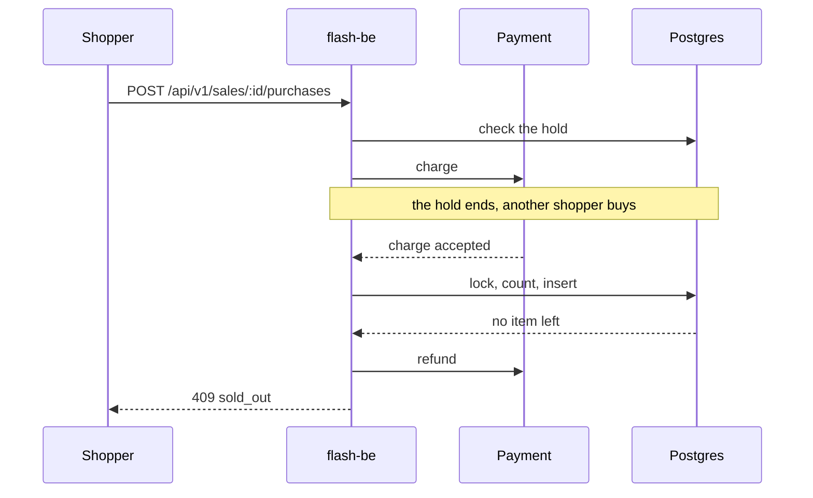
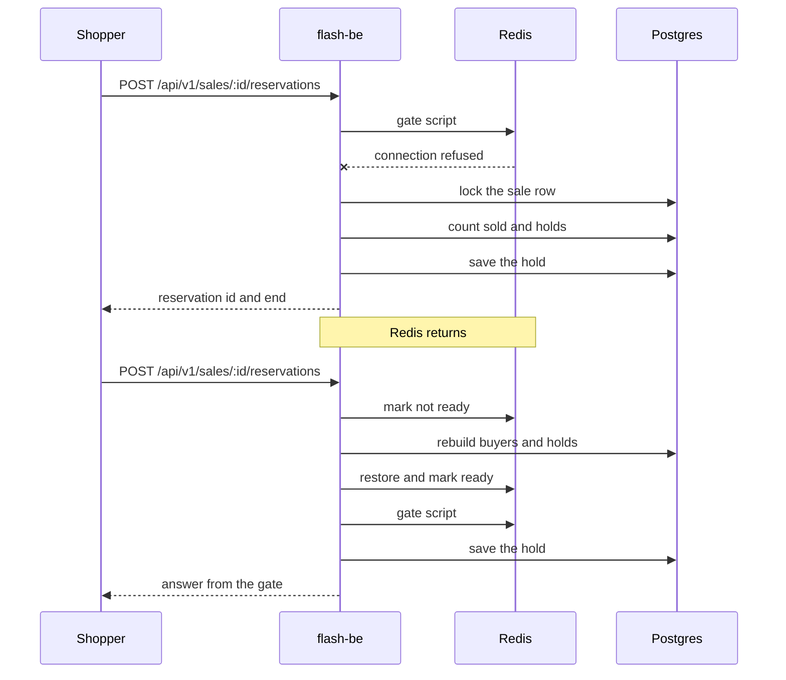

# Sequences

Four flows that cross the parts of `flash-be`. The sequence diagrams show the order of the calls. The prose below each
one states the rule behind it. A request from the shopper is written with its method and path, where `:id` is the
sale id. The paths are in the [endpoint reference](../../../../docs/reference/http-endpoints.md).

## Log in



- The tokens are 32 random bytes. Only their SHA-256 goes to Postgres and to the Redis key, so a copy of either store
  cannot be used to log in. The password is stored as a scrypt hash with its own salt.
- A wrong name and a wrong password get the same answer (`invalid_credentials`).
- The refresh token is used once. When a token that was already replaced comes back, the session is marked deleted, because
  someone holds a copy. The Redis copy of the access token is forgotten on every rotation and on logout, so a revoked
  token stops working at once rather than at the end of its cache time.
- The cookies are `HttpOnly` and `SameSite=Lax`, and `Secure` when `COOKIE_SECURE` is true (the default in production). The refresh cookie is sent to `/api/v1/auth` only.

### The calls in full

```sql
-- read the user (login)
SELECT "id", "username", "role", "password_hash" FROM "users"
WHERE "username" = $1 AND "deleted_at" IS NULL;

-- save the session and the login time: one transaction. The user is the author of their own session.
INSERT INTO "sessions" ("user_id", "access_hash", "access_expires_at", "refresh_hash", "refresh_expires_at",
  "ip", "user_agent", "created_by")
VALUES ($1, $2, $3, $4, $5, $6, $7, $1);
UPDATE "users" SET "last_login_at" = now(), "updated_at" = now(), "updated_by" = $1 WHERE "id" = $1;

-- read the session by token hash (on a miss in Redis)
SELECT "users"."id", "users"."username", "users"."role", "sessions"."access_expires_at"
FROM "sessions" INNER JOIN "users" ON "users"."id" = "sessions"."user_id"
WHERE "sessions"."access_hash" = $1 AND "sessions"."deleted_at" IS NULL
  AND "sessions"."access_expires_at" > $2 AND "users"."deleted_at" IS NULL;

-- swap the pair (refresh): one transaction. The old refresh hash is kept in previous_refresh_hash.
SELECT "id", "user_id", "access_hash", "refresh_expires_at" FROM "sessions"
WHERE "refresh_hash" = $1 AND "deleted_at" IS NULL FOR UPDATE;
-- a refresh_expires_at in the past is refused here, and the row stays as it is
UPDATE "sessions" SET "access_hash" = $2, "access_expires_at" = $3, "previous_refresh_hash" = $1,
  "refresh_hash" = $4, "refresh_expires_at" = $5, "updated_at" = now(), "updated_by" = $6
WHERE "id" = $7;  -- $6 is the session's user_id, $7 its id

-- a refresh token that was already replaced: when the first SELECT finds no row, this one ends the session
SELECT "id", "user_id", "access_hash" FROM "sessions"
WHERE "previous_refresh_hash" = $1 AND "deleted_at" IS NULL FOR UPDATE;
UPDATE "sessions" SET "deleted_at" = now(), "deleted_by" = $2 WHERE "id" = $3;  -- $2 is its user_id, $3 its id
```

```text
GET session:<access hash>        -- the session cache; SET with EX of at most 60 s, never past the token's end
DEL session:<access hash>        -- on a refresh, a replay and a logout
```

## Reserve and pay



- The shopper is the account of the session cookie, never a name in the path or the body.
- The line and the admission live in Redis. A tick admits shoppers at the sale's rate; one instance wins each tick.
- The gate script runs as one step in Redis. It refuses when buyers plus live holds reach the stock. An expired hold
  stops counting by its time, so nothing sweeps it.
- The hold is written to Postgres too. Without that row, a Redis that lost its data could not give the hold back.
- Confirming is safe to repeat. The reservation id is the key for the charge and for the purchase. The mock payment
  keeps its charges in the `payments` table, so two instances that confirm one hold charge it once.

### The calls in full

Each call is written as the code sends it, and the comments use the labels of the diagram. In the SQL, `$1`, `$2`
and so on are parameters. The sources are [`redis-queue-store.ts`](../../../../apps/flash-be/src/adapters/outbound/redis/redis-queue-store.ts), [`redis-hold-gate.ts`](../../../../apps/flash-be/src/adapters/outbound/redis/redis-hold-gate.ts),
[`reservation-repository.ts`](../../../../apps/flash-be/src/adapters/outbound/postgres/reservation-repository.ts) and [`purchase-repository.ts`](../../../../apps/flash-be/src/adapters/outbound/postgres/purchase-repository.ts) in `apps/flash-be/src/adapters/outbound`.

Redis, where each script runs as one step. `KEYS` and `ARGV` are the keys `sale:<saleId>:...` and the arguments of
the call.

```lua
-- add to the line (JOIN). KEYS: queue, admitted, queue-seq. ARGV: user, now.
local admitted = redis.call('ZSCORE', KEYS[2], ARGV[1])
if admitted and tonumber(admitted) > tonumber(ARGV[2]) then return {2, 0} end
local rank = redis.call('ZRANK', KEYS[1], ARGV[1])
if rank then return {1, rank + 1} end
local arrival = redis.call('INCR', KEYS[3])
redis.call('ZADD', KEYS[1], arrival, ARGV[1])
return {0, redis.call('ZRANK', KEYS[1], ARGV[1]) + 1}

-- admit the next shoppers (ADMIT). KEYS: queue, admitted. ARGV: how many, until, now.
redis.call('ZREMRANGEBYSCORE', KEYS[2], '-inf', ARGV[3])
local users = redis.call('ZRANGE', KEYS[1], 0, tonumber(ARGV[1]) - 1)
for _, user in ipairs(users) do
  redis.call('ZREM', KEYS[1], user)
  redis.call('ZADD', KEYS[2], ARGV[2], user)
end
return users

-- gate script (RESERVE). KEYS: ready, buyers, holds, ids. ARGV: user, now, expiresAt, stock, reservationId.
if redis.call('EXISTS', KEYS[1]) == 0 then return {4} end
if redis.call('SISMEMBER', KEYS[2], ARGV[1]) == 1 then return {2} end
local now = tonumber(ARGV[2])
local score = redis.call('ZSCORE', KEYS[3], ARGV[1])
if score and tonumber(score) > now then
  return {3, redis.call('HGET', KEYS[4], ARGV[1]), tostring(score)}
end
local used = redis.call('SCARD', KEYS[2]) + redis.call('ZCOUNT', KEYS[3], now, '+inf')
if used >= tonumber(ARGV[4]) then return {0} end
redis.call('ZADD', KEYS[3], ARGV[3], ARGV[1])
redis.call('HSET', KEYS[4], ARGV[1], ARGV[5])
return {1, ARGV[5], ARGV[3]}

-- mark the buyer (CONFIRM). KEYS: buyers, holds, ids. ARGV: user.
redis.call('SADD', KEYS[1], ARGV[1])
redis.call('ZREM', KEYS[2], ARGV[1])
redis.call('HDEL', KEYS[3], ARGV[1])
return 1
```

Postgres. The purchase is one transaction, in this order.

```sql
-- save the hold: one transaction, locking sale, then user, then hold, as the fallback without Redis does.
-- $3 is the id of the user row, made first if the shopper has none. A removed sale returns no row and ends the save
-- with no write.
SELECT "id" FROM "sales" WHERE "id" = $2 AND "deleted_at" IS NULL FOR KEY SHARE;
SELECT "id" FROM "users" WHERE "id" = $3 FOR NO KEY UPDATE;
-- read after the lock, in its own statement, so it sees a hold another save just committed
SELECT "id", "expires_at" FROM "reservations"
WHERE "sale_id" = $2 AND "user_id" = $3 AND "deleted_at" IS NULL;
-- the same hold again (renew): its row keeps its id and gets the new end
UPDATE "reservations" SET "expires_at" = $4, "updated_at" = now(), "updated_by" = $3
WHERE "id" = $1 AND "deleted_at" IS NULL;
-- another hold (an expired one taken again): the old row is marked deleted by the shopper, then a new row
UPDATE "reservations" SET "deleted_at" = now(), "deleted_by" = $3
WHERE "sale_id" = $2 AND "user_id" = $3 AND "deleted_at" IS NULL;
INSERT INTO "reservations" ("id", "sale_id", "user_id", "expires_at", "created_by") VALUES ($1, $2, $3, $4, $3);

-- lock, count, insert: one transaction
SELECT * FROM "sales" WHERE "id" = $1 AND "deleted_at" IS NULL FOR UPDATE;
SELECT "purchases".*, "users"."username" FROM "purchases"
INNER JOIN "users" ON "users"."id" = "purchases"."user_id"
WHERE "purchases"."deleted_at" IS NULL AND "users"."deleted_at" IS NULL AND "purchases"."reservation_id" = $1;
SELECT "id" FROM "users" WHERE "username" = $1 AND "deleted_at" IS NULL;  -- the buyer's id
SELECT "purchases".*, "users"."username" FROM "purchases"
INNER JOIN "users" ON "users"."id" = "purchases"."user_id"
WHERE "purchases"."deleted_at" IS NULL AND "users"."deleted_at" IS NULL
AND "purchases"."sale_id" = $1 AND "users"."username" = $2;
SELECT "ref" FROM "payments"                                  -- the charge is still live
WHERE "ref" = $4 AND "status" = 'charged' AND "deleted_at" IS NULL FOR SHARE;
UPDATE "sales" SET "sold" = sold + 1, "updated_at" = now(), "updated_by" = $2
WHERE "id" = $1 AND "deleted_at" IS NULL AND sold < stock;
INSERT INTO "purchases" ("sale_id", "user_id", "reservation_id", "payment_ref", "created_by")
VALUES ($1, $2, $3, $4, $2) RETURNING *;
UPDATE "reservations" SET "deleted_at" = now(), "deleted_by" = $2
WHERE "sale_id" = $1 AND "user_id" = $2 AND "deleted_at" IS NULL;
```

- The first `SELECT` locks the sale row, so shoppers who confirm take turns.
- The second `SELECT` finds a repeated confirm by its reservation id, and the fourth finds a shopper who already bought.
  Both end the transaction without a change.
- The `SELECT` on `payments` finds no row when another confirm of the hold refunded the charge first. The transaction
  then writes nothing and the shopper gets `402 payment_failed`. A refund locks the same row and changes nothing while a
  live purchase holds the ref, so the two take turns.
- The `UPDATE` changes no row when the stock is gone, and the `CHECK` on the table repeats that rule. In that case the
  transaction stops with `sold_out`.
- The hold is not deleted. It is marked deleted by the buyer, and the partial unique index only counts live rows.
- `$2` is the buyer's `users.id`, found by name once in the transaction (`SELECT "id" FROM "users" WHERE "username" = $1
  AND "deleted_at" IS NULL`).
- The `CONFIRM` script runs after the commit.

## The hold ends during payment



- The hold is checked before the charge, but the commit decides. Postgres guards `sold < stock` under the sale row lock.
- A charge that cannot become a purchase is always refunded, so a shopper never pays for nothing.

The calls are those of the first flow. _check the hold_ is this statement, run before the charge:

```sql
SELECT "reservations".*, "users"."username" FROM "reservations"
INNER JOIN "users" ON "users"."id" = "reservations"."user_id"
WHERE "reservations"."deleted_at" IS NULL AND "users"."deleted_at" IS NULL
AND "reservations"."sale_id" = $1 AND "users"."username" = $2;
```

_lock, count, insert_ is the purchase transaction above. _no item left_ is its `UPDATE ... WHERE sold < stock` that
changed no row.

## Redis goes away



- The client fails at once while disconnected, so a request learns of the outage in milliseconds.
- Joining the queue returns a valid ticket and admits the shopper: the line only protects fairness, and the stock does
  not depend on it.
- After a failure the sale is marked stale in the process. The next reservation deletes the `ready` key, which makes one
  instance rebuild buyers and live holds from Postgres under the sale row lock.

The calls, in full. _gate script_ is the `RESERVE` script of the first flow.

```sql
-- lock the sale row, then count sold and holds: one transaction
SELECT * FROM "sales" WHERE "id" = $1 AND "deleted_at" IS NULL FOR UPDATE;
-- EXISTS sale:<saleId>:ready in Redis: if another instance rebuilt the gate, the request goes back to the gate
SELECT "id" FROM "users" WHERE "username" = $1 AND "deleted_at" IS NULL;  -- the shopper's id
SELECT "purchases".*, "users"."username" FROM "purchases"
INNER JOIN "users" ON "users"."id" = "purchases"."user_id"
WHERE "purchases"."deleted_at" IS NULL AND "users"."deleted_at" IS NULL
AND "purchases"."sale_id" = $1 AND "users"."username" = $2;
SELECT "id", "expires_at" FROM "reservations"
WHERE "sale_id" = $1 AND "user_id" = $2 AND "deleted_at" IS NULL;
SELECT COUNT(*) AS "count" FROM "reservations"
WHERE "sale_id" = $1 AND "deleted_at" IS NULL AND "expires_at" > $2 AND "user_id" != $3;
-- save the hold: the same lock of the shopper's row, then renew, or retire and insert, as in the first flow

-- rebuild buyers and holds: one transaction, under the same lock
SELECT * FROM "sales" WHERE "id" = $1 AND "deleted_at" IS NULL FOR UPDATE;
SELECT "purchases".*, "users"."username" FROM "purchases"
INNER JOIN "users" ON "users"."id" = "purchases"."user_id"
WHERE "purchases"."deleted_at" IS NULL AND "users"."deleted_at" IS NULL AND "purchases"."sale_id" = $1;
SELECT "reservations".*, "users"."username" FROM "reservations"
INNER JOIN "users" ON "users"."id" = "reservations"."user_id"
WHERE "reservations"."deleted_at" IS NULL AND "users"."deleted_at" IS NULL
AND "reservations"."sale_id" = $1 AND "reservations"."expires_at" > $2;
```

- The `sold` of the locked row plus the count is compared with the stock. A shopper who already holds or bought gets
  that answer instead.
- _mark not ready_ is `DEL sale:<saleId>:ready`.
- _restore and mark ready_ is one script (`RESTORE`): `DEL` of `buyers`, `holds` and `ids`, then `SADD` of the buyers, `ZADD` and
  `HSET` for each live hold, and `SET sale:<saleId>:ready 1`.
