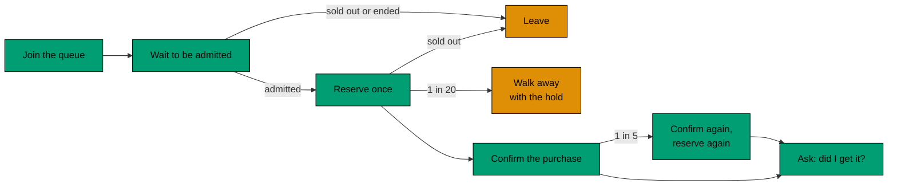

# Profiles

A profile is one scenario of the load test. Each one answers a question about the sale. The numbers of every profile
are in [`apps/flash-load/k6/profiles.ts`](../../../../apps/flash-load/k6/profiles.ts).

## The shopper

Shoppers arrive at a fixed rate, one new shopper per iteration. The load therefore does not slow down when the system
does. Each shopper:

1. joins the queue (and tries again, a few times, when the API says to slow down) and waits to be admitted;
2. reserves one item;
3. usually confirms the purchase (and tries again, a few times, when the payment is declined), then asks whether they
   got it;
4. while waiting, reads the sale and gives up when it is sold out or has ended.

One shopper in twenty walks away with a hold and does not confirm. One in five of the shoppers who bought confirms again:
the repeat must return the same purchase, and a second reserve must not give a second item. Flooders join the queue many
times to prove that they are limited, not failed.

Latecomers arrive once every hold has lapsed. They take the items that abandoned holds gave back.

A visit lasts at least two seconds. So the virtual users needed are the same as the shoppers.

## The profiles

| Profile    | Question                                                                           |
| ---------- | ---------------------------------------------------------------------------------- |
| smoke      | Does a small sale work from end to end in a few minutes?                           |
| full       | Does the queue hold when many more shoppers than items arrive over time?           |
| chaos      | Does the sale keep its invariants when Redis stops and starts again?               |
| burst      | Does the queue take a herd that arrives within one second?                         |
| contention | Do many shoppers that reserve in the same moment still get no more than the stock? |

### smoke, full

They spread their shoppers over many seconds, so the queue smooths the load first. They show the normal path.

### chaos

Redis stops during the sale and starts again later. The stock is large so that items are still for sale when Redis
stops. With a small stock the sale is over before the stop and the run proves nothing. The speed limits do not apply,
because a stopped Redis may fail the requests that were in flight.

### burst

All shoppers arrive within one second. The queue must take the herd and admit shoppers at its own pace.

### contention

All shoppers are admitted at once, so many of them reserve for a few items in the same moment. This is the only profile
that reaches the reserve script and the database guard under real contention.

## Sizing the herd profiles

The herd profiles use 700 shoppers, the largest herd the client machine was known to start. A first try with 2,000 never
began. The size is set before a run, and the reason is written next to the numbers in `profiles.ts`. The speed limits are
the same as for every other profile.
