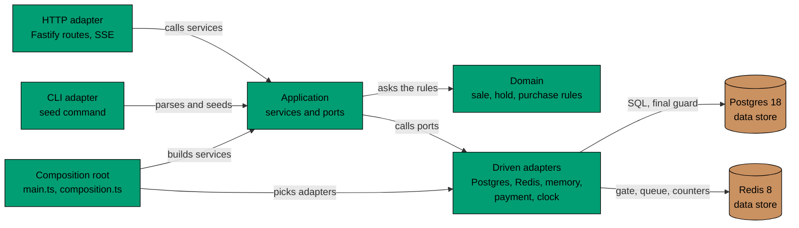

# Components of flash-be

C4 level 3, for the API container only. `flash-be` is a hexagon (ports and adapters) with a small domain model in the
middle. Driving adapters call the application; the application calls driven adapters only through ports. `flash-web`
is still a few routes and has no component view.

## Components in Prose

- **HTTP adapter** (`adapters/inbound/http/`) maps paths to the services and turns their results into status codes.
  It also turns a sale or a shopper's place into Server-Sent Events. It holds no rules.
- **CLI adapter** (`adapters/inbound/cli/`) reads the seed command's options. `seed-sale.ts` wires it to the database.
- **Application** (`application/`) has one service per use case: the sale status with its read cache, the waiting queue,
  reserving, paying and the rate limiter. A service orders the steps and calls ports. Its ports are in
  `application/ports/`: `SaleRepository`, `QueueStore`, `HoldGate`, `ReservationRepository`, `PurchaseRepository`,
  `RateLimitStore`, `Payment`, `Clock` and `SaleSeeder`.
- **Domain** (`domain/`) holds the rules and imports nothing else: when a sale is upcoming, active, sold out or
  ended, who may queue or reserve, how long a hold lives, how many shoppers one tick admits, what a user id and a
  ticket are.
- **Driven adapters** (`adapters/outbound/`) implement the ports. `postgres/` reads and writes the sales, holds and
  purchases and runs the migrations. `redis/` holds the gate script, the queue and the rate counters. `memory/` counts
  rate limits when Redis fails. `payment/` is the mock provider. `system/` reads the clock.
- **Composition root** (`main.ts`, `composition.ts`) is the only place that picks an adapter for a port.

## Constraints

- Postgres wins every disagreement with Redis. The constraints `sold <= stock` and one purchase per user and sale are
  in the schema, so no part can break them.
- Dependencies point inward. The domain imports nothing but Node built-ins. The application imports the domain and its
  own ports. An inbound adapter never imports an outbound adapter, and an outbound adapter imports only ports and the
  domain. `apps/flash-be/src/architecture_tests.ts` fails the unit tests when an import breaks this.
- The same rules run against memory in unit tests, because the ports (`QueueStore`, `HoldGate`,
  `ReservationRepository`, `PurchaseRepository`, `RateLimitStore`, `Payment`) have memory copies.
