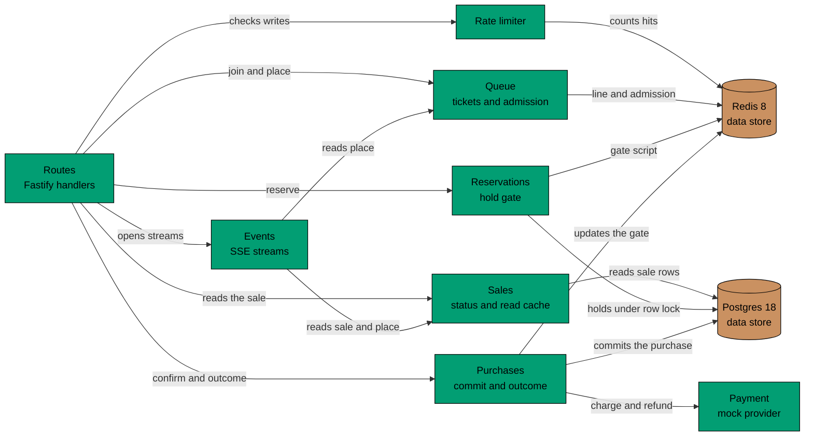

# Components of flash-be

C4 level 3, for the API container only. `flash-be` has grown past a few small modules: it has seven parts with their own
rules and their own stores, so the structure is worth drawing. `flash-web` is still a few routes and has no component
view.

## Components in Prose

- **Routes** (`routes.ts`) map paths to the parts below and turn their results into status codes. They hold no rules.
- **Rate limiter** (`ratelimit/`) counts write requests per user and per address in a fixed window. It counts in Redis,
  and in the process memory when Redis fails.
- **Sales** (`sales/`) works out the status of a sale from its row and the clock. Public reads go through a short
  in-process cache; the write routes read the row without it.
- **Queue** (`queue/`) holds the line and the admitted set in Redis and signs the ticket that proves a shopper joined.
  When Redis fails it lets shoppers through.
- **Reservations** (`reservations/`) holds the gate: one Redis script that counts buyers and live holds against the
  stock. Every hold is also written to Postgres, and Postgres decides alone when Redis is down.
- **Purchases** (`purchases/`) charges the held item, then commits it in one Postgres transaction that guards
  `sold < stock`. A commit that Postgres refuses is refunded. It tells the gate afterwards.
- **Payment** (`payment/`) is the provider behind a port. The mock lives in the process, remembers a charge by
  reservation id, and can be set to wait and to decline.
- **Events** (`events/`) turns the sale and a shopper's place into Server-Sent Events, sending a change only when
  the data differs.

## Constraints

- Postgres wins every disagreement with Redis. The constraints `sold <= stock` and one purchase per user and sale are
  in the schema, so no part can break them.
- Parts reach Redis and Postgres through ports (`QueueStore`, `HoldGate`, `ReservationRepository`,
  `PurchaseRepository`, `RateLimitStore`, `Payment`), so the same rules run against memory in unit tests.
