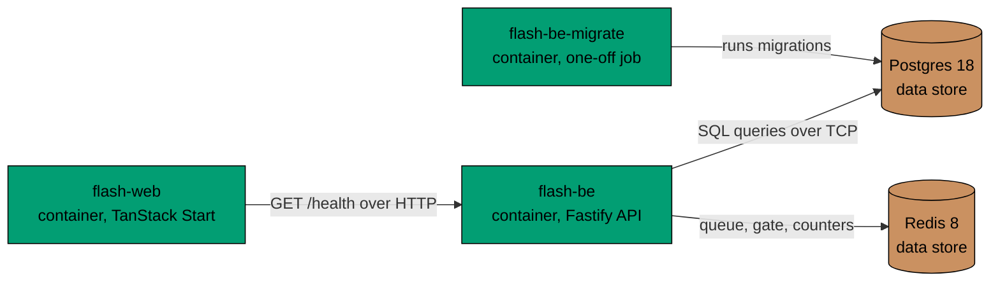

# Containers

C4 level 2. It shows the deployable units of the flash sale product and the data stores they use. The API has its own
component view in [components.md](components.md). The web app is a few routes and has none.

## Relationships in Prose

- `flash-web` calls `flash-be` over HTTP at `GET /health` to show the backend status on the home page. The address comes
  from `FLASH_BE_URL`, read only on the server.
- `flash-be` runs SQL queries against Postgres over TCP through its Kysely query builder.
- `flash-be` uses Redis over the RESP protocol for the waiting queue, the reservation gate and the rate limit counters,
  and pings it to answer its readiness check. Redis holds nothing that Postgres cannot rebuild.
- `flash-be-migrate` applies the hand-written migrations to Postgres over TCP. It runs once, before `flash-be` starts.

## Constraints

- The browser never receives `FLASH_BE_URL`: only server functions read it.
- `GET /health` on `flash-be` does no I/O. Only `GET /ready` touches Postgres and Redis.
- In production, `flash-be` refuses to start when `DATABASE_URL`, `REDIS_URL` or `TICKET_SECRET` is missing.
- When Redis is down, `flash-be` keeps selling from Postgres alone (see [sequences.md](sequences.md)).
- Compose in production does not publish Postgres or Redis to the host. Only the web and API ports are published.
